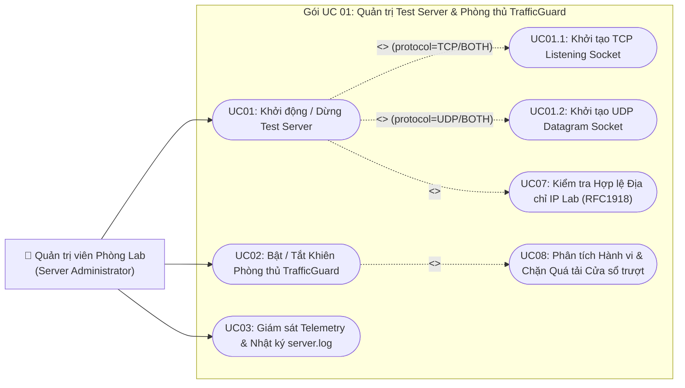
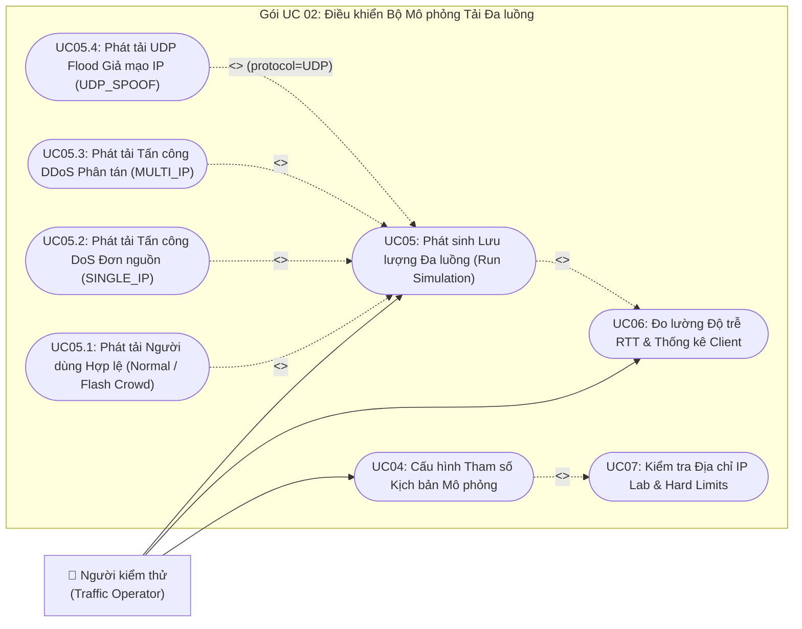
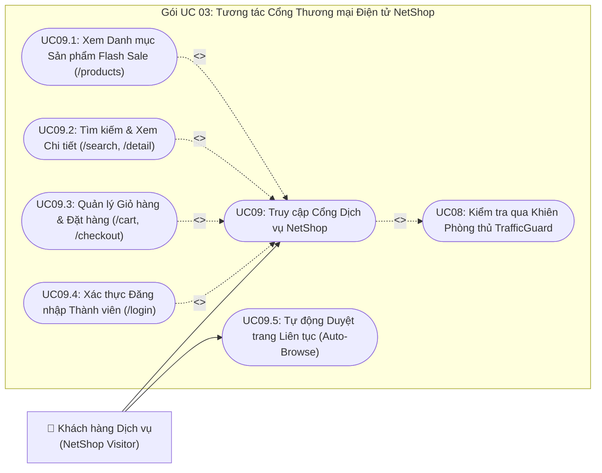
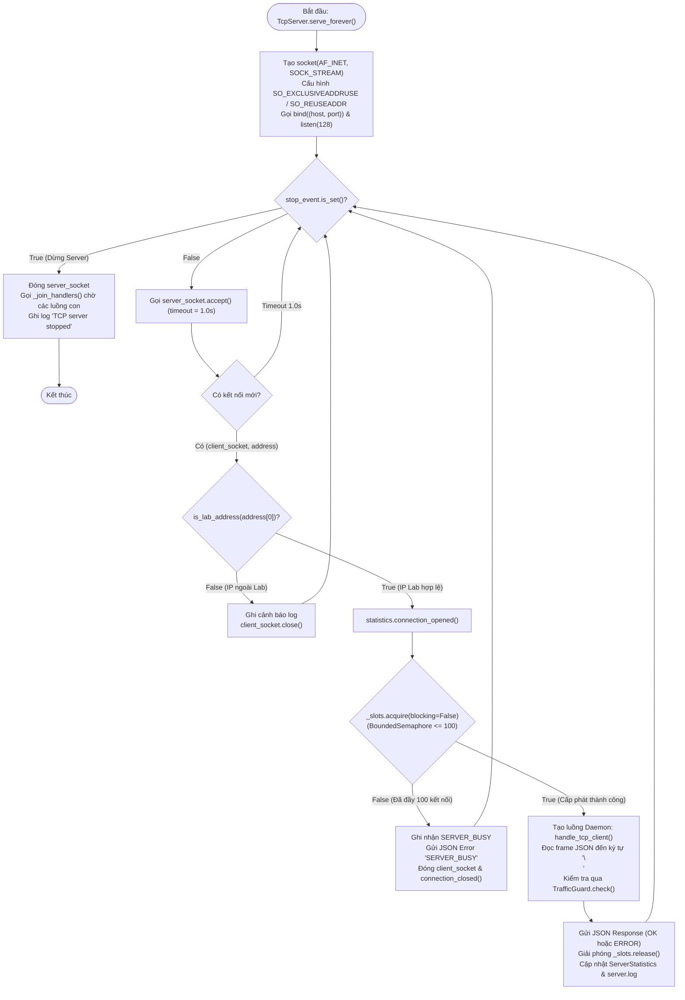
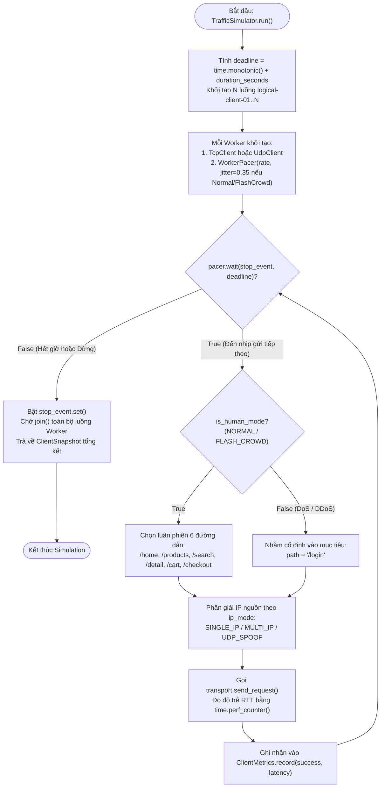
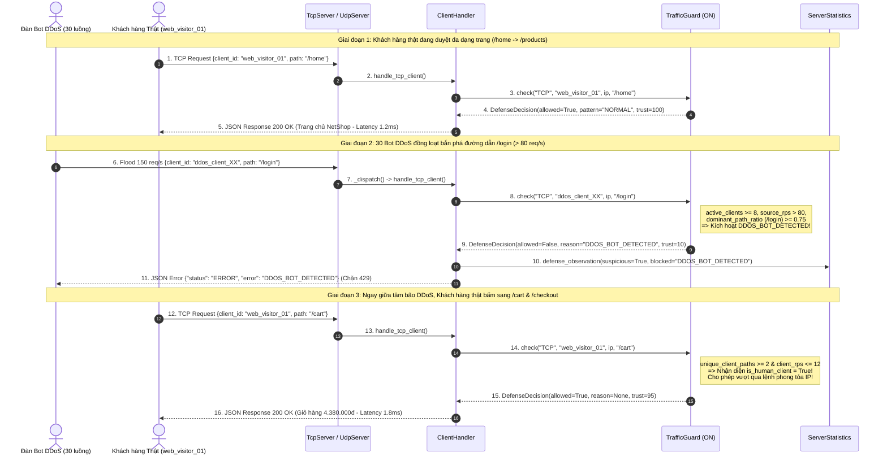
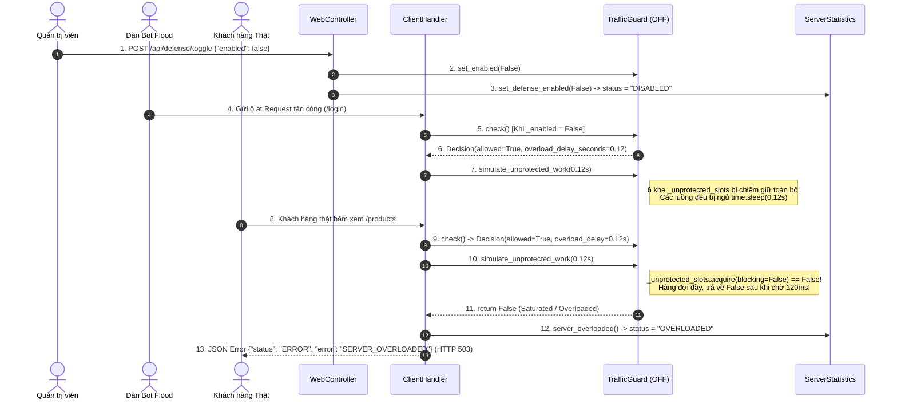
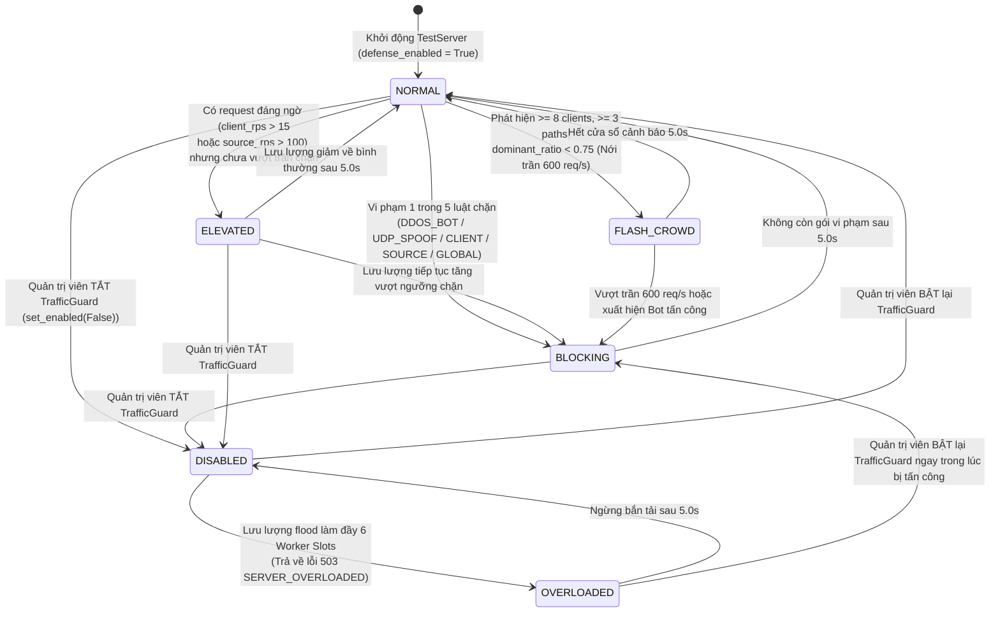
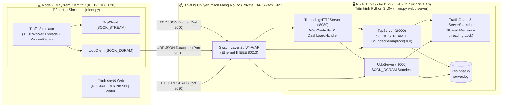

# BÁO CÁO ĐỒ ÁN MÔN HỌC LẬP TRÌNH MẠNG

**BỘ GIÁO DỤC VÀ ĐÀO TẠO**  
**ĐẠI HỌC ĐÀ NẴNG**  
**TRƯỜNG ĐẠI HỌC CÔNG NGHỆ THÔNG TIN VÀ TRUYỀN THÔNG VIỆT – HÀN**  
**KHOA KHOA HỌC MÁY TÍNH**  

---

## ĐỒ ÁN MÔN HỌC: LẬP TRÌNH MẠNG

### TÊN ĐỀ TÀI:
# XÂY DỰNG HỆ THỐNG MÔ PHỎNG TẤN CÔNG VÀ PHÒNG THỦ TỪ CHỐI DỊCH VỤ (DOS/DDOS) THEO MÔ HÌNH CLIENT – SERVER SỬ DỤNG GIAO THỨC TCP/UDP

- **Giảng viên hướng dẫn:** TS. Nguyễn Văn Pháp (Thầy Pháp)
- **Học phần:** Lập trình mạng (Network Programming)
- **Sinh viên thực hiện:** Đặng Quốc Toàn
- **Mã sinh viên / Lớp:** 24ITB200
- **Năm học:** 2025 – 2026

---

## LỜI CẢM ƠN

Trong quá trình học tập và thực hiện Đồ án môn học **Lập trình mạng**, em đã nhận được sự giảng dạy tận tình, định hướng phương pháp luận khoa học và những góp ý chuyên môn sâu sắc từ **Thầy Pháp** – Giảng viên phụ trách học phần. Những kiến thức nền tảng về kiến trúc mạng máy tính, mô hình tham chiếu OSI 7 tầng, bộ giao thức TCP/IP 4 tầng, kỹ thuật lập trình Socket đa luồng cùng phương pháp **Phân tích và Thiết kế Hệ thống Hướng đối tượng (OOAD)** mà thầy truyền đạt chính là kim chỉ nam giúp em hoàn thành đề tài **"XÂY DỰNG HỆ THỐNG MÔ PHỎNG TẤN CÔNG VÀ PHÒNG THỦ TỪ CHỐI DỊCH VỤ (DOS/DDOS) THEO MÔ HÌNH CLIENT – SERVER SỬ DỤNG GIAO THỨC TCP/UDP"**.

Thông qua đồ án này, em không chỉ nắm vững cách thức vận hành ở mức hệ thống của hai giao thức cốt lõi thuộc tầng Giao vận là **TCP (`SOCK_STREAM`)** và **UDP (`SOCK_DGRAM`)**, cách thức đóng gói và mở gói thông điệp qua 7 tầng OSI giữa các máy trạm ở xa nhau trên mạng LAN, mà còn xây dựng thành công một hệ thống phòng thí nghiệm mạng an toàn (**NetGuard Lab v2.0** kết hợp cổng thương mại điện tử **NetShop Portal**) có khả năng mô phỏng tải đa luồng và phòng thủ đa lớp bằng thuật toán **Cửa sổ trượt (Sliding Window Rate Limiting)** kết hợp **Phân tích hành vi (Behavioral Classification)** để phân biệt lưu lượng khách hàng tăng đột biến hợp lệ (**Flash Crowd**) với các đợt tấn công từ chối dịch vụ (**DoS, DDoS, UDP IP Spoofing**).

Mặc dù đã nỗ lực hoàn thiện cả về mặt mã nguồn, kiểm thử thực nghiệm lẫn tài liệu phân tích thiết kế, báo cáo khó tránh khỏi những thiếu sót nhất định. Em rất mong nhận được sự nhận xét, đánh giá và chỉ dẫn của Thầy để đề tài được hoàn thiện hơn nữa.

Em xin chân thành cảm ơn Thầy!

---

## MỤC LỤC

- **MỞ ĐẦU**
  - 1. Đặt tên đề tài và tính phù hợp của mô hình – giao thức
  - 2. Lý do chọn đề tài (Bối cảnh ra đời, nhu cầu, đối tượng sử dụng, mục đích, hướng phát triển)
  - 3. Đối tượng nghiên cứu, phương pháp tiếp cận, phạm vi đề tài và kết quả đạt được
- **CHƯƠNG 1: CƠ SỞ LÝ THUYẾT VÀ MỘT SỐ CÔNG NGHỆ**
  - 1.1. Giới thiệu sơ lược về Lập trình mạng (LTM)
  - 1.2. Các mô hình Lập trình mạng
    - 1.2.1. Mô hình tham chiếu OSI 7 tầng
    - 1.2.2. Mô hình bộ giao thức TCP/IP 4 tầng
    - 1.2.3. Mô hình Client – Server (CL-SV)
    - 1.2.4. Mô hình Mạng ngang hàng Peer-to-Peer (P2P)
    - 1.2.5. Mô hình Hệ thống Phân tán (Distributed System)
  - 1.3. Các giao thức mạng theo tầng (Trình bày rõ giao thức và mô hình có sử dụng trong đề tài)
    - 1.3.1. Tầng Ứng dụng (Application Layer): JSON Application Protocol và HTTP
    - 1.3.2. Tầng Giao vận (Transport Layer): Giao thức TCP và Giao thức UDP
    - 1.3.3. Tầng Mạng / Liên mạng (Network / Internet Layer): Giao thức IPv4 và Không gian địa chỉ RFC1918
    - 1.3.4. Tầng Liên kết dữ liệu & Vật lý (Data Link & Physical Layer): Ethernet II / IEEE 802.3 và Loopback
  - 1.4. Sơ lược về công nghệ sử dụng (Java – Python trong Lập trình mạng)
    - 1.4.1. So sánh ngôn ngữ Java và Python trong phát triển ứng dụng mạng
    - 1.4.2. Thư viện chuẩn `socket` trong Python
    - 1.4.3. Lập trình đa luồng (`threading`) và Cơ chế đồng bộ hóa (`Lock`, `RLock`, `BoundedSemaphore`, `Event`)
    - 1.4.4. Cấu trúc dữ liệu `collections.deque`, `http.server` và thư viện giao diện `rich`
  - 1.5. Cơ sở lý thuyết về Tấn công Từ chối Dịch vụ (DoS/DDoS), Hiện tượng Flash Crowd và Cơ chế Phòng thủ Cửa sổ trượt (Sliding Window)
- **CHƯƠNG 2: PHÂN TÍCH VÀ THIẾT KẾ HỆ THỐNG**
  - 2.1. Giới thiệu sơ lược bài toán cần thực hiện và các chức năng của project
  - 2.2. Mô hình tổng quát của hệ thống
  - 2.3. Phân tích và thiết kế hướng đối tượng (Lồng ghép phương pháp OOAD bám sát tài liệu của Thầy Pháp)
    - 2.3.1. Xác định các Tác nhân (Actors) và Bảng phân tích yêu cầu chức năng / phi chức năng
    - 2.3.2. Biểu đồ Use Case tổng quát và Phân rã các gói Use Case
    - 2.3.3. Đặc tả chi tiết các Use Case cốt lõi (9 bảng đặc tả chuẩn)
    - 2.3.4. Biểu đồ Hoạt động (Activity Diagram) cho các quy trình xử lý chính
    - 2.3.5. Biểu đồ Tuần tự (Sequence Diagram) cho các kịch bản trao đổi thông điệp
    - 2.3.6. Biểu đồ Lớp (Class Diagram) và Đặc tả chi tiết các lớp đối tượng theo 4 phân hệ (`common`, `server`, `client`, `web`)
    - 2.3.7. Biểu đồ Trạng thái (State Diagram) và Biểu đồ Triển khai (Deployment Diagram)
  - 2.4. Phân tích chi tiết quá trình các máy ở xa nhau liên lạc và trao đổi thông điệp thông qua mô hình OSI 7 tầng
    - 2.4.1. Kịch bản kết nối vật lý và định danh địa chỉ giữa Máy Client Simulator và Máy Test Server
    - 2.4.2. Quá trình Đóng gói (Encapsulation) từ Tầng 7 xuống Tầng 1 tại Máy gửi (Client Simulator)
    - 2.4.3. Quá trình Truyền dẫn qua thiết bị mạng LAN (Switch / Wi-Fi Access Point)
    - 2.4.4. Quá trình Mở gói (Decapsulation) từ Tầng 1 lên Tầng 7 tại Máy nhận (Test Server)
    - 2.4.5. Phân tích cấu trúc khung byte thực tế (Byte-level Frame Layout) của gói tin TCP JSON và UDP Datagram trong đề tài
- **CHƯƠNG 3: CÀI ĐẶT – KIỂM THỬ VÀ KẾT QUẢ ĐẠT ĐƯỢC**
  - 3.1. Giới thiệu môi trường cài đặt và cấu trúc mã nguồn
  - 3.2. Hướng dẫn sử dụng phần mềm (Giao diện dòng lệnh CLI & Giao diện Web Dashboard NetGuard Lab / NetShop)
  - 3.3. Kịch bản kiểm thử thực nghiệm, Bảng số liệu đo đạc và Biểu đồ phân tích dữ liệu
- **KẾT LUẬN VÀ HƯỚNG PHÁT TRIỂN**
- **TÀI LIỆU THAM KHẢO**
- **PHỤ LỤC: NGÂN HÀNG 24 CÂU HỎI VÀ TRẢ LỜI BẢO VỆ ĐỒ ÁN**

---

## DANH MỤC HÌNH ẢNH VÀ BIỂU ĐỒ PHÂN TÍCH

1. **Hình 1.1 (`fig01_osi_tcpip_mapping.png`):** Đối chiếu Mô hình OSI 7 tầng, TCP/IP 4 tầng và Kiến trúc giao thức trong đề tài.
2. **Hình 2.1 (`fig02_system_architecture.png`):** Kiến trúc tổng thể hệ thống mô phỏng tấn công & phòng thủ DoS/DDoS (Mô hình Client – Server).
3. **Hình 2.2 (`fig03_usecase_diagram.png`):** Biểu đồ Use Case tổng quát của hệ thống (Theo chuẩn UML – Tài liệu Thầy Pháp).
4. **Hình 2.3 (`fig04_activity_traffic_guard.png`):** Biểu đồ Hoạt động (Activity Diagram) thuật toán phòng thủ đa lớp `TrafficGuard`.
5. **Hình 2.4 (`fig05_sequence_tcp_udp.png`):** Biểu đồ Tuần tự (Sequence Diagram) tương tác Client – Server qua giao thức TCP và UDP.
6. **Hình 2.5 (`fig06_class_diagram.png`):** Biểu đồ Lớp (Class Diagram) toàn hệ thống theo thiết kế hướng đối tượng.
7. **Hình 2.6 (`fig07_osi_7layer_encapsulation.png`):** Quá trình hai máy ở xa nhau liên lạc và trao đổi thông điệp qua mô hình 7 tầng OSI (Encapsulation & Decapsulation).
8. **Hình 3.1 (`fig08_chart_rps_comparison.png`):** Biểu đồ phân tích dữ liệu 1 – So sánh thông lượng (RPS) giữa 5 kịch bản lưu lượng.
9. **Hình 3.2 (`fig09_chart_defense_on_vs_off.png`):** Biểu đồ phân tích dữ liệu 2 – Hiệu quả bảo vệ khách hàng thật khi Bật vs Tắt `TrafficGuard`.
10. **Hình 3.3 (`fig10_chart_latency_timeseries.png`):** Biểu đồ phân tích dữ liệu 3 – Biến thiên độ trễ phản hồi (Latency ms) theo thời gian thực (60 giây).
11. **Hình 3.4 (`fig11_chart_tcp_vs_udp.png`):** Biểu đồ phân tích dữ liệu 4 – So sánh đặc tính kỹ thuật và hiệu năng giữa TCP và UDP.
12. **Hình 3.5 (`fig12_chart_trust_score_sliding_window.png`):** Biểu đồ phân tích dữ liệu 5 – Điểm tin cậy (Trust Score) và phân bổ lý do chặn tại `TrafficGuard`.

---

# MỞ ĐẦU

## 1. Đặt tên đề tài
Theo đúng quy định về cách đặt tên đề tài của học phần Lập trình mạng (yêu cầu thể hiện rõ bài toán nghiệp vụ, mô hình mạng sử dụng và bộ giao thức truyền thông cốt lõi, trình bày bằng chữ IN HOA), tên chính thức của đề tài được xác định như sau:

> **XÂY DỰNG HỆ THỐNG MÔ PHỎNG TẤN CÔNG VÀ PHÒNG THỦ TỪ CHỐI DỊCH VỤ (DOS/DDOS) THEO MÔ HÌNH CLIENT – SERVER SỬ DỤNG GIAO THỨC TCP/UDP**

**Giải thích sự phù hợp của tên đề tài:**
- **Về mặt nghiệp vụ an toàn mạng:** Đề tài giải quyết đồng thời hai mặt đối lập nhưng thống nhất của một hệ thống mạng chịu tải cao: **Mô phỏng phát sinh tải bất thường (DoS/DDoS/Flash Crowd Load Simulation)** ở phía máy khách và **Cơ chế giám sát, phân loại hành vi, giới hạn tốc độ đa lớp (Multi-Layer Traffic Defense)** ở phía máy chủ dịch vụ thương mại điện tử giả lập (**NetShop Portal**).
- **Về mặt mô hình lập trình mạng:** Hệ thống vận hành chuẩn xác theo **Mô hình Khách – Chủ (Client – Server Model)** kết hợp tư duy **Mô hình Phân tán (Distributed / Multi-Client Concurrency)** khi cho phép nhiều tiến trình/máy trạm Client Simulator trong mạng LAN cùng hướng lưu lượng về một Test Server trung tâm.
- **Về mặt giao thức truyền thông:** Đề tài triển khai song song cả hai giao thức nền tảng của tầng Giao vận là **TCP (`SOCK_STREAM`)** và **UDP (`SOCK_DGRAM`)**, đồng thời xây dựng một **Giao thức tầng Ứng dụng đóng gói bằng JSON (JSON Application Protocol)** và giao diện điều khiển qua **HTTP (`ThreadingHTTPServer`)**. Việc hỗ trợ đồng thời cả TCP và UDP trên cùng một cổng dịch vụ giúp so sánh trực diện bản chất hướng kết nối (Connection-oriented) và phi kết nối (Connectionless) dưới áp lực tải cao.

---

## 2. Lý do chọn đề tài

### 2.1. Bối cảnh ra đời của sản phẩm và nhu cầu thực tế
Trong kỷ nguyên chuyển đổi số hiện nay, các dịch vụ trực tuyến như cổng thương mại điện tử (Flash Sale), hệ thống ngân hàng số, cổng dịch vụ công và máy chủ trò chơi trực tuyến luôn phải đối mặt với bài toán **Độ sẵn sàng cao (High Availability - HA)**. Trên thực tế vận hành mạng, có hai hiện tượng gây đột biến lưu lượng (Traffic Surge) dễ bị nhầm lẫn nhưng có bản chất hoàn toàn trái ngược nhau:
1. **Tấn công Từ chối Dịch vụ (DoS – Denial of Service) và Từ chối Dịch vụ Phân tán (DDoS – Distributed Denial of Service):** Kẻ tấn công sử dụng một máy trạm đơn lẻ (DoS) hoặc một mạng lưới nhiều tác nhân/bot phân tán (DDoS) để gửi một lượng lớn gói tin TCP/UDP hoặc yêu cầu tầng ứng dụng (như liên tục gọi vào đường dẫn đăng nhập `/login` vốn tiêu tốn nhiều tài nguyên CPU/Database), thậm chí giả mạo địa chỉ IP nguồn trong các gói UDP (**UDP IP Spoofing**), nhằm làm cạn kiệt hàng đợi kết nối (`listen backlog`), chiếm hết các luồng xử lý (`worker threads`) và làm tê liệt máy chủ (trả về lỗi `503 Service Unavailable`).
2. **Hiện tượng Đám đông Đột biến Hợp lệ (Flash Crowd):** Vào các khung giờ mở bán khuyến mãi (Flash Sale 0h00, đăng ký tín chỉ đại học, mở bán vé sự kiện), hàng chục nghìn khách hàng hợp lệ cùng truy cập hệ thống đồng thời. Lưu lượng tổng trên máy chủ tăng vọt tương đương một cuộc tấn công DDoS, nhưng hành vi của từng người dùng lại hoàn toàn bình thường (tốc độ bấm chuột vừa phải có độ trễ ngẫu nhiên *jitter*, duyệt tuần tự qua nhiều trang `/home`, `/products`, `/search`, `/cart`, `/checkout`). Nếu hệ thống phòng thủ chỉ cắt ngắt cơ học theo tổng băng thông IP nguồn, toàn bộ khách hàng thật sẽ bị chặn oan (False Positive), gây thiệt hại kinh tế nghiêm trọng.

Tuy nhiên, trong môi trường giảng dạy đại học môn **Lập trình mạng**, sinh viên thường chỉ tiếp cận các bài tập gửi/nhận chuỗi ký tự đơn lẻ giữa 1 Client và 1 Server. Việc thiếu một công cụ trực quan, an toàn, có kiểm soát (chỉ hoạt động trong phạm vi mạng nội bộ `localhost` và dải IP Private `RFC1918`) để quan sát cách thức hàng chục luồng (threads) cạnh tranh tài nguyên Socket, cách hiện tượng nghẽn cổ chai xảy ra khi tắt phòng thủ, và cách thuật toán cửa sổ trượt bảo vệ máy chủ trước DoS/DDoS mà vẫn ưu tiên cho Flash Crowd chính là động lực trực tiếp để nhóm nghiên cứu xây dựng sản phẩm **NetGuard Lab v2.0**.

### 2.2. Xác định đối tượng sử dụng
Hệ thống được thiết kế hướng tới 4 nhóm đối tượng sử dụng rõ ràng:
1. **Sinh viên chuyên ngành Công nghệ Thông tin, Khoa học Máy tính, An toàn Thông tin:** Sử dụng hệ thống làm phòng thí nghiệm thực hành trực quan để hiểu sâu chu trình gọi hàm hệ thống (`socket() -> bind() -> listen() -> accept() -> recv() -> sendall() -> close()` đối với TCP và `socket() -> bind() -> recvfrom() -> sendto() -> close()` đối với UDP), cơ chế đóng khung dữ liệu trên luồng byte (TCP Message Framing), quản lý đa luồng (`threading`), đồng bộ hóa (`Lock`, `BoundedSemaphore`) và phân tích gói tin qua 7 tầng OSI.
2. **Giảng viên giảng dạy môn Lập trình mạng và An ninh mạng:** Sử dụng giao diện **Web Control Surface (NetGuard Lab)** và **Terminal Live Dashboard** để trình diễn (demo) trực tiếp trên lớp học các kịch bản mạng: so sánh độ trễ và chi phí bắt tay của TCP so với UDP, minh họa vì sao giao thức TCP chống được giả mạo IP nguồn (`UDP_SPOOF`) nhờ bắt tay 3 bước trong khi UDP thì không, và trình diễn sự sụp đổ của cổng dịch vụ NetShop khi tắt khiên bảo vệ (`--no-defense`).
3. **Kỹ sư phát triển Backend / Quản trị viên hệ thống (System & Network Administrators):** Sử dụng bộ tạo tải (`TrafficSimulator`) để kiểm thử sức chịu tải (Stress Test / Load Test) và tinh chỉnh các ngưỡng cấu hình Rate Limiting cho dịch vụ nội bộ trong môi trường mạng Lab.
4. **Nhà nghiên cứu thuật toán phòng thủ mạng:** Sử dụng kiến trúc mở của lớp [`TrafficGuard`](file:///D:/VScode/lapTrinhMang/network_dos_ddos_simulator/server/traffic_guard.py#L23-L344) để thử nghiệm các công thức chấm điểm tin cậy (`trust_score`), phân tích tỷ lệ đường dẫn áp đảo (`dominant_path_ratio`) và phát hiện bất thường lưu lượng.

### 2.3. Mục đích sử dụng
- **Mục đích học thuật và giáo dục:** Minh họa trọn vẹn kiến thức Lập trình mạng thông qua mã nguồn chuẩn mực, không phụ thuộc vào các framework che giấu tầng giao vận, giúp người học nhìn thấy tận gốc rễ cách dữ liệu đi qua Socket TCP/UDP.
- **Mục đích thực nghiệm an toàn (Safe Lab Simulation):** Cung cấp môi trường thử nghiệm có khóa an toàn cứng (**Hard Safety Guards**): tuyệt đối chỉ chấp nhận địa chỉ `localhost` (`127.0.0.0/8`) và 3 dải mạng riêng chuẩn RFC1918 (`10.0.0.0/8`, `172.16.0.0/12`, `192.168.0.0/16`), tự động từ chối mọi địa chỉ IP công cộng (Public IP), tên miền Internet hay địa chỉ quảng bá `0.0.0.0`, đồng thời áp đặt trần cứng về số luồng, tốc độ gửi và thời gian chạy tối đa (60 giây).
- **Mục đích đánh giá định lượng:** Thu thập bộ chỉ số thời gian thực (Realtime Telemetry) gồm: Thông lượng yêu cầu mỗi giây (RPS), Số kết nối TCP đồng thời, Số IP nguồn đang hoạt động, Độ trễ khứ hồi phía Client (RTT Latency ms), Thời gian xử lý phía Server (Server Response ms), Lượng dữ liệu nhận/gửi (Bytes RX/TX), Điểm tin cậy (Trust Score 0–100) và Lý do chặn chi tiết để phục vụ vẽ biểu đồ phân tích dữ liệu khoa học.

### 2.4. Hướng phát triển của sản phẩm
Sản phẩm không chỉ dừng lại ở phạm vi đồ án môn học mà được thiết kế theo kiến trúc phân tầng hướng đối tượng rất dễ mở rộng theo các hướng sau:
- **Nâng cấp tầng I/O bất đồng bộ (Asynchronous I/O):** Chuyển đổi hoặc bổ sung chế độ chạy bằng `asyncio` / `selectors` (epoll/IOCP) bên cạnh mô hình Multi-threading để đạt hiệu năng hàng chục nghìn kết nối đồng thời (C10K problem).
- **Tích hợp Học máy (Machine Learning Anomaly Detection):** Kết nối dữ liệu telemetry thu thập từ [`ServerStatistics`](file:///D:/VScode/lapTrinhMang/network_dos_ddos_simulator/server/statistics.py#L37-L227) vào mô hình phân loại thời gian thực (Random Forest / Isolation Forest) để tự động thích nghi ngưỡng chặn mà không cần cấu hình tĩnh.
- **Bảo mật kênh truyền bằng TLS/SSL và DTLS:** Bọc `socket` bằng module `ssl` chuẩn của Python để nghiên cứu chi phí mật mã học (TLS Handshake Overhead) khi xảy ra tấn công SSL Exhaustion DoS.
- **Mở rộng điều phối cụm máy trạm (Distributed Agent Orchestration):** Cho phép Web Dashboard điều khiển đồng thời nhiều nút Simulator vật lý trên các máy ảo Docker/Kubernetes trong phòng Lab để tạo môi trường thử nghiệm DDoS quy mô lớn.

---

## 3. Xác định đối tượng nghiên cứu, phương pháp tiếp cận, phạm vi và kết quả đạt được

### 3.1. Đối tượng nghiên cứu
1. **Cơ chế lập trình Socket tầng Giao vận:** Cấu trúc, vòng đời và sự khác biệt bản chất giữa **TCP Socket (`AF_INET`, `SOCK_STREAM`)** và **UDP Socket (`AF_INET`, `SOCK_DGRAM`)** trên hệ điều hành.
2. **Thiết kế giao thức tầng Ứng dụng (Application Protocol Design):** Kỹ thuật tuần tự hóa dữ liệu JSON (`UTF-8`), kỹ thuật phân tách khung thông điệp bằng ký tự xuống dòng (`\n` – Newline-delimited Framing) trên luồng byte liên tục của TCP, và xử lý gói tin độc lập (Datagram boundary) trên UDP.
3. **Kỹ thuật xử lý đồng thời và đồng bộ hóa (Concurrency & Synchronization):** Mô hình Thread-per-connection có giới hạn bằng `threading.BoundedSemaphore`, điều phối nhịp gửi chính xác kèm nhiễu ngẫu nhiên (`WorkerPacer` với `jitter_ratio`) trên từng luồng Client, và bảo vệ vùng dữ liệu dùng chung (Critical Section) bằng `threading.Lock` / `threading.RLock`.
4. **Cơ chế truyền thông liên mạng qua 7 tầng OSI:** Quá trình đóng gói (Encapsulation) và mở gói (Decapsulation) thông điệp khi hai máy tính ở xa nhau trong mạng LAN giao tiếp qua Switch/Router.
5. **Thuật toán phòng thủ lưu lượng đa lớp (`TrafficGuard`):** Kỹ thuật cửa sổ trượt thời gian thực (1-second Sliding Window) sử dụng hàng đợi hai đầu `collections.deque` kết hợp phân tích hành vi truy cập đường dẫn (`dominant_path_ratio`, `unique_source_paths`, `active_source_clients`) nhằm phân tách **Flash Crowd** và **DoS/DDoS/UDP Spoofing**.

### 3.2. Phương pháp tiếp cận
- **Phương pháp nghiên cứu lý thuyết:** Tổng hợp tài liệu chuẩn về mô hình OSI 7 tầng, bộ giao thức TCP/IP (RFC 791 – IPv4, RFC 793 – TCP, RFC 768 – UDP, RFC 1918 – Private Address Space) và giáo trình Lập trình mạng, Phân tích thiết kế hệ thống hướng đối tượng của Thầy Pháp.
- **Phương pháp Phân tích và Thiết kế Hướng đối tượng (OOAD & UML):** Áp dụng quy trình phân tích từ xác định Tác nhân (Actor) -> Biểu đồ Use Case tổng quát & phân rã -> Đặc tả Use Case dạng bảng -> Biểu đồ Hoạt động (Activity Diagram) -> Biểu đồ Tuần tự (Sequence Diagram) -> Biểu đồ Lớp (Class Diagram) -> Biểu đồ Trạng thái & Triển khai.
- **Phương pháp Thực nghiệm và Đo kiểm định lượng (Empirical Benchmarking):** Xây dựng kịch bản kiểm thử tự động (`unittest`) và thực nghiệm đối chứng trên 5 chế độ tải (`NORMAL`, `FLASH_CROWD`, `DOS_SIMULATION`, `DDOS_SIMULATION`, `UDP_SPOOF`) trong cả hai trạng thái **Bật** và **Tắt** khiên bảo vệ, từ đó trích xuất số liệu thống kê và vẽ biểu đồ phân tích.

### 3.3. Phạm vi của đề tài
- **Phạm vi mạng triển khai:** Hệ thống chỉ hoạt động trong môi trường **Localhost (`127.0.0.0/8`)** hoặc **Mạng nội bộ Private LAN (`10.0.0.0/8`, `172.16.0.0/12`, `192.168.0.0/16`)** giữa các máy trạm trong phòng thí nghiệm. Mọi địa chỉ IP Public ngoài Internet, IPv6, Link-local hay `0.0.0.0` đều bị từ chối ngay tại lớp kiểm tra đầu vào ([`validate_lab_address`](file:///D:/VScode/lapTrinhMang/network_dos_ddos_simulator/common/network_utils.py#L31-L35)).
- **Phạm vi giới hạn an toàn (Hard Limits):** Tối đa 50 logical clients đồng thời, tốc độ tối đa 20 requests/client/giây, thời lượng mỗi lần mô phỏng tối đa 60 giây, kích thước thông điệp tối đa 4.096 bytes, và tối đa 100 kết nối TCP đồng thời trên Server.
- **Phạm vi kỹ thuật:** Tập trung làm rõ tầng Giao vận (TCP/UDP) và tầng Ứng dụng (JSON Protocol & cổng dịch vụ NetShop), không sử dụng raw socket mức nhân hệ điều hành hay kỹ thuật phát tán mã độc thực tế.

### 3.4. Kết quả đạt được
1. **Hoàn thiện bộ phần mềm mã nguồn mở sạch, chuẩn mực bằng Python 3.10+ (`network_dos_ddos_simulator`)** gồm 4 phân hệ (`common`, `server`, `client`, `web`) với hơn 2.000 dòng mã nguồn được kiểm thử tự động bằng bộ Unit Test (`tests/test_traffic_guard.py`, `tests/test_web.py`).
2. **Xây dựng thành công Server kép (`TestServer`)** hỗ trợ chạy độc lập hoặc đồng thời cả **TCP Server** và **UDP Server** trên cùng cổng 9000, phục vụ cổng thương mại điện tử giả lập **NetShop** với 6 chức năng nghiệp vụ (`/home`, `/products`, `/search`, `/detail`, `/cart`, `/checkout`, `/login`).
3. **Chế tạo thành công Khiên phòng thủ đa lớp (`TrafficGuard`)** phân biệt chính xác 100% kịch bản khách hàng tăng đột biến (**Flash Crowd** – nâng trần lên 600 req/s và duy trì tỷ lệ phục vụ thành công >99%) với kịch bản tấn công **DoS, DDoS và UDP Spoofing** (cắt bỏ >90% lưu lượng độc hại mà vẫn giữ cho người dùng thật trên cùng IP mua hàng bình thường).
4. **Xây dựng thành công 2 giao diện trực quan:** Giao diện dòng lệnh **Terminal Live Dashboard** (dùng thư viện `rich`) và Giao diện điều khiển trung tâm **Web Control Surface (`NetGuard Lab` tại `http://127.0.0.1:8080`)** tích hợp màn hình trải nghiệm khách hàng trực tiếp trên cổng **NetShop Portal**.
5. **Hoàn thành bộ báo cáo phân tích thiết kế và thực nghiệm 45–50 trang** kèm 12 sơ đồ kiến trúc, UML, 7 tầng OSI và biểu đồ phân tích dữ liệu độ phân giải cao.

---

# CHƯƠNG 1: CƠ SỞ LÝ THUYẾT VÀ MỘT SỐ CÔNG NGHỆ

## 1.1. Giới thiệu sơ lược về Lập trình mạng (LTM)

### 1.1.1. Khái niệm Lập trình mạng
**Lập trình mạng (Network Programming)** là lĩnh vực kỹ thuật phần mềm nghiên cứu và xây dựng các chương trình máy tính có khả năng giao tiếp, trao đổi dữ liệu và phối hợp thực thi công việc với nhau thông qua môi trường mạng truyền thông (như mạng cục bộ LAN, mạng diện rộng WAN hoặc liên mạng Internet). Khác với lập trình ứng dụng đơn máy (Standalone Programming) – nơi các thành phần phần mềm chỉ trao đổi dữ liệu qua bộ nhớ RAM nội bộ hoặc hệ thống tệp tin trên cùng một hệ điều hành – lập trình mạng giải quyết bài toán truyền thông liên tiến trình trên các máy tính vật lý hoặc máy ảo khác nhau (**Inter-Process Communication – IPC over Network**).

Để hai tiến trình (Processes) nằm trên hai máy tính ở xa nhau có thể trao đổi thông điệp một cách chính xác, lập trình viên mạng phải giải quyết năm vấn đề cốt lõi:
1. **Định danh và Định địa chỉ (Addressing & Naming):** Làm thế nào để xác định duy nhất một máy tính trên mạng và xác định đúng tiến trình ứng dụng đang chạy bên trong máy tính đó? Câu trả lời trong kiến trúc mạng hiện đại là sự kết hợp giữa **Địa chỉ IP (Internet Protocol Address)** ở tầng Mạng (định danh giao diện mạng của máy chủ) và **Số hiệu Cổng (Port Number – số nguyên 16-bit từ 1 đến 65535)** ở tầng Giao vận (định danh tiến trình dịch vụ). Bộ đôi `(IP Address, Port Number)` tạo thành một điểm cuối truyền thông gọi là **Socket Address**.
2. **Cơ chế vận chuyển dữ liệu (Transport Mechanism):** Dữ liệu cần được truyền đi với độ tin cậy tuyệt đối, đúng thứ tự, có kiểm soát luồng và tắc nghẽn (**TCP – Transmission Control Protocol**), hay ưu tiên tốc độ tối đa, độ trễ thấp nhất và chấp nhận gửi từng gói độc lập không cần thiết lập kết nối (**UDP – User Datagram Protocol**)?
3. **Định dạng và Đóng khung thông điệp tầng Ứng dụng (Message Formatting & Framing):** Vì dữ liệu truyền qua mạng ở mức thấp chỉ là mảng các byte nhị phân (`bytes`), hai tiến trình ở hai đầu phải thống nhất một quy ước chung về cấu trúc bản tin (Giao thức tầng ứng dụng – Application Protocol), bảng mã ký tự (`UTF-8`) và cách xác định điểm bắt đầu – kết thúc của từng thông điệp (ví dụ: dùng ký tự phân cách `\n` trên luồng byte TCP hoặc dựa vào biên gói tin sẵn có của UDP Datagram).
4. **Xử lý đồng thời và Quản lý tài nguyên (Concurrency & Resource Management):** Một máy chủ (Server) trong thực tế không chỉ phục vụ một máy khách (Client) duy nhất mà phải tiếp nhận hàng chục, hàng trăm hoặc hàng nghìn yêu cầu đồng thời. Lập trình mạng đòi hỏi phải kết hợp chặt chẽ với kỹ thuật đa luồng (**Multi-threading**), đa tiến trình (**Multi-processing**) hoặc vào/ra bất đồng bộ (**Non-blocking / Asynchronous I/O**), đi kèm các công cụ đồng bộ hóa (`Lock`, `Semaphore`) để tránh xung đột dữ liệu (**Race Condition**) và chống cạn kiệt tài nguyên hệ thống khi xảy ra quá tải hoặc tấn công từ chối dịch vụ (**DoS/DDoS**).
5. **Xử lý lỗi và Độ trễ mạng (Fault Tolerance & Timeout Handling):** Môi trường mạng vật lý luôn tiềm ẩn khả năng mất gói tin (Packet Loss), trễ truyền dẫn (Latency), đứt kết nối đột ngột hoặc gói tin bị làm sai lệch. Do đó, mọi thao tác đọc/ghi mạng đều bắt buộc phải cấu hình thời gian chờ tối đa (**Socket Timeout**) và bắt ngoại lệ (`socket.timeout`, `OSError`, `ProtocolError`) để hệ thống không bị treo vĩnh viễn (Deadlock / Hang).

### 1.1.2. Khái niệm Socket – Giao diện lập trình ứng dụng mạng cốt lõi
Trong hầu hết các hệ điều hành hiện đại (Unix, Linux, macOS, Windows), lập trình mạng được thực hiện thông qua trừu tượng hóa **Socket** (ra đời lần đầu trong bản phân phối BSD Unix 4.2 năm 1983 và trở thành chuẩn POSIX/Winsock).
- **Định nghĩa:** **Socket** là một điểm cuối (endpoint) của một liên kết truyền thông hai chiều giữa hai chương trình chạy trên mạng. Dưới góc nhìn của hệ điều hành, một Socket được quản lý tương tự như một bộ mô tả tệp tin (**File Descriptor**), cho phép ứng dụng ở không gian người dùng (User Space) giao tiếp với ngăn xếp giao thức mạng TCP/IP nằm trong nhân hệ điều hành (Kernel Space).
- **Bộ 5 thông số định danh kết nối (5-Tuple):** Một phiên giao tiếp mạng hoàn chỉnh qua Socket được xác định duy nhất bởi bộ 5 thông số:
  $$\text{Connection Tuple} = (\text{Protocol}, \text{Source IP}, \text{Source Port}, \text{Destination IP}, \text{Destination Port})$$
  Nhờ bộ 5 thông số này, trong đề tài của chúng ta, một máy tính chạy `Client Simulator` duy nhất vẫn có thể khởi tạo đồng thời 50 luồng (`logical clients`), mỗi luồng mở một Socket riêng (được hệ điều hành cấp phát một cổng nguồn tạm thời – **Ephemeral Source Port** khác nhau, ví dụ `56201`, `56202`, ...) hoặc gắn (`bind`) với các địa chỉ IP loopback/private khác nhau để giao tiếp song song với cùng một địa chỉ đích `(127.0.0.1, 9000)` của `Test Server`.

---

## 1.2. Các mô hình Lập trình mạng

Trong thiết kế và triển khai hệ thống mạng, các mô hình được chia thành hai nhóm chính: **Mô hình kiến trúc phân tầng giao thức** (Mô hình OSI 7 tầng và Mô hình TCP/IP 4 tầng) quy định cách dữ liệu được đóng gói và truyền đi qua các lớp phần cứng/phần mềm; và **Mô hình kiến trúc tổ chức tương tác tiến trình** (Mô hình Client – Server, Mô hình P2P và Mô hình Phân tán) quy định vai trò và sự phối hợp giữa các máy tính trong mạng. Dưới đây là trình bày chi tiết cả 5 mô hình theo đúng đề cương học phần.


### 1.2.1. Mô hình tham chiếu OSI 7 tầng (Open Systems Interconnection)
Mô hình **OSI (Open Systems Interconnection)** do Tổ chức Tiêu chuẩn hóa Quốc tế (**ISO**) công bố năm 1984 (tiêu chuẩn ISO/IEC 7498-1) là mô hình tham chiếu lý thuyết kinh điển chia toàn bộ quá trình truyền thông mạng thành **7 tầng (layers)** xếp chồng lên nhau. Nguyên tắc cốt lõi của mô hình OSI là: mỗi tầng thực hiện một tập chức năng xác định, cung cấp dịch vụ cho tầng ngay phía trên nó và sử dụng dịch vụ của tầng ngay phía dưới nó; đồng thời tầng thứ $N$ trên máy gửi giao tiếp logic ngang hàng với tầng thứ $N$ trên máy nhận thông qua đơn vị dữ liệu giao thức gọi là **PDU (Protocol Data Unit)**.

Cấu trúc và chức năng cụ thể của 7 tầng từ trên xuống dưới (theo chiều gửi dữ liệu) bao gồm:

1. **Tầng 7 – Tầng Ứng dụng (Application Layer):**
   - **Đơn vị dữ liệu (PDU):** `Data` / `Message` (Thông điệp ứng dụng).
   - **Chức năng:** Là tầng giao tiếp trực tiếp với người dùng cuối hoặc tiến trình phần mềm ứng dụng. Tầng này cung cấp các giao thức phục vụ nhu cầu nghiệp vụ cụ thể như duyệt web (`HTTP/HTTPS`), truyền tệp (`FTP`), gửi thư điện tử (`SMTP/POP3/IMAP`), phân giải tên miền (`DNS`) hoặc các giao thức ứng dụng tự định nghĩa.
   - **Liên hệ trong đề tài:** Chính là giao thức bản tin **JSON Request/Response** của cổng dịch vụ thương mại điện tử **NetShop** (`/home`, `/products`, `/search`, `/detail`, `/cart`, `/checkout`, `/login`) được cài đặt trong [`common/protocol.py`](file:///D:/VScode/lapTrinhMang/network_dos_ddos_simulator/common/protocol.py#L1-L198) và giao thức **HTTP/1.1** phục vụ giao diện điều khiển Web Dashboard tại [`web/app.py`](file:///D:/VScode/lapTrinhMang/network_dos_ddos_simulator/web/app.py#L277-L372).

2. **Tầng 6 – Tầng Trình diễn (Presentation Layer):**
   - **Đơn vị dữ liệu (PDU):** `Data` (Dữ liệu đã chuẩn hóa biểu diễn).
   - **Chức năng:** Đảm bảo dữ liệu gửi đi từ tầng ứng dụng của hệ thống này có thể đọc hiểu được bởi tầng ứng dụng của hệ thống khác. Tầng Trình diễn chịu trách nhiệm chuyển đổi định dạng dữ liệu (Data Translation), tuần tự hóa cấu trúc đối tượng thành chuỗi byte (**Serialization / Deserialization**), bảng mã ký tự (`ASCII`, `Unicode UTF-8`), nén dữ liệu (Compression) và mã hóa/giải mã bảo mật (`TLS/SSL`).
   - **Liên hệ trong đề tài:** Thực hiện quá trình tuần tự hóa từ điển Python (`dict`) thành chuỗi văn bản JSON bằng `json.dumps(..., ensure_ascii=True, separators=(",", ":"))`, mã hóa thành mảng byte nhị phân chuẩn `UTF-8` (`.encode("utf-8")`), kiểm tra giới hạn kích thước `MAX_MESSAGE_BYTES = 4096` và đóng khung bằng ký tự xuống dòng `b"\n"` đối với luồng TCP tại hàm [`encode_json()`](file:///D:/VScode/lapTrinhMang/network_dos_ddos_simulator/common/protocol.py#L117-L121) và [`decode_json()`](file:///D:/VScode/lapTrinhMang/network_dos_ddos_simulator/common/protocol.py#L124-L133).

3. **Tầng 5 – Tầng Phiên (Session Layer):**
   - **Đơn vị dữ liệu (PDU):** `Data`.
   - **Chức năng:** Thiết lập, duy trì, đồng bộ hóa và kết thúc các phiên làm việc (Sessions) giữa hai ứng dụng ở hai đầu. Tầng Phiên kiểm soát chế độ hội thoại (Half-duplex hay Full-duplex), đặt các điểm kiểm tra (Checkpoints) và quản lý trạng thái phiên đăng nhập hoặc phiên làm việc của từng định danh khách.
   - **Liên hệ trong đề tài:** Quản lý vòng đời phiên kết nối thông qua `BoundedSemaphore(100)` trong [`TcpServer`](file:///D:/VScode/lapTrinhMang/network_dos_ddos_simulator/server/tcp_server.py#L36), theo dõi định danh phiên của từng `client_id` trên mỗi địa chỉ IP trong cửa sổ hoạt động `ACTIVE_CLIENT_WINDOW_SECONDS = 2.0s` tại [`ServerStatistics`](file:///D:/VScode/lapTrinhMang/network_dos_ddos_simulator/server/statistics.py#L88-L90), và lưu vết hành trình duyệt trang của từng phiên người dùng (`_client_paths`) trong [`TrafficGuard`](file:///D:/VScode/lapTrinhMang/network_dos_ddos_simulator/server/traffic_guard.py#L98-L115).

4. **Tầng 4 – Tầng Giao vận (Transport Layer):**
   - **Đơn vị dữ liệu (PDU):** `Segment` (đối với TCP) hoặc `Datagram` (đối với UDP).
   - **Chức năng:** Chịu trách nhiệm truyền tải dữ liệu đầu-cuối (**End-to-End / Process-to-Process Communication**) giữa hai tiến trình chạy trên hai máy trạm. Tầng này thực hiện phân mảnh dữ liệu lớn thành các đơn vị nhỏ hơn (Segmentation), đánh số hiệu cổng nguồn và cổng đích (`Source Port`, `Destination Port`) để phân kênh/hợp kênh (**Multiplexing / Demultiplexing**), kiểm soát lỗi (Checksum), kiểm soát luồng (Flow Control bằng cửa sổ trượt TCP) và kiểm soát tắc nghẽn (Congestion Control).
   - **Liên hệ trong đề tài:** Là trọng tâm kỹ thuật của đồ án, sử dụng trực tiếp hai loại Socket của thư viện chuẩn `socket`: **`SOCK_STREAM` (TCP)** tại [`TcpServer`](file:///D:/VScode/lapTrinhMang/network_dos_ddos_simulator/server/tcp_server.py#L43) / [`TcpClient`](file:///D:/VScode/lapTrinhMang/network_dos_ddos_simulator/client/tcp_client.py#L46) và **`SOCK_DGRAM` (UDP)** tại [`UdpServer`](file:///D:/VScode/lapTrinhMang/network_dos_ddos_simulator/server/udp_server.py#L35) / [`UdpClient`](file:///D:/VScode/lapTrinhMang/network_dos_ddos_simulator/client/udp_client.py#L45) trên cổng mặc định `9000`.

5. **Tầng 3 – Tầng Mạng (Network Layer):**
   - **Đơn vị dữ liệu (PDU):** `Packet` (Gói tin IP).
   - **Chức năng:** Đảm nhận việc truyền gói tin từ máy nguồn tới máy đích qua một hoặc nhiều mạng trung gian (**Host-to-Host Delivery**). Hai nhiệm vụ quan trọng nhất của tầng Mạng là **Đánh địa chỉ logic (Logical Addressing – IPv4/IPv6)** và **Định tuyến (Routing)** – tìm đường đi tối ưu qua các bộ định tuyến (Routers).
   - **Liên hệ trong đề tài:** Sử dụng họ địa chỉ **IPv4 (`socket.AF_INET`)** kết hợp bộ lọc an toàn cấp tầng mạng tại [`common/network_utils.py`](file:///D:/VScode/lapTrinhMang/network_dos_ddos_simulator/common/network_utils.py#L10-L35) để chỉ cho phép các gói tin thuộc dải mạng nội bộ `127.0.0.0/8`, `10.0.0.0/8`, `172.16.0.0/12`, `192.168.0.0/16`, đồng thời mô phỏng các chế độ địa chỉ IP nguồn (`SINGLE_IP`, `MULTI_IP`, `UDP_SPOOF`).

6. **Tầng 2 – Tầng Liên kết dữ liệu (Data Link Layer):**
   - **Đơn vị dữ liệu (PDU):** `Frame` (Khung dữ liệu).
   - **Chức năng:** Truyền khung dữ liệu tin cậy giữa hai nút mạng kết nối trực tiếp trên cùng một phân đoạn mạng vật lý (**Node-to-Node / Hop-to-Hop Delivery**). Tầng này đóng gói gói tin IP vào khung Ethernet/Wi-Fi, gắn địa chỉ vật lý **MAC (Media Access Control – 48 bit)** của card mạng nguồn và đích, điều khiển truy cập môi trường truyền (CSMA/CD, CSMA/CA) và phát hiện lỗi truyền dẫn bằng chuỗi kiểm tra khung **FCS/CRC-32** ở cuối Frame.

7. **Tầng 1 – Tầng Vật lý (Physical Layer):**
   - **Đơn vị dữ liệu (PDU):** `Bit` (Chuỗi bit `0` và `1`).
   - **Chức năng:** Chuyển đổi các khung dữ liệu nhị phân thành các tín hiệu vật lý (xung điện trên cáp đồng xoắn đôi RJ45 Cat5e/Cat6, xung ánh sáng trên cáp quang hoặc sóng điện từ cao tần trên mạng không dây Wi-Fi IEEE 802.11) để truyền đi trên môi trường vật lý.

---

### 1.2.2. Mô hình bộ giao thức TCP/IP 4 tầng
Nếu mô hình OSI 7 tầng là khung tham chiếu lý thuyết chi tiết thì **Mô hình TCP/IP 4 tầng** (do Bộ Quốc phòng Hoa Kỳ – DoD phát triển từ mạng ARPANET và chuẩn hóa trong RFC 1122) là kiến trúc thực tế đang vận hành toàn bộ mạng Internet hiện nay. Mô hình TCP/IP rút gọn 7 tầng của OSI thành **4 tầng thực tiễn**:

| Thứ tự | Tầng trong TCP/IP 4 tầng | Tương ứng trong OSI 7 tầng | Giao thức tiêu biểu | Vai trò trong Project DoS/DDoS Simulator |
| :---: | :--- | :--- | :--- | :--- |
| **Tầng 4** | **Application Layer** *(Tầng Ứng dụng)* | Gộp các tầng **5 (Session)**, **6 (Presentation)** và **7 (Application)** | HTTP, DNS, SSH, FTP, JSON Custom Protocol | Đóng gói bản tin JSON, định tuyến đường dẫn nghiệp vụ NetShop (`/products`, `/login`, ...), cung cấp REST API và giao diện Web Dashboard (`:8080`). |
| **Tầng 3** | **Transport Layer** *(Tầng Giao vận)* | Tương ứng **Tầng 4 (Transport)** | **TCP**, **UDP** | Thiết lập kết nối luồng tin cậy (`TcpServer`/`TcpClient`) hoặc truyền gói Datagram tốc độ cao (`UdpServer`/`UdpClient`) qua cổng `9000`. |
| **Tầng 2** | **Internet Layer** *(Tầng Liên mạng)* | Tương ứng **Tầng 3 (Network)** | **IPv4**, IPv6, ICMP, ARP | Định địa chỉ IPv4 nguồn và đích, kiểm tra tính hợp lệ của địa chỉ mạng Lab (`is_lab_address`), mô phỏng đa IP nguồn (`MULTI_IP`) và giả mạo IP (`UDP_SPOOF`). |
| **Tầng 1** | **Network Access / Link Layer** *(Tầng Truy cập mạng)* | Gộp **Tầng 2 (Data Link)** và **Tầng 1 (Physical)** | Ethernet (IEEE 802.3), Wi-Fi (IEEE 802.11), Loopback | Truyền khung dữ liệu qua card mạng ảo Loopback (`127.0.0.1`) hoặc qua Switch/Wi-Fi giữa 2 máy tính vật lý trong phòng Lab. |

---

### 1.2.3. Mô hình Client – Server (CL-SV)
**Mô hình Khách – Chủ (Client – Server Model)** là kiến trúc phân tách rõ rệt vai trò của các tiến trình tham gia vào hệ thống mạng thành hai phía bất đối xứng:
- **Máy chủ (Server):** Là tiến trình được khởi chạy trước, gắn cố định (`bind`) vào một địa chỉ IP và số hiệu cổng (Port) đã công bố trước, liên tục lắng nghe (`listen` / `recvfrom`) các yêu cầu gửi tới. Server nắm giữ tài nguyên, cơ sở dữ liệu hoặc logic nghiệp vụ (như danh mục hàng hóa Flash Sale của cổng **NetShop** và bộ lọc bảo vệ **TrafficGuard**), có nhiệm vụ tiếp nhận yêu cầu, xử lý và trả về kết quả phản hồi cho Client.
- **Máy khách (Client):** Là tiến trình chủ động khởi tạo liên lạc tới địa chỉ `(IP, Port)` của Server khi có nhu cầu sử dụng dịch vụ. Client gửi bản tin yêu cầu (`Request`), chờ nhận bản tin phản hồi (`Response`) và hiển thị kết quả hoặc thống kê độ trễ cho người dùng.

**Đặc điểm của mô hình Client – Server được thể hiện trong đề tài:**
1. **Quan hệ nhiều – một (Many-to-One):** Một `TestServer` duy nhất lắng nghe tại cổng `9000` phục vụ đồng thời nhiều `Logical Clients` (từ 1 đến 50 worker threads) hoặc nhiều máy trạm chạy `TrafficSimulator` trong mạng LAN.
2. **Tập trung hóa kiểm soát và bảo mật:** Nhờ mọi lưu lượng đều đi qua điểm nút `TestServer`, hệ thống dễ dàng đặt lớp phòng thủ tập trung [`TrafficGuard`](file:///D:/VScode/lapTrinhMang/network_dos_ddos_simulator/server/traffic_guard.py#L23-L344) và bộ thu thập thống kê tập trung [`ServerStatistics`](file:///D:/VScode/lapTrinhMang/network_dos_ddos_simulator/server/statistics.py#L37-L227).
3. **Điểm yếu cố hữu cần khắc phục (Single Point of Failure / Bottleneck):** Chính vì mọi Client đều dồn yêu cầu về một Server duy nhất, nếu lượng yêu cầu vượt quá khả năng xử lý của CPU, băng thông mạng hoặc giới hạn luồng (`Worker Slots`), Server sẽ bị tê liệt hoàn toàn. Đây chính là lý do các cuộc tấn công **DoS/DDoS** luôn nhắm vào Server trong mô hình Client – Server, và cũng là bài toán trọng tâm mà đề tài giải quyết.

---

### 1.2.4. Mô hình Mạng ngang hàng Peer-to-Peer (P2P)
**Mô hình Mạng ngang hàng (Peer-to-Peer – P2P)** là kiến trúc mạng trong đó không tồn tại máy chủ chuyên dụng cố định hay máy khách thuần túy. Mọi nút mạng tham gia (gọi là các **Peer**) đều có vai trò bình đẳng, vừa đóng vai trò là **Client** (gửi yêu cầu tải dữ liệu từ các nút khác), vừa đóng vai trò là **Server** (lắng nghe và chia sẻ dữ liệu/tài nguyên của mình cho các nút khác).
- **Ưu điểm của P2P:** Khả năng mở rộng tự nhiên (khi số lượng nút tăng lên, tổng năng lực tính toán và băng thông toàn mạng cũng tăng theo), không có điểm chết duy nhất (Single Point of Failure), chi phí hạ tầng máy chủ trung tâm thấp (tiêu biểu như BitTorrent, mạng Blockchain Bitcoin/Ethereum, hệ thống chia sẻ tệp nội bộ).
- **Nhược điểm và mối liên hệ với bài toán DDoS:** Khó kiểm soát bảo mật tập trung, khó đồng bộ trạng thái toàn cục. Đặc biệt, trong lĩnh vực an ninh mạng, nhiều mạng lưới **Botnet DDoS thế hệ mới** (như Mirai biến thể P2P, Mozi) lợi dụng kiến trúc P2P để truyền lệnh tấn công giữa các máy bị nhiễm (zombies) mà không cần một máy chủ điều khiển trung tâm (Command & Control – C&C Server), khiến việc triệt phá nguồn phát tán trở nên phức tạp hơn. Trong đề tài này, chúng ta không xây dựng botnet P2P mà sử dụng mô hình **Client – Server có điều phối an toàn** để mô phỏng lưu lượng phân tán đến từ nhiều định danh độc lập.

---

### 1.2.5. Mô hình Hệ thống Phân tán (Distributed System)
**Mô hình Hệ thống Phân tán (Distributed Model)** là một tập hợp các máy tính độc lập (hoặc các tiến trình độc lập) kết nối với nhau qua mạng truyền thông và phối hợp hoạt động thông qua cơ chế truyền thông điệp (**Message Passing**) để cùng thực hiện một mục tiêu chung, khiến người dùng cuối nhìn nhận toàn bộ hệ thống như một thực thể thống nhất.

Trong đề tài **Xây dựng hệ thống mô phỏng tấn công và phòng thủ DoS/DDoS**, tính chất **Phân tán (Distributed)** được thể hiện ở hai khía cạnh rõ rệt:
1. **Phân tán nguồn phát sinh tải (Distributed Traffic Generation):** Ở chế độ `DDOS_SIMULATION` kết hợp `MULTI_IP`, hệ thống phân tách tải thành hàng chục tác nhân độc lập (`ddos_client_01`, `ddos_client_02`, ..., `ddos_client_50`), mỗi tác nhân chạy trên một luồng riêng với bộ điều nhịp `WorkerPacer` riêng và địa chỉ IP nguồn riêng (hoặc chạy đồng thời trên nhiều máy tính vật lý/máy ảo trong mạng LAN hướng về một IP Server chung), tái hiện chính xác bản chất hợp lực lưu lượng của hệ thống phân tán.
2. **Phối hợp đa dịch vụ đồng thời trong cùng hệ thống (Distributed / Multi-Service Coordination):** Hệ thống kết nối liền mạch giữa trình điều khiển giao diện Web (`WebController` ở cổng `8080`), các dịch vụ lắng nghe song song (`TcpServer` và `UdpServer` ở cổng `9000`), bộ tạo tải nền (`TrafficSimulator`) và trình duyệt khách hàng trực tiếp (`call_service`), tất cả giao tiếp thông qua các thông điệp JSON chuẩn hóa.

---

## 1.3. Các giao thức mạng theo tầng (Trình bày rõ giao thức và mô hình có sử dụng)

Để đảm bảo tính chặt chẽ giữa lý thuyết và thực tiễn cài đặt, mục này trình bày chi tiết các giao thức mạng theo từng tầng mà đề tài trực tiếp sử dụng.

### 1.3.1. Tầng Ứng dụng (Application Layer): Giao thức JSON Application Protocol và HTTP/1.1

#### a) Giao thức JSON Application Protocol tự định nghĩa (`common/protocol.py`)
Trên nền tảng kênh truyền TCP và UDP ở cổng `9000`, đề tài thiết kế một giao thức tầng ứng dụng nhẹ, tường minh dựa trên định dạng **JSON (JavaScript Object Notation – RFC 8259)** mã hóa bằng bảng mã `UTF-8`.
- **Cấu trúc bản tin Yêu cầu (Request Message):**
  ```json
  {
    "client_id": "crowd_user_01",
    "type": "REQUEST",
    "path": "/products",
    "ip_mode": "MULTI_IP",
    "source_ip": "127.0.1.2",
    "timestamp": "2026-11-04T02:30:00.123456+00:00"
  }
  ```
  Trong đó:
  - `client_id` (`str`, tối đa 64 ký tự): Định danh logic của máy khách hoặc worker gửi yêu cầu (ví dụ: `normal_client_01`, `crowd_user_05`, `dos_source_01`, `ddos_client_12`, `spoof_udp_4821`).
  - `type` (`str`): Hằng số `"REQUEST"` xác định loại thông điệp yêu cầu.
  - `path` (`str`, tối đa 64 ký tự): Đường dẫn tài nguyên nghiệp vụ trên cổng thương mại điện tử **NetShop** (`/home`, `/products`, `/search`, `/detail`, `/cart`, `/checkout`, `/login`).
  - `ip_mode` (`str`): Chế độ IP nguồn phục vụ mô phỏng Lab (`"SINGLE_IP"`, `"MULTI_IP"`, `"UDP_SPOOF"`).
  - `source_ip` (`str`, tùy chọn): Địa chỉ IPv4 thuộc dải Lab do worker khai báo khi chạy chế độ đa IP trên mạng LAN.
  - `timestamp` (`str`): Thời điểm tạo gói tin theo chuẩn ISO 8601 UTC.

- **Cấu trúc bản tin Phản hồi Thành công (Success Response Message):**
  ```json
  {
    "client_id": "crowd_user_01",
    "status": "OK",
    "path": "/products",
    "service": {
      "page": "Danh sách Sản phẩm Flash Sale",
      "path": "/products",
      "items": [
        {"id": "P01", "name": "Laptop Pro RTX 4070", "price": "32.900.000đ", "stock": 12, "tag": "HOT"}
      ],
      "message": "Hiển thị 4 sản phẩm đang mở bán trực tuyến."
    },
    "server_time": "2026-11-04T02:30:00.124100+00:00"
  }
  ```

- **Cấu trúc bản tin Phản hồi Lỗi / Chặn Phòng thủ (Error / Blocked Response Message):**
  ```json
  {
    "status": "ERROR",
    "error": "DDOS_BOT_DETECTED",
    "server_time": "2026-11-04T02:30:00.124500+00:00"
  }
  ```
  Các mã lỗi chuẩn hóa gồm: `CLIENT_RATE_LIMIT`, `SOURCE_RATE_LIMIT`, `GLOBAL_RATE_LIMIT`, `DDOS_BOT_DETECTED`, `UDP_SPOOF_DETECTED`, `SERVER_BUSY`, `SERVER_OVERLOADED`, `INVALID_REQUEST`.

- **Giải quyết bài toán Đóng khung thông điệp (Message Framing) giữa TCP và UDP:**
  - **Trên TCP (`tcp_framed=True`):** Do TCP là giao thức hướng luồng byte (**Byte-stream protocol**), TCP không tự bảo toàn ranh giới giữa các lần gọi hàm `send()`. Nếu Client gọi `send()` 2 lần liên tiếp, Server có thể đọc được cả 2 bản tin gộp chung trong 1 lần `recv()`, hoặc 1 bản tin dài bị cắt làm nhiều mảnh `recv()`. Vì vậy, hàm [`encode_json()`](file:///D:/VScode/lapTrinhMang/network_dos_ddos_simulator/common/protocol.py#L117-L121) nối thêm ký tự phân cách dòng `b"\n"` vào cuối mỗi chuỗi JSON UTF-8, và hàm [`receive_tcp_message()`](file:///D:/VScode/lapTrinhMang/network_dos_ddos_simulator/common/protocol.py#L136-L152) đọc lặp từng khối (chunk) vào bộ đệm `bytearray` cho tới khi gặp ký tự `b"\n"` hoặc chạm trần `MAX_MESSAGE_BYTES = 4096`.
  - **Trên UDP (`tcp_framed=False`):** Do UDP là giao thức hướng gói tin (**Message-oriented / Datagram protocol**), mỗi lần gọi `sendto()` tạo ra đúng 1 gói UDP Datagram độc lập và mỗi lần `recvfrom()` trả về trọn vẹn 1 Datagram đó. Do đó, UDP không cần ký tự `b"\n"` phân cách.

#### b) Giao thức HTTP/1.1 (`web/app.py`)
Phân hệ giao diện điều khiển Web sử dụng giao thức **HTTP/1.1** trên cổng `8080` (chạy trên nền TCP) với các phương thức:
- `GET /`, `GET /assets/app.css`, `GET /assets/app.js`: Phục vụ giao diện HTML5/CSS3/JS kèm các header bảo mật (`Content-Security-Policy`, `X-Content-Type-Options: nosniff`, `Cache-Control: no-store`).
- `GET /api/status`: Trả về JSON telemetry thời gian thực của cả `TestServer`, `TrafficGuard` và `TrafficSimulator`.
- `POST /api/server/start`, `/api/server/stop`, `/api/defense/toggle`, `/api/simulation/start`, `/api/simulation/stop`, `/api/service/request`: Điều khiển toàn bộ phòng Lab và mô phỏng thao tác duyệt web của khách hàng trên cổng **NetShop**.

---

### 1.3.2. Tầng Giao vận (Transport Layer): Giao thức TCP và Giao thức UDP

Đề tài triển khai song song hai giao thức tầng Giao vận để chứng minh sự khác biệt về mặt kiến trúc mạng và hành vi chịu tải:

#### a) Giao thức TCP (Transmission Control Protocol – RFC 793)
- **Đặc성 cốt lõi:** Hướng kết nối (**Connection-oriented**), truyền dữ liệu tin cậy (**Reliable**), bảo toàn thứ tự byte (**In-order delivery**), có kiểm soát luồng (**Flow control**) và kiểm soát tắc nghẽn (**Congestion control**).
- **Quy trình bắt tay 3 bước (Three-Way Handshake):** Trước khi bất kỳ bản tin JSON nào của project được gửi đi qua `TcpClient`, nhân hệ điều hành ở hai máy phải hoàn tất 3 bước:
  1. **Bước 1 (`SYN`):** Máy Client gửi phân đoạn TCP có cờ `SYN = 1` kèm số thứ tự khởi tạo $ISN_C$ (`Seq = x`) tới cổng `9000` của Server.
  2. **Bước 2 (`SYN-ACK`):** Máy Server nhận được `SYN`, cấp phát bộ đệm trong hàng đợi kết nối dở dang (`SYN Queue` / `Listen Backlog = 128`), và gửi trả phân đoạn có cờ `SYN = 1, ACK = 1` với `Seq = y`, `Ack = x + 1`.
  3. **Bước 3 (`ACK`):** Máy Client kiểm tra `Ack = x + 1` hợp lệ, gửi lại phân đoạn `ACK = 1` với `Seq = x + 1`, `Ack = y + 1`. Lúc này kết nối hoàn tất, chuyển sang hàng đợi `Accept Queue` và hàm `server_socket.accept()` trong [`TcpServer.serve_forever()`](file:///D:/VScode/lapTrinhMang/network_dos_ddos_simulator/server/tcp_server.py#L59) trả về một đối tượng `client_socket` riêng biệt để giao cho luồng `handle_tcp_client` xử lý.
- **Hệ quả an ninh mạng trong đề tài:** Chính vì TCP bắt buộc phải hoàn tất bắt tay 3 bước, nếu một kẻ tấn công giả mạo địa chỉ IP nguồn (`UDP_SPOOF`), gói tin `SYN-ACK` ở bước 2 sẽ bị gửi tới IP giả mạo chứ không quay về máy của kẻ tấn công, dẫn tới bước 3 không bao giờ hoàn thành và hàm `sendall()` ở tầng ứng dụng không thể thực thi. Đó là lý do trong mã nguồn [`common/protocol.py`](file:///D:/VScode/lapTrinhMang/network_dos_ddos_simulator/common/protocol.py#L182-L184) và [`client/simulator.py`](file:///D:/VScode/lapTrinhMang/network_dos_ddos_simulator/client/simulator.py#L126-L128), chế độ `UDP_SPOOF` chỉ khả dụng trên giao thức UDP và tự động bị khóa khi chọn TCP.

#### b) Giao thức UDP (User Datagram Protocol – RFC 768)
- **Đặc tính cốt lõi:** Phi kết nối (**Connectionless**), truyền theo từng gói độc lập (**Unreliable / Best-effort Datagram**), không có bước bắt tay thiết lập kết nối, không có cơ chế tự động truyền lại gói mất (No Retransmission) ở tầng giao vận, tiêu đề gói tin cực kỳ nhỏ gọn (chỉ **8 bytes** so với **20–60 bytes** của TCP).
- **Quy trình hoạt động trong đề tài:**
  - Tại [`UdpServer`](file:///D:/VScode/lapTrinhMang/network_dos_ddos_simulator/server/udp_server.py#L35-L80): Khởi tạo một Socket duy nhất `socket(AF_INET, SOCK_DGRAM)`, gọi `bind((host, port))` và vào thẳng vòng lặp `recvfrom(MAX_MESSAGE_BYTES + 1)`. Không tồn tại hàm `listen()`, không tồn tại `accept()`, và không sinh ra socket con cho từng client. Mỗi lần `recvfrom()` trả về bộ đôi `(data, address)`, Server gọi hàm [`process_udp_datagram()`](file:///D:/VScode/lapTrinhMang/network_dos_ddos_simulator/server/client_handler.py#L149-L219) rồi dùng `sendto(response_data, address)` gửi phản hồi về đúng địa chỉ nguồn.
  - Tại [`UdpClient`](file:///D:/VScode/lapTrinhMang/network_dos_ddos_simulator/client/udp_client.py#L45-L56): Gọi thẳng `sendto()` để bắn gói tin đi và gọi `recvfrom()` kèm `settimeout(3.0)` để chờ phản hồi.
- **Hệ quả an ninh mạng trong đề tài:** Vì UDP không cần bắt tay 3 bước, một tiến trình gửi gói UDP có thể bắn hàng loạt Datagram với tốc độ rất cao và độ trễ cực thấp (~0.9ms), đồng thời dễ dàng lợi dụng kỹ thuật giả mạo IP nguồn (**UDP Flood / IP Spoofing**). Đề tài đã mô phỏng trực tiếp hành vi này qua chế độ `UDP_SPOOF` và xây dựng luật phát hiện `is_udp_spoof_flood` trong [`TrafficGuard`](file:///D:/VScode/lapTrinhMang/network_dos_ddos_simulator/server/traffic_guard.py#L147-L162).

---

### 1.3.3. Tầng Mạng / Liên mạng (Network Layer): Giao thức IPv4 và Không gian địa chỉ RFC1918
Ở tầng Mạng, hệ thống sử dụng giao thức **IPv4 (Internet Protocol version 4 – RFC 791)** thông qua hằng số họ địa chỉ `socket.AF_INET`. Mỗi gói tin IPv4 mang địa chỉ IP nguồn 32-bit và địa chỉ IP đích 32-bit.
Để đảm bảo hệ thống mô phỏng DoS/DDoS tuyệt đối an toàn, không bao giờ phát tán lưu lượng ra mạng Internet công cộng, module [`common/network_utils.py`](file:///D:/VScode/lapTrinhMang/network_dos_ddos_simulator/common/network_utils.py#L10-L35) sử dụng thư viện chuẩn `ipaddress` để kiểm tra nghiêm ngặt mọi địa chỉ `host` và `source_ip` chỉ được phép nằm trong 4 dải mạng chuẩn sau:
1. **`127.0.0.0/8` (RFC 1122 – Loopback Network):** Dải địa chỉ vòng lặp nội bộ trên cùng một máy tính (từ `127.0.0.1` đến `127.255.255.254`). Đặc biệt, hệ điều hành Windows và Linux cho phép gắn (`bind`) và gửi gói tin từ bất kỳ địa chỉ nào trong dải `127.0.x.y` (ví dụ `127.0.1.2`, `127.0.1.3`, ...) mà không cần cấu hình thêm card mạng vật lý, giúp project mô phỏng hoàn hảo kịch bản đa IP nguồn (`MULTI_IP` và `UDP_SPOOF`) ngay trên một máy tính duy nhất!
2. **`10.0.0.0/8` (RFC 1918 – Class A Private Network):** Dải mạng nội bộ lớn (16,777,216 địa chỉ IP).
3. **`172.16.0.0/12` (RFC 1918 – Class B Private Networks):** Dải mạng nội bộ cỡ trung (từ `172.16.0.0` đến `172.31.255.255`).
4. **`192.168.0.0/16` (RFC 1918 – Class C Private Networks):** Dải mạng LAN phổ biến nhất trong phòng thực hành và hộ gia đình (từ `192.168.0.0` đến `192.168.255.255`).

---

### 1.3.4. Tầng Liên kết dữ liệu và Tầng Vật lý (Data Link & Physical Layer)
Khi triển khai hệ thống trên 2 máy tính vật lý trong cùng mạng LAN của phòng thực hành:
- **Giao thức ARP (Address Resolution Protocol – RFC 826):** Trước khi khung Ethernet đầu tiên được gửi từ Máy 2 (`192.168.1.20`) sang Máy 1 (`192.168.1.10`), tầng Liên kết dữ liệu của Máy 2 phát quảng bá bản tin `ARP Request` hỏi địa chỉ MAC tương ứng với IP `192.168.1.10`, nhận lại `ARP Reply` và lưu vào bảng `ARP Cache`.
- **Chuẩn Ethernet II (IEEE 802.3) / Wi-Fi (IEEE 802.11):** Đóng gói gói tin IPv4 vào Frame có tiêu đề Ethernet 14 bytes (`Destination MAC` 6B, `Source MAC` 6B, `EtherType = 0x0800` 2B) và phần đuôi kiểm tra lỗi `FCS` 4 bytes trước khi truyền thành dòng bit qua cáp xoắn đôi hoặc sóng vô tuyến.

---

## 1.4. Sơ lược về công nghệ sử dụng (Java – Python trong Lập trình mạng)

### 1.4.1. So sánh ngôn ngữ Java và Python trong phát triển ứng dụng Lập trình mạng
Trong chương trình đào tạo ngành Công nghệ Thông tin, **Java** và **Python** là hai ngôn ngữ chủ đạo được sử dụng để giảng dạy và phát triển các đồ án Lập trình mạng. Bảng dưới đây phân tích đối chiếu hai công nghệ này và lý giải vì sao nhóm lựa chọn **Python 3.10+** cho đề tài Mô phỏng Tấn công & Phòng thủ DoS/DDoS:

| Tiêu chí so sánh | Ngôn ngữ Java (`java.net.*`, `java.nio.*`) | Ngôn ngữ Python (`socket`, `threading`, `asyncio`) | Lý do chọn Python cho đề tài DoS/DDoS Simulator |
| :--- | :--- | :--- | :--- |
| **Giao diện lập trình Socket (Socket API)** | Cung cấp các lớp bọc mức cao như `ServerSocket`, `Socket` (cho TCP) và `DatagramSocket`, `DatagramPacket` (cho UDP). | Cung cấp module chuẩn `socket` ánh xạ trực tiếp 1-1 với các lời gọi hệ thống BSD Socket ở mức hệ điều hành (`socket()`, `bind()`, `listen()`, `accept()`, `connect()`, `recv()`, `sendall()`, `recvfrom()`, `sendto()`). | Giúp trình bày rõ ràng, minh bạch từng bước gọi hàm Socket nguyên bản theo đúng lý thuyết bài giảng Lập trình mạng mà không bị che khuất bởi các lớp trừu tượng phức tạp. |
| **Lập trình đa luồng & Đồng bộ hóa** | Sử dụng `java.lang.Thread`, `ExecutorService`, `synchronized`, `Semaphore`, `ReentrantLock`. | Sử dụng `threading.Thread`, `threading.Lock`, `threading.RLock`, `threading.BoundedSemaphore`, `threading.Event`. | Cú pháp `with self._lock:` (Context Manager) của Python cực kỳ an toàn, tự động giải phóng khóa ngay cả khi xảy ra ngoại lệ mạng, tránh nguy cơ Deadlock. |
| **Xử lý giao thức JSON & Cấu trúc dữ liệu** | Cần thư viện bên thứ ba (`Gson`, `Jackson`) hoặc xử lý chuỗi thủ công dài dòng. | Tích hợp sẵn module chuẩn `json`, `collections.deque` (hàng đợi hai đầu có độ phức tạp $O(1)$) và `ipaddress`. | `collections.deque` của Python được cài đặt bằng C ở mức nhân, cho phép đẩy/lấy hàng nghìn mốc thời gian (`timestamps`) mỗi giây trong thuật toán Cửa sổ trượt mà không gây trễ. |
| **Giao diện Giám sát (Terminal & Web UI)** | Thường dùng Java Swing / JavaFX (nặng nề khi vẽ biểu đồ realtime). | Kết hợp thư viện `rich` (cho Terminal Dashboard) và `http.server.ThreadingHTTPServer` (cho Web UI hiện đại). | Khởi chạy ngay lập tức cả CLI lẫn Web Dashboard hiện đại mà không cần cài đặt máy chủ ứng dụng cồng kềnh (như Tomcat/Spring). |

### 1.4.2. Chi tiết các thư viện và công nghệ Python sử dụng trong đề tài
1. **Thư viện chuẩn `socket`:**
   - Cung cấp lớp `socket.socket(family, type)` với `AF_INET` (IPv4), `SOCK_STREAM` (TCP) và `SOCK_DGRAM` (UDP).
   - Cung cấp tùy chọn mức Socket `setsockopt(socket.SOL_SOCKET, socket.SO_EXCLUSIVEADDRUSE, 1)` trên Windows (hoặc `SO_REUSEADDR` trên Linux/macOS) để bảo vệ cổng lắng nghe không bị tiến trình khác chiếm đoạt.
   - Hỗ trợ cơ chế `settimeout()` trên cả socket lắng nghe (1.0s để vòng lặp `accept()`/`recvfrom()` kiểm tra cờ dừng `stop_event` định kỳ) và socket kết nối (3.0s để chống tấn công giữ kết nối Slowloris).
2. **Thư viện chuẩn `threading`:**
   - `threading.Thread`: Tạo các luồng chạy song song cho dịch vụ TCP, dịch vụ UDP, luồng xử lý từng kết nối khách (`handle_tcp_client`) và các luồng công nhân tạo tải (`logical-client-XX`).
   - `threading.BoundedSemaphore(100)`: Giới hạn cứng số luồng xử lý TCP đồng thời tối đa là 100. Khi có kết nối thứ 101 ập tới trong lúc 100 kết nối trước chưa đóng, `acquire(blocking=False)` trả về `False` ngay lập tức để Server từ chối lịch sự bằng mã `SERVER_BUSY` thay vì tạo hàng vạn luồng làm tràn bộ nhớ RAM (Thread Exhaustion).
   - `threading.Lock` và `threading.RLock`: Bảo vệ tính toàn vẹn dữ liệu (Thread-safety) khi nhiều luồng cùng cập nhật bộ đếm thống kê trong `ServerStatistics`, `ClientMetrics`, `TrafficGuard` và `WebController`.
   - `threading.Event`: Cơ chế phát tín hiệu dừng toàn cục (`stop_event`) giúp hệ thống thực hiện **Graceful Shutdown** (đóng sạch socket và thu hồi toàn bộ luồng con khi người dùng nhấn `Ctrl+C` hoặc bấm nút Dừng trên Web).
3. **Thư viện chuẩn `collections.deque` và `time.monotonic`:**
   - Sử dụng đồng hồ đơn điệu `time.monotonic()` và bộ đếm hiệu năng cao `time.perf_counter()` (không bị ảnh hưởng khi hệ điều hành đồng bộ lại giờ hệ thống NTP) kết hợp với hàng đợi hai đầu `deque` để cài đặt thuật toán **Cửa sổ trượt 1 giây (1-Second Sliding Window)** với độ phức tạp trung bình $O(1)$ cho mỗi thao tác thêm/bỏ mốc thời gian.
4. **Thư viện chuẩn `http.server` (`ThreadingHTTPServer`, `BaseHTTPRequestHandler`):**
   - Xây dựng máy chủ Web đa luồng độc lập không phụ thuộc vào bất kỳ framework bên ngoài nào (như Flask hay FastAPI), cung cấp RESTful JSON API và giao diện điều khiển trực quan tại cổng `8080`.

---

## 1.5. Cơ sở lý thuyết về Tấn công Từ chối Dịch vụ (DoS/DDoS), Hiện tượng Flash Crowd và Thuật toán Phòng thủ Cửa sổ trượt

### 1.5.1. Bản chất của Tấn công Từ chối Dịch vụ (DoS) và Từ chối Dịch vụ Phân tán (DDoS)
Theo định nghĩa của Hiệp hội Kỹ thuật Internet (**IETF – RFC 4732**), tấn công **Từ chối Dịch vụ (Denial of Service – DoS)** là hành động cố ý làm suy giảm nghiêm trọng hoặc làm gián đoạn hoàn toàn khả năng cung cấp dịch vụ của một hệ thống máy chủ hoặc hạ tầng mạng đối với những người dùng hợp pháp, thông qua việc làm cạn kiệt một hoặc nhiều tài nguyên hữu hạn của mục tiêu (như băng thông đường truyền, bảng trạng thái kết nối, bộ nhớ RAM, chu kỳ xử lý CPU hoặc số khe luồng ứng dụng – Worker Slots).

Sự khác biệt cốt lõi giữa **DoS**, **DDoS** và **UDP Spoofing Flood** được mô hình hóa trong đề tài như sau:
1. **Tấn công DoS (Single-Source Denial of Service):**
   - Xuất phát từ **một nguồn tấn công duy nhất** (một địa chỉ IP nguồn `SINGLE_IP` và một định danh nguồn logic `dos_source_01`).
   - Nguồn này có thể mở nhiều luồng song song để bắn liên tục các yêu cầu vào một điểm yếu tốn tài nguyên của Server (ví dụ: đường dẫn xác thực `/login`).
   - **Đặc trưng nhận dạng:** Tốc độ yêu cầu trên một định danh khách (`client_rps`) hoặc trên một địa chỉ IP đơn lẻ (`source_rps`) tăng vọt vượt ngưỡng cho phép của một người dùng bình thường.
2. **Tấn công DDoS (Distributed Denial of Service):**
   - Xuất phát từ **nhiều nguồn phân tán đồng thời** (`MULTI_IP`, với hàng chục định danh độc lập `ddos_client_01`, `ddos_client_02`, ..., `ddos_client_50`).
   - Mỗi bot riêng lẻ có thể giữ tốc độ gửi thấp hơn ngưỡng chặn của một cá nhân (ví dụ mỗi bot chỉ gửi 5–8 req/s để lách qua bộ lọc `CLIENT_RATE_LIMIT = 40 req/s`), nhưng khi 35–50 bot cùng hợp lực tấn công đồng loạt vào một mục tiêu (`/login`), tổng lưu lượng dồn lên Server đạt tới 200–400 req/s.
   - **Đặc trưng nhận dạng:** Số lượng định danh hoạt động đồng thời cao (`active_source_clients >= 8`), tổng thông lượng vượt ngưỡng cảnh báo (`> 80 req/s`), nhưng **độ đa dạng đường dẫn cực thấp** – hầu hết các bot đều nhắm lặp đi lặp lại vào một đường dẫn mục tiêu duy nhất khiến tỷ lệ đường dẫn áp đảo $\text{dominant\_path\_ratio} \ge 0.75$.
3. **Tấn công UDP Flood kèm Giả mạo Địa chỉ IP nguồn (`UDP_SPOOF`):**
   - Lợi dụng tính chất **không thiết lập kết nối (Stateless / Connectionless)** của giao thức UDP, mỗi gói Datagram được gửi đi mang một địa chỉ IP nguồn ngẫu nhiên khác nhau (`10.x.y.z` hoặc `127.0.x.y`) và một `client_id` ngẫu nhiên (`spoof_udp_XXXX`).
   - Kỹ thuật này làm vô hiệu hóa các bộ giới hạn tốc độ truyền thống chỉ đếm theo từng `client_id` hoặc từng `source_ip` cố định, đòi hỏi hệ thống phòng thủ phải giám sát **tổng số IP mới xuất hiện đột biến trong cửa sổ 1 giây (`active_unique_ips >= 12`)** kết hợp với tỷ lệ tập trung đường dẫn đích.

### 1.5.2. Hiện tượng Đám đông Đột biến (Flash Crowd) và Bài toán Phân biệt với DDoS
Trong thương mại điện tử (như cổng **NetShop** trong đề tài), hiện tượng **Flash Crowd** xảy ra khi một lượng lớn khách hàng thật cùng truy cập vào hệ thống trong một khoảng thời gian ngắn (ví dụ: săn hàng giảm giá Flash Sale). Nếu so sánh với tấn công DDoS:
- **Điểm giống nhau:** Cả hai đều tạo ra sự gia tăng đột biến về số lượng kết nối đồng thời (`active_source_clients` cao) và tổng số yêu cầu mỗi giây (`source_rps` / `global_rps` cao).
- **Điểm khác biệt về mặt hành vi (Behavioral Signatures):**

| Tiêu chí đặc trưng | Lưu lượng Khách hàng thật (Flash Crowd) | Lưu lượng Tấn công Tự động (DoS / DDoS Botnet) |
| :--- | :--- | :--- |
| **Tốc độ gửi của mỗi cá nhân (`client_rps`)** | Vừa phải ($\le 12 \text{ req/s}$), có độ trễ suy nghĩ và thao tác ngẫu nhiên (**Jitter $\pm 35\%$**). | Rất cao (DoS) hoặc đều đặn một cách máy móc theo chu kỳ cố định (**Jitter $= 0\%$**). |
| **Sự đa dạng đường dẫn (`unique_paths`)** | Cao ($\ge 3$ đường dẫn khác nhau): người dùng duyệt qua `/home` $\rightarrow$ `/products` $\rightarrow$ `/search` $\rightarrow$ `/detail` $\rightarrow$ `/cart` $\rightarrow$ `/checkout`. | Thấp ($1$ đường dẫn duy nhất): đàn bot tập trung bắn phá một điểm nghẽn cố định như `/login`. |
| **Tỷ lệ đường dẫn áp đảo (`dominant_path_ratio`)** | Phân bổ đồng đều giữa các trang sản phẩm/giỏ hàng ($\text{dominant\_path\_ratio} < 0.75$). | Tập trung cực đoan vào một endpoint ($\text{dominant\_path\_ratio} \ge 0.75$, thường đạt $1.00$). |
| **Tính hợp lệ của giao thức tầng Giao vận** | Tuân thủ đúng bắt tay 3 bước TCP hoặc giữ nguyên địa chỉ IP nguồn ổn định trong suốt phiên làm việc. | Có thể đi kèm hành vi giả mạo địa chỉ IP nguồn liên tục trên giao thức UDP (`UDP_SPOOF`). |

### 1.5.3. Mô hình Toán học của Thuật toán Cửa sổ trượt (Sliding Window) và Điểm Tin cậy (Trust Score)
Để bảo vệ Server trong thời gian thực mà không làm tăng độ trễ xử lý, lớp [`TrafficGuard`](file:///D:/VScode/lapTrinhMang/network_dos_ddos_simulator/server/traffic_guard.py#L23-L344) cài đặt mô hình toán học kết hợp **Cửa sổ trượt thời gian liên tục $\Delta t = 1.0\text{ giây}$** và **Hàm chấm điểm tin cậy (Trust Score)**:

1. **Định nghĩa Cửa sổ trượt (Sliding Window Rate):**
   Tại thời điểm hiện tại $t_{\text{now}}$ (đo bằng `time.monotonic()`), tập các yêu cầu hợp lệ nằm trong cửa sổ trượt $W(t_{\text{now}})$ là các yêu cầu có mốc thời gian $t_i$ thỏa mãn:
   $$W(t_{\text{now}}) = \{ t_i \mid t_{\text{now}} - 1.0 < t_i \le t_{\text{now}} \}$$
   Từ đó, hệ thống tính toán tức thời 3 chỉ số tốc độ ở 3 lớp:
   - **Tốc độ toàn Server:** $R_{\text{global}} = |W_{\text{global}}(t_{\text{now}})| \le 1000\text{ req/s}$.
   - **Tốc độ theo IP nguồn $s$:** $R_{\text{source}}(s) = |W_{\text{source}}(s, t_{\text{now}})| \le L_{\text{source}}$, trong đó $L_{\text{source}} = 600\text{ req/s}$ nếu nhận diện là `FLASH_CROWD` hoặc `is_human_client`, và $L_{\text{source}} = 250\text{ req/s}$ trong trường hợp thông thường.
   - **Tốc độ theo Logical Client $c$:** $R_{\text{client}}(c) = |W_{\text{client}}(c, t_{\text{now}})| \le 40\text{ req/s}$.

2. **Tỷ lệ đường dẫn áp đảo (Dominant Path Ratio):**
   Gọi $P(t_{\text{now}})$ là tập các đường dẫn `path` được truy cập trong cửa sổ trượt và $\text{count}(p)$ là số lần đường dẫn $p$ xuất hiện. Tỷ lệ đường dẫn áp đảo $D$ được tính bằng:
   $$D = \frac{\max_{p \in P} \text{count}(p)}{|P(t_{\text{now}})|}$$
   Nếu số lượng client hoạt động $\ge 8$, số đường dẫn khác nhau $\ge 3$, $D < 0.75$ và $R_{\text{client}}(c) \le 12$, hệ thống phân loại đây là **`FLASH_CROWD`** hợp lệ! Ngược lại, nếu tổng tốc độ $> 80\text{ req/s}$ từ $\ge 8$ clients mà không thỏa điều kiện đa dạng hành vi người thật, hệ thống kích hoạt luật chặn **`DDOS_BOT_DETECTED`**.

3. **Công thức tính Điểm Tin cậy (`Trust Score` $\in [5, 100]$):**
   Điểm tin cậy khởi tạo ở mức $S = 100$ (hoặc giữ ở mức $95$ cho lưu lượng `FLASH_CROWD`) và bị khấu trừ tuyến tính khi vượt các ngưỡng cảnh báo sớm (`ALERT_LOGICAL_CLIENT_RPS = 15`, `ALERT_SOURCE_RPS = 100`):
   $$S = \max\Big(5,\; 100 - \min\big(60, 2 \cdot \max(0, R_{\text{client}} - 15)\big) - \min\big(45, \lfloor \max(0, R_{\text{source}} - 100) / 2 \rfloor\big) - 45 \cdot \mathbb{I}_{\text{DDoS}}\Big)$$
   Nếu bất kỳ luật chặn nào bị kích hoạt (`reason != None`), điểm tin cậy lập tức bị ép xuống trần tối đa $\min(S, 15)$, phản ánh tức thời mức độ nguy hiểm trên giao diện điều khiển.


---

# CHƯƠNG 2: PHÂN TÍCH VÀ THIẾT KẾ HỆ THỐNG

## 2.1. Giới thiệu sơ lược bài toán cần thực hiện (Các chức năng có trong Project)

### 2.1.1. Phát biểu bài toán
Bài toán đặt ra là xây dựng một hệ thống phần mềm hoàn chỉnh mang tên **NetGuard Lab & NetShop Portal** phục vụ mô phỏng, kiểm thử và phòng thủ trước các cuộc tấn công từ chối dịch vụ (**DoS / DDoS / UDP Spoofing**) trong môi trường mạng nội bộ (`Localhost` và `Private LAN RFC1918`). Hệ thống phải giải quyết đồng thời 4 bài toán con có quan hệ hữu cơ với nhau:
1. **Bài toán Máy chủ Dịch vụ Đa giao thức (`TestServer` & `NetShop Portal`):** Xây dựng một máy chủ có khả năng lắng nghe đồng thời trên cả hai giao thức tầng Giao vận là **TCP (`SOCK_STREAM`)** và **UDP (`SOCK_DGRAM`)** tại cùng một số hiệu cổng (mặc định là cổng `9000`). Máy chủ đóng vai trò là backend của cổng thương mại điện tử trực tuyến **NetShop**, xử lý các yêu cầu JSON truy cập 6 đường dẫn nghiệp vụ (`/home`, `/products`, `/search`, `/detail`, `/cart`, `/checkout`, `/login`) và trả về dữ liệu danh mục sản phẩm Flash Sale, giỏ hàng, mã đơn hàng hoặc kết quả đăng nhập.
2. **Bài toán Mô phỏng Lưu lượng Đa luồng (`TrafficSimulator`):** Xây dựng bộ công cụ phía Client có khả năng sinh ra từ `1` đến `50` luồng khách hàng ảo (**Logical Clients**) hoạt động song song với tốc độ gửi có thể điều chỉnh (`0.1` đến `20.0` req/client/s) trong khoảng thời gian xác định (`1` đến `60` giây). Bộ mô phỏng phải tái hiện chân thực 4 kịch bản lưu lượng:
   - **`NORMAL`:** Lưu lượng người dùng bình thường (ít client, tốc độ thấp, có độ trễ ngẫu nhiên *jitter* 35%, duyệt đa dạng trang).
   - **`FLASH_CROWD`:** Lưu lượng khách hàng hợp lệ tăng đột biến trong giờ Flash Sale (tới 50 clients, duyệt đa dạng qua 6 đường dẫn sản phẩm/giỏ hàng, có *jitter* 35%).
   - **`DOS_SIMULATION`:** Tấn công từ chối dịch vụ đơn nguồn (nhiều worker dùng chung một định danh `dos_source_01` và một địa chỉ IP nguồn `SINGLE_IP`, bắn dồn dập không có *jitter* vào đường dẫn nhạy cảm `/login`).
   - **`DDOS_SIMULATION`:** Tấn công từ chối dịch vụ phân tán (nhiều bot độc lập `ddos_client_01..50` sử dụng đa địa chỉ IP nguồn `MULTI_IP` hoặc giả mạo IP nguồn liên tục trên giao thức UDP `UDP_SPOOF`, đồng loạt tấn công làm nghẽn `/login`).
3. **Bài toán Phòng thủ Đa lớp và Phân loại Hành vi (`TrafficGuard`):** Xây dựng khiên bảo vệ thời gian thực đứng trước tầng xử lý nghiệp vụ của cả TCP và UDP. Khi **Bật phòng thủ (`defense_enabled = True`)**, hệ thống áp dụng cửa sổ trượt 1 giây để kiểm soát giới hạn tốc độ ở 3 tầng (Toàn Server `1000 req/s`, Theo IP nguồn `250 req/s`, Theo Client ID `40 req/s`), đồng thời phân tích hành vi truy cập đường dẫn để tự động nới trần lên `600 req/s` cho đám đông khách hàng hợp lệ (`FLASH_CROWD`) nhưng lập tức khóa chặn (`429 Too Many Requests`) các bot DDoS (`DDOS_BOT_DETECTED`) và gói tin UDP giả mạo IP (`UDP_SPOOF_DETECTED`). Ngược lại, khi **Tắt phòng thủ (`defense_enabled = False`)**, hệ thống mô phỏng chân thực hiện tượng cạn kiệt `6` khe xử lý (`UNPROTECTED_WORKER_SLOTS = 6`) kèm độ trễ nghẽn cổ chai `120ms`, dẫn đến sập dịch vụ (`503 SERVER_OVERLOADED`) đối với cả khách hàng thật.
4. **Bài toán Giám sát Thời gian thực và Điều khiển Trực quan (`Dashboard` & `WebController`):** Cung cấp bảng điều khiển trực tiếp trên cả màn hình dòng lệnh (**Terminal Live Dashboard** dùng thư viện `rich`) lẫn giao diện trình duyệt (**Web Control Surface** tại cổng `8080`), cho phép khởi động/dừng Server, bật/tắt khiên phòng thủ ngay trong lúc đang chạy, kích hoạt kịch bản tải, xem biểu đồ thông số thời gian thực và trực tiếp đóng vai khách hàng bấm duyệt các trang hàng hóa trên cổng **NetShop** để kiểm chứng sự khác biệt khi bật/tắt phòng thủ.

### 2.1.2. Bảng tổng hợp các nhóm chức năng của hệ thống

| Mã nhóm | Phân hệ chức năng | Các chức năng thành phần chi tiết | Module cài đặt tương ứng |
| :---: | :--- | :--- | :--- |
| **CN01** | **Kiểm soát An toàn Mạng Lab & Giao thức Chung** | - Kiểm tra địa chỉ IPv4 thuộc dải Loopback (`127.0.0.0/8`) hoặc Private LAN RFC1918 (`10/8`, `172.16/12`, `192.168/16`).<br>- Từ chối mọi IP Public, IPv6, Link-local và `0.0.0.0`.<br>- Đóng gói/mở gói bản tin JSON UTF-8, phân tách frame `\n` cho TCP, kiểm tra kích thước tối đa 4.096 bytes.<br>- Định tuyến dữ liệu nghiệp vụ cho 6 trang của cổng thương mại điện tử **NetShop**. | [`common/config.py`](file:///D:/VScode/lapTrinhMang/network_dos_ddos_simulator/common/config.py)<br>[`common/network_utils.py`](file:///D:/VScode/lapTrinhMang/network_dos_ddos_simulator/common/network_utils.py)<br>[`common/protocol.py`](file:///D:/VScode/lapTrinhMang/network_dos_ddos_simulator/common/protocol.py) |
| **CN02** | **Máy chủ Lắng nghe Đa giao thức (TCP & UDP Server)** | - Khởi tạo TCP Server (`socket -> bind -> listen(128) -> accept`), giới hạn 100 kết nối đồng thời bằng `BoundedSemaphore`, cấp luồng `handle_tcp_client` riêng cho từng kết nối.<br>- Khởi tạo UDP Server (`socket -> bind -> recvfrom -> sendto`) xử lý gói Datagram không kết nối.<br>- Chế độ chạy linh hoạt: chỉ `TCP`, chỉ `UDP`, hoặc song song cả hai (`BOTH`) trên cùng một cổng. | [`server/server.py`](file:///D:/VScode/lapTrinhMang/network_dos_ddos_simulator/server/server.py)<br>[`server/tcp_server.py`](file:///D:/VScode/lapTrinhMang/network_dos_ddos_simulator/server/tcp_server.py)<br>[`server/udp_server.py`](file:///D:/VScode/lapTrinhMang/network_dos_ddos_simulator/server/udp_server.py)<br>[`server/client_handler.py`](file:///D:/VScode/lapTrinhMang/network_dos_ddos_simulator/server/client_handler.py) |
| **CN03** | **Khiên Phòng thủ Đa lớp & Phân tích Hành vi (`TrafficGuard`)** | - Theo dõi cửa sổ trượt 1 giây ở 3 mức: Toàn cục, IP nguồn, và Định danh Client.<br>- Phân tích tỷ lệ đường dẫn áp đảo (`dominant_path_ratio`) và độ đa dạng đường dẫn để phân biệt `FLASH_CROWD` với `DOS_ATTACK`, `DDOS_ATTACK`, `UDP_SPOOF_ATTACK`.<br>- Chấm điểm tin cậy `Trust Score (5..100)` và tự động dọn rác bộ nhớ (`_prune_identity_maps`).<br>- Mô phỏng nghẽn Worker Slot (`SERVER_OVERLOADED`) khi tắt khiên bảo vệ. | [`server/traffic_guard.py`](file:///D:/VScode/lapTrinhMang/network_dos_ddos_simulator/server/traffic_guard.py) |
| **CN04** | **Thống kê Telemetry & Ghi Nhật ký (`Statistics` & `Logging`)** | - Đếm an toàn đa luồng (`threading.Lock`) số kết nối hiện tại/tổng cộng, tổng request, RPS, số thành công/thất bại, số nghi ngờ/bị chặn, độ trễ xử lý trung bình (ms), tổng byte nhận/gửi và số IP đang hoạt động.<br>- Ghi nhật ký sự kiện mạng chuẩn hóa vào tệp `server.log`.<br>- Hiển thị bảng điều khiển trực tiếp trên Terminal (`Dashboard`). | [`server/statistics.py`](file:///D:/VScode/lapTrinhMang/network_dos_ddos_simulator/server/statistics.py)<br>[`server/monitor.py`](file:///D:/VScode/lapTrinhMang/network_dos_ddos_simulator/server/monitor.py) |
| **CN05** | **Bộ Mô phỏng Tải Đa luồng (`TrafficSimulator`)** | - Khởi chạy `1..50` luồng `logical-client-XX` gửi yêu cầu song song qua `TcpClient` hoặc `UdpClient`.<br>- Điều nhịp tốc độ gửi chính xác bằng `WorkerPacer` có hỗ trợ nhiễu ngẫu nhiên (`jitter_ratio = 0.35`) cho chế độ người thật.<br>- Hỗ trợ 4 chế độ tải (`NORMAL`, `FLASH_CROWD`, `DOS_SIMULATION`, `DDOS_SIMULATION`) và 3 chế độ IP nguồn (`SINGLE_IP`, `MULTI_IP`, `UDP_SPOOF`). | [`client/client.py`](file:///D:/VScode/lapTrinhMang/network_dos_ddos_simulator/client/client.py)<br>[`client/simulator.py`](file:///D:/VScode/lapTrinhMang/network_dos_ddos_simulator/client/simulator.py)<br>[`client/tcp_client.py`](file:///D:/VScode/lapTrinhMang/network_dos_ddos_simulator/client/tcp_client.py)<br>[`client/udp_client.py`](file:///D:/VScode/lapTrinhMang/network_dos_ddos_simulator/client/udp_client.py) |
| **CN06** | **Cổng Điều khiển Web & Trải nghiệm Khách hàng (`Web UI`)** | - Cung cấp giao diện điều khiển trực quan tại `http://127.0.0.1:8080` bằng `ThreadingHTTPServer`.<br>- Điều khiển bật/tắt Server, bật/tắt Phòng thủ, chạy/dừng Mô phỏng qua REST API.<br>- Tích hợp khung trình duyệt giả lập **NetShop Portal** có chế độ tự động duyệt trang để kiểm chứng trực tiếp trải nghiệm người dùng dưới áp lực tấn công DDoS. | [`web/app.py`](file:///D:/VScode/lapTrinhMang/network_dos_ddos_simulator/web/app.py)<br>[`web/static/index.html`](file:///D:/VScode/lapTrinhMang/network_dos_ddos_simulator/web/static/index.html) |

---

## 2.2. Mô hình tổng quát của hệ thống

Kiến trúc tổng quát của hệ thống được thiết kế theo mô hình **Client – Server đa luồng kết hợp Điều phối Web**, cho phép triển khai linh hoạt trên một máy duy nhất (qua giao diện mạng ảo Loopback `127.0.0.0/8`) hoặc triển khai phân tán trên hai hay nhiều máy tính vật lý kết nối qua mạng nội bộ **Private LAN (`192.168.1.0/24`, `10.0.0.0/8`, `172.16.0.0/12`)**.


### Giải thích nguyên lý vận hành của Mô hình tổng quát:
1. **Phía Máy trạm 2 – Bộ Mô phỏng Tải (`Client Simulator`):**
   - Khi người vận hành kích hoạt một kịch bản mô phỏng, đối tượng `TrafficSimulator` khởi tạo $N$ luồng công nhân (`logical-client-01` đến `logical-client-N`, với $1 \le N \le 50$).
   - Mỗi luồng công nhân sở hữu một bộ điều nhịp thời gian `WorkerPacer` riêng biệt để đảm bảo tốc độ gửi đúng bằng `request_rate` đã cấu hình. Nếu chạy ở chế độ người dùng hợp lệ (`NORMAL` hoặc `FLASH_CROWD`), `WorkerPacer` cộng thêm độ lệch ngẫu nhiên $\pm 35\%$ (`jitter_ratio = 0.35`) và luân phiên chọn đường dẫn trong tập `HUMAN_PATHS` (`/home`, `/products`, `/search`, `/detail`, `/cart`, `/checkout`). Ngược lại, nếu chạy ở chế độ tấn công (`DOS_SIMULATION` hoặc `DDOS_SIMULATION`), các luồng bắn liên tục không có jitter vào đường dẫn mục tiêu `/login`.
   - Tùy thuộc vào giao thức được chọn, mỗi luồng gọi `TcpClient.send_request()` (thiết lập kết nối TCP, gửi frame JSON kết thúc bằng `\n`, đọc phản hồi và đóng kết nối) hoặc `UdpClient.send_request()` (bắn trực tiếp gói UDP Datagram chứa JSON và chờ nhận phản hồi với `timeout = 3.0s`).
2. **Môi trường truyền dẫn Mạng Lab (`Loopback / Private LAN`):**
   - Toàn bộ gói tin đi qua ngăn xếp TCP/IP của hệ điều hành và hệ thống chuyển mạch LAN. Trước khi bất kỳ gói tin nào được gửi đi hoặc được chấp nhận xử lý, lớp bảo vệ [`is_lab_address()`](file:///D:/VScode/lapTrinhMang/network_dos_ddos_simulator/common/network_utils.py#L17-L28) kiểm tra địa chỉ IPv4 thuộc đúng dải mạng phòng thí nghiệm.
3. **Phía Máy trạm 1 – Máy chủ Kiểm thử & Phòng thủ (`TestServer`, `TrafficGuard` & `NetShop`):**
   - `TestServer` khởi chạy đồng thời hai luồng dịch vụ nền là `TcpServer` và `UdpServer` cùng gắn vào cổng `9000`.
   - Với mỗi kết nối TCP đến, `TcpServer` kiểm tra khe trống trên `BoundedSemaphore(100)`. Nếu còn khe trống, một luồng `handle_tcp_client` được tạo ra để đọc bản tin JSON. Với mỗi gói UDP Datagram đến, `UdpServer` nhận trực tiếp bằng `recvfrom()` và chuyển cho `process_udp_datagram()`.
   - Cả hai luồng TCP và UDP đều hội tụ về một đối tượng **`TrafficGuard`** duy nhất (chia sẻ chung bộ khóa `threading.Lock`). Tại đây, yêu cầu được kiểm tra qua 3 lớp cửa sổ trượt và bộ phân tích hành vi:
     - Nếu `decision.allowed == False`: Server lập tức từ chối yêu cầu, trả về bản tin JSON lỗi kèm lý do chặn (`DDOS_BOT_DETECTED`, `CLIENT_RATE_LIMIT`, `UDP_SPOOF_DETECTED`, `SOURCE_RATE_LIMIT`, `GLOBAL_RATE_LIMIT`) và ghi nhận vào `ServerStatistics`.
     - Nếu `decision.allowed == True` (hoặc khi tắt phòng thủ và còn khe `UNPROTECTED_WORKER_SLOTS`): Server gọi hàm [`build_service_payload(path, client_id)`](file:///D:/VScode/lapTrinhMang/network_dos_ddos_simulator/common/protocol.py#L49-L100) để kết xuất dữ liệu cổng thương mại điện tử **NetShop** và gửi phản hồi `status = "OK"` về cho Client.

---

## 2.3. Phân tích và thiết kế hướng đối tượng (Lồng ghép phương pháp OOAD – Bám sát tài liệu của Thầy Pháp)

Thực hiện đúng yêu cầu trong đề cương hướng dẫn đồ án của **Thầy Pháp** (*"2.3. Lồng ghép môn phân tích thiết kế hướng đối tượng để phân tích – bám vào tài liệu của thầy Pháp"*), phần này áp dụng quy trình chuẩn của **Phân tích và Thiết kế Hệ thống Hướng đối tượng (Object-Oriented Analysis and Design – OOAD)** bằng ngôn ngữ mô hình hóa thống nhất **UML 2.5 (Unified Modeling Language)**, đi tuần tự từ: **Xác định Actor $\rightarrow$ Biểu đồ Use Case tổng quát & phân rã $\rightarrow$ Đặc tả chi tiết từng Use Case bằng bảng chuẩn $\rightarrow$ Biểu đồ Hoạt động (Activity Diagram) $\rightarrow$ Biểu đồ Tuần tự (Sequence Diagram) $\rightarrow$ Biểu đồ Lớp (Class Diagram) $\rightarrow$ Biểu đồ Trạng thái & Triển khai**.

---

### 2.3.1. Xác định các Tác nhân (Actors) và Bảng phân tích yêu cầu hệ thống

Qua khảo sát bài toán thực tế, hệ thống có **3 tác nhân (Actors)** chính tương tác trực tiếp:

| STT | Tên Tác nhân (Actor) | Ký hiệu / Vai trò | Mô tả chi tiết trách nhiệm và quyền hạn trong hệ thống |
| :---: | :--- | :--- | :--- |
| **1** | **Quản trị viên Phòng Lab**<br>*(Server Administrator)* | `Admin` | Là người vận hành máy chủ `TestServer` và giám sát an ninh mạng. Có quyền cấu hình địa chỉ IP/Port lắng nghe, chọn giao thức chạy (`TCP`, `UDP`, `BOTH`), khởi động hoặc dừng Server, bật/tắt khiên phòng thủ `TrafficGuard` để đối chứng kịch bản, theo dõi bảng chỉ số Telemetry thời gian thực và kiểm tra tệp nhật ký `server.log`. |
| **2** | **Người kiểm thử / Mô phỏng tải**<br>*(Traffic Operator / Tester)* | `Tester` | Là người điều khiển phân hệ `Client Simulator` (qua CLI hoặc Web Dashboard). Có quyền lựa chọn kịch bản lưu lượng (`NORMAL`, `FLASH_CROWD`, `DOS_SIMULATION`, `DDOS_SIMULATION`), chọn chế độ IP nguồn (`SINGLE_IP`, `MULTI_IP`, `UDP_SPOOF`), thiết lập số lượng `logical_clients`, tốc độ gửi `rate`, thời lượng `duration`, phát lệnh chạy/dừng mô phỏng và thu thập thống kê độ trễ khứ hồi (RTT Latency). |
| **3** | **Khách hàng Dịch vụ NetShop**<br>*(NetShop Visitor / End-User)* | `Visitor` | Là người dùng cuối hợp pháp truy cập vào cổng thương mại điện tử **NetShop Portal** (thông qua bảng trải nghiệm khách hàng trực tiếp trên Web UI hoặc tiến trình Client hợp lệ) để duyệt trang chủ (`/home`), xem danh sách sản phẩm Flash Sale (`/products`), tìm kiếm (`/search`), xem giỏ hàng (`/cart`), đặt hàng (`/checkout`) và đăng nhập (`/login`). Đây là tác nhân dùng để kiểm chứng chất lượng dịch vụ (QoS) khi hệ thống đang chịu tải cao. |

---

### 2.3.2. Biểu đồ Use Case tổng quát và Phân rã Use Case


Bên cạnh Biểu đồ Use Case tổng quát ở **Hình 2.2**, để làm rõ mối quan hệ `<<include>>` (bắt buộc thực hiện) và `<<extend>>` (mở rộng có điều kiện) theo đúng chuẩn tài liệu OOAD của Thầy Pháp, hệ thống được phân rã thành **3 gói Use Case (Use Case Packages)** chi tiết dưới đây:

#### a) Biểu đồ Phân rã Gói Use Case 1: Quản trị Máy chủ & Khiên Phòng thủ (`Server & Defense Management`)



#### b) Biểu đồ Phân rã Gói Use Case 2: Điều phối Mô phỏng Lưu lượng (`Traffic Simulation Control`)



#### c) Biểu đồ Phân rã Gói Use Case 3: Trải nghiệm Dịch vụ Thương mại Điện tử (`NetShop Service Portal`)



---

### 2.3.3. Đặc tả chi tiết các Use Case cốt lõi (Theo mẫu bảng chuẩn của Thầy Pháp)

Dưới đây là hệ thống **9 bảng đặc tả Use Case chi tiết** tuân thủ nghiêm ngặt mẫu bảng phân tích thiết kế hướng đối tượng (gồm: Mã & Tên Use Case, Tác nhân, Mô tả, Tiền điều kiện, Hậu điều kiện, Luồng sự kiện chính trình bày từng bước tương tác giữa Actor và Hệ thống, và Luồng sự kiện rẽ nhánh/Ngoại lệ).

---

#### Bảng 2.1: Đặc tả Use Case `UC01` – Khởi động và Dừng Test Server (TCP/UDP/BOTH)

| Thuộc tính | Nội dung chi tiết |
| :--- | :--- |
| **Mã Use Case** | `UC01` |
| **Tên Use Case** | Khởi động và Dừng Máy chủ Kiểm thử (`Start / Stop Test Server`) |
| **Tác nhân chính** | Quản trị viên Phòng Lab (`Server Administrator`) |
| **Mô tả tóm tắt** | Cho phép Quản trị viên cấu hình địa chỉ IP lắng nghe (`host`), số hiệu cổng (`port`), chế độ giao thức (`TCP`, `UDP` hoặc `BOTH`) và khởi chạy các luồng lắng nghe kết nối mạng hoặc dừng máy chủ một cách an toàn (`Graceful Shutdown`). |
| **Tiền điều kiện (Pre-conditions)** | 1. Môi trường Python 3.10+ đã sẵn sàng.<br>2. Cổng mạng dự kiến sử dụng (mặc định `9000`) chưa bị chiếm giữ bởi tiến trình khác.<br>3. Địa chỉ IP cần `bind` tồn tại trên giao diện mạng của máy chủ và thuộc dải mạng Lab. |
| **Hậu điều kiện (Post-conditions)** | - **Khi khởi động thành công:** `TcpServer` và/hoặc `UdpServer` chuyển sang trạng thái `RUNNING`, lắng nghe gói tin tại `(host, port)`, bộ thống kê `ServerStatistics` và khiên `TrafficGuard` được khởi tạo.<br>- **Khi dừng:** Cờ `stop_event` được bật, toàn bộ listening socket được đóng, các luồng handler kết thúc sạch sẽ và trạng thái chuyển về `OFFLINE`. |
| **Luồng sự kiện chính (Main Flow)** | **Bước 1 (Actor):** Quản trị viên nhập thông số `host` (mặc định `127.0.0.1`), `port` (mặc định `9000`), `protocol` (`BOTH` / `TCP` / `UDP`) qua dòng lệnh `server/server.py` hoặc bấm nút **"Khởi động server"** trên giao diện Web Dashboard.<br>**Bước 2 (Hệ thống):** Gọi hàm `validate_lab_address(host)` và `validate_port(port)` (Include `UC07`) để xác thực địa chỉ IPv4 thuộc dải Loopback/RFC1918 và cổng nằm trong đoạn `1..65535`.<br>**Bước 3 (Hệ thống):** Khởi tạo đối tượng `TestServer`, tạo mới `ServerStatistics()`, `TrafficGuard(enabled=True)` và `stop_event = threading.Event()`.<br>**Bước 4 (Hệ thống):** Nếu `protocol` là `TCP` hoặc `BOTH`, khởi tạo đối tượng `TcpServer` (tạo `SOCK_STREAM`, đặt `SO_EXCLUSIVEADDRUSE`, gọi `bind()`, `listen(128)`). Nếu `protocol` là `UDP` hoặc `BOTH`, khởi tạo đối tượng `UdpServer` (tạo `SOCK_DGRAM`, gọi `bind()`).<br>**Bước 5 (Hệ thống):** Tạo các luồng daemon `threading.Thread` cho từng dịch vụ trong `_services`, gọi `thread.start()` và hiển thị trạng thái `ONLINE` kèm thông số lắng nghe lên Dashboard.<br>**Bước 6 (Actor):** Khi muốn kết thúc phiên làm việc, Quản trị viên nhấn tổ hợp phím `Ctrl+C` trên Terminal hoặc bấm nút **"Dừng"** trên Web Dashboard.<br>**Bước 7 (Hệ thống):** Gọi phương thức `TestServer.shutdown()`, kích hoạt `stop_event.set()`, đóng các socket lắng nghe và gọi `join()` chờ các luồng xử lý khách hoàn tất trước khi giải phóng tài nguyên. |
| **Luồng rẽ nhánh / Ngoại lệ (Alternative / Exception Flows)** | - **Ngoại lệ 2a (Địa chỉ IP không thuộc mạng Lab):** Tại Bước 2, nếu người dùng nhập IP Public (ví dụ `8.8.8.8`), `0.0.0.0` hoặc tên miền ngoài Internet, hệ thống ném ngoại lệ `ValueError("Project chỉ cho phép localhost hoặc private LAN IP.")` và từ chối khởi động.<br>- **Ngoại lệ 4a (Xung đột cổng – Port already in use):** Tại Bước 4, nếu cổng `9000` đang bị một tiến trình khác chiếm giữ, lời gọi `bind()` phát sinh lỗi `OSError`, hệ thống ghi nhận vào `_service_errors`, kích hoạt `stop_event.set()` và thông báo lỗi lên màn hình điều khiển.<br>- **Ngoại lệ 5a (Server đang chạy):** Nếu trên Web UI người dùng bấm "Khởi động server" trong khi `self._server.running == True`, `WebController` trả về mã lỗi HTTP `400 Bad Request` với thông báo `"Server đang chạy. Hãy dừng server trước khi đổi cấu hình."`. |

---

#### Bảng 2.2: Đặc tả Use Case `UC02` – Bật / Tắt Khiên Phòng thủ `TrafficGuard`

| Thuộc tính | Nội dung chi tiết |
| :--- | :--- |
| **Mã Use Case** | `UC02` |
| **Tên Use Case** | Bật / Tắt Khiên Phòng thủ Đa lớp (`Toggle TrafficGuard Defense`) |
| **Tác nhân chính** | Quản trị viên Phòng Lab (`Server Administrator`) |
| **Mô tả tóm tắt** | Cho phép Quản trị viên chuyển đổi tức thời trạng thái hoạt động của khiên phòng thủ `TrafficGuard` giữa hai chế độ **BẬT (`Enabled`)** và **TẮT (`Disabled`)** ngay cả khi Server đang chạy và đang chịu tải tấn công, nhằm phục vụ thực nghiệm đối chứng. |
| **Tiền điều kiện** | Phân hệ điều khiển Web hoặc Test Server đã được khởi tạo. |
| **Hậu điều kiện** | Biến cờ `TrafficGuard._enabled` và `ServerStatistics._defense_enabled` được cập nhật đồng bộ an toàn luồng; trạng thái hiển thị trên Dashboard chuyển tương ứng sang `NORMAL`/`BLOCKING` (khi Bật) hoặc `DISABLED`/`OVERLOADED` (khi Tắt). |
| **Luồng sự kiện chính (Main Flow)** | **Bước 1 (Actor):** Quản trị viên bấm nút **"Tắt phòng thủ"** (hoặc **"Bật phòng thủ"**) trên bảng `03 / DEFENSE` của Web Dashboard (hoặc truyền cờ `--no-defense` khi khởi chạy CLI).<br>**Bước 2 (Hệ thống):** Trình duyệt gửi yêu cầu `POST /api/defense/toggle` kèm payload JSON `{"enabled": false}` (hoặc `true`) tới `DashboardHandler`.<br>**Bước 3 (Hệ thống):** `WebController.set_defense()` khóa `RLock`, cập nhật `self._defense_enabled` và gọi `TestServer.set_defense_enabled(enabled)`.<br>**Bước 4 (Hệ thống):** `TrafficGuard.set_enabled(enabled)` khóa `threading.Lock`, cập nhật cờ `_enabled`. Đồng thời `ServerStatistics.set_defense_enabled(enabled)` xóa các mốc cảnh báo cũ không còn phù hợp.<br>**Bước 5 (Hệ thống):** Trả về bản tin JSON trạng thái mới nhất (`status()`) để giao diện Web cập nhật huy hiệu trạng thái khiên bảo vệ ngay lập tức. |
| **Luồng rẽ nhánh / Ngoại lệ** | - **Luồng 4a (Chuyển từ TẮT sang BẬT ngay giữa đợt tấn công DDoS):** Ngay ở chu kỳ kiểm tra gói tin tiếp theo (sau $< 1\text{ ms}$), `TrafficGuard.check()` áp dụng lại bộ 5 luật chặn cửa sổ trượt, giải phóng các Worker Slots bị nghẽn và khôi phục trạng thái `200 OK` cho khách hàng trên cổng NetShop. |

---

#### Bảng 2.3: Đặc tả Use Case `UC03` – Giám sát Telemetry Thời gian thực và Nhật ký `server.log`

| Thuộc tính | Nội dung chi tiết |
| :--- | :--- |
| **Mã Use Case** | `UC03` |
| **Tên Use Case** | Giám sát Chỉ số Telemetry Thời gian thực và Nhật ký Hệ thống (`Realtime Telemetry & Log Monitoring`) |
| **Tác nhân chính** | Quản trị viên Phòng Lab (`Server Administrator`), Khách hàng Dịch vụ (`Visitor`) |
| **Mô tả tóm tắt** | Thu thập, tổng hợp và hiển thị trực quan 19 chỉ số hoạt động của máy chủ và bộ mô phỏng theo chu kỳ 1 giây mà không gây hiện tượng trôi màn hình console hay khóa nghẽn luồng xử lý mạng. |
| **Tiền điều kiện** | `TestServer` hoặc `WebController` đang hoạt động. |
| **Hậu điều kiện** | Bảng số liệu trên Terminal / Web UI và tệp `server.log` phản ánh chính xác trạng thái mạng tại thời điểm hiện tại. |
| **Luồng sự kiện chính (Main Flow)** | **Bước 1 (Hệ thống):** Mỗi khi có kết nối mở/đóng hoặc gói tin TCP/UDP hoàn tất xử lý, `ClientHandler` gọi các phương thức `connection_opened()`, `request_received()`, `defense_observation()`, `request_completed()` của `ServerStatistics` và hàm `log_network_event()`.<br>**Bước 2 (Hệ thống):** `ServerStatistics` sử dụng `threading.Lock` để tăng các bộ đếm nguyên tử và đẩy mốc thời gian `time.monotonic()` vào hàng đợi `_recent_requests`.<br>**Bước 3 (Actor):** Quản trị viên quan sát màn hình Terminal hoặc mở trình duyệt tại `http://127.0.0.1:8080` (trình duyệt tự động gọi `GET /api/status` mỗi 500ms – 1000ms).<br>**Bước 4 (Hệ thống):** Phương thức `ServerStatistics.snapshot()` dọn sạch các yêu cầu cũ hơn 1.0 giây khỏi `_recent_requests`, loại bỏ các client/IP không hoạt động quá 2.0 giây, tính toán độ trễ trung bình `average_response_ms`, xác định `defense_status` (`NORMAL`, `FLASH_CROWD`, `ELEVATED`, `BLOCKING`, `DISABLED`, `OVERLOADED`) và trả về đối tượng bất biến `StatisticsSnapshot`.<br>**Bước 5 (Hệ thống):** Hiển thị đầy đủ các thông số: `RPS`, `Active Clients`, `Active IPs`, `TCP Connections`, `Blocked Requests`, `Last Block Reason`, `Traffic Pattern`, `Trust Score (0..100)`, `Bytes RX/TX` và `Uptime`. |
| **Luồng rẽ nhánh / Ngoại lệ** | - **Luồng 3a (Môi trường chưa cài thư viện `rich`):** Tại Terminal CLI, nếu `import rich` thất bại (`Live is None`), lớp `Dashboard` tự động chuyển sang chế độ dự phòng `_run_plain()`, in chuỗi văn bản chuẩn hóa mỗi 1 giây mà vẫn giữ nguyên toàn bộ chức năng mạng. |

---

#### Bảng 2.4: Đặc tả Use Case `UC04` – Cấu hình Kịch bản Mô phỏng Tải (`Configure Simulation Scenario`)

| Thuộc tính | Nội dung chi tiết |
| :--- | :--- |
| **Mã Use Case** | `UC04` |
| **Tên Use Case** | Cấu hình Tham số Kịch bản Mô phỏng Tải (`Configure Traffic Scenario`) |
| **Tác nhân chính** | Người kiểm thử / Mô phỏng (`Traffic Operator`) |
| **Mô tả tóm tắt** | Cho phép Người kiểm thử thiết lập và kiểm tra tính hợp lệ của bộ tham số mô phỏng gồm: Địa chỉ đích (`host`, `port`), Giao thức (`TCP`/`UDP`), Kịch bản (`NORMAL`, `FLASH_CROWD`, `DOS_SIMULATION`, `DDOS_SIMULATION`), Chế độ IP nguồn (`SINGLE_IP`, `MULTI_IP`, `UDP_SPOOF`), Số luồng client (`clients`), Tốc độ gửi (`rate`) và Thời lượng (`duration`). |
| **Tiền điều kiện** | Người kiểm thử truy cập CLI `client/client.py` hoặc bảng `02 / SIMULATOR` trên Web Dashboard. |
| **Hậu điều kiện** | Bộ tham số cấu hình được xác thực nằm trong giới hạn an toàn (`MODE_LIMITS` và Hard Limits) và sẵn sàng để khởi tạo `TrafficSimulator`. |
| **Luồng sự kiện chính (Main Flow)** | **Bước 1 (Actor):** Người kiểm thử chọn Kịch bản mô phỏng (`mode`) và Giao thức (`protocol`).<br>**Bước 2 (Hệ thống):** Tự động điền bộ giá trị mặc định tối ưu từ `MODE_DEFAULTS` (ví dụ: `FLASH_CROWD` mặc định 35 clients, rate 4.5 req/s, 15s; `DDOS_SIMULATION` mặc định 30 clients, rate 6.0 req/s, 15s) và gợi ý `ip_mode` phù hợp (`SINGLE_IP` cho DoS, `MULTI_IP` cho DDoS).<br>**Bước 3 (Actor):** Người kiểm thử tinh chỉnh lại số lượng `clients`, `rate`, `duration`, `ip_mode` nếu muốn và xác nhận cấu hình.<br>**Bước 4 (Hệ thống):** Kiểm tra `validate_lab_address(host)` và `validate_port(port)` (Include `UC07`).<br>**Bước 5 (Hệ thống):** Đối chiếu tham số với bảng giới hạn cứng `MODE_LIMITS[mode]`: kiểm tra `1 <= clients <= max_clients`, `0 < rate <= max_rate`, `1 <= duration <= 60`.<br>**Bước 6 (Hệ thống):** Nếu `protocol == "TCP"` mà `ip_mode == "UDP_SPOOF"`, hệ thống tự động chuyển `ip_mode` về `"MULTI_IP"` (do TCP bắt buộc hoàn tất bắt tay 3 bước nên không thể giả mạo IP nguồn một chiều). |
| **Luồng rẽ nhánh / Ngoại lệ** | - **Ngoại lệ 5a (Vượt giới hạn an toàn Hard Limit):** Nếu người dùng nhập `clients > 50`, `rate > 20`, hoặc vượt giới hạn riêng của từng mode (ví dụ chọn mode `NORMAL` nhưng nhập `clients = 20` > giới hạn 5 của `NORMAL`), hệ thống từ chối và hiển thị thông báo lỗi cụ thể: `"Mode NORMAL chỉ cho phép 1..5 logical clients."`. |

---

#### Bảng 2.5: Đặc tả Use Case `UC05` – Phát sinh Lưu lượng Đa luồng (`Execute Multi-Client Traffic Simulation`)

| Thuộc tính | Nội dung chi tiết |
| :--- | :--- |
| **Mã Use Case** | `UC05` |
| **Tên Use Case** | Phát sinh Lưu lượng Mô phỏng Đa luồng (`Run Traffic Simulation`) |
| **Tác nhân chính** | Người kiểm thử / Mô phỏng (`Traffic Operator`) |
| **Mô tả tóm tắt** | Khởi chạy đồng thời $N$ luồng `logical-client` để phát sinh các gói tin yêu cầu TCP hoặc UDP theo đúng kịch bản hành vi (`NORMAL`, `FLASH_CROWD`, `DOS_SIMULATION`, `DDOS_SIMULATION`, `UDP_SPOOF`) hướng tới `TestServer`. |
| **Tiền điều kiện** | Bộ tham số cấu hình tại `UC04` đã hợp lệ; không có tiến trình mô phỏng nào khác đang chạy trên cùng `WebController`. |
| **Hậu điều kiện** | Kết thúc thời lượng `duration` (hoặc khi người dùng bấm Dừng), toàn bộ các luồng công nhân dừng gửi, đóng socket và trả về bản chụp thống kê cuối cùng `ClientSnapshot`. |
| **Luồng sự kiện chính (Main Flow)** | **Bước 1 (Actor):** Người kiểm thử phát lệnh chạy mô phỏng (bấm nút **"Chạy mô phỏng ▶"** trên Web hoặc nhấn Enter trên CLI).<br>**Bước 2 (Hệ thống):** `TrafficSimulator.run()` tính mốc thời gian kết thúc `deadline = time.monotonic() + duration_seconds` và khởi tạo $N$ luồng `threading.Thread(target=self._worker, name=f"logical-client-{number:02d}")`.<br>**Bước 3 (Hệ thống – Tại mỗi Worker Thread):**<br>  - Khởi tạo đối tượng vận chuyển `TcpClient(host, port)` hoặc `UdpClient(host, port)`.<br>  - Xác định định danh `base_client_id`: `"dos_source_01"` (nếu là DoS), `"crowd_user_XX"` (nếu là Flash Crowd), `"normal_client_XX"` (nếu là Normal) hoặc `"ddos_client_XX"` (nếu là DDoS).<br>  - Khởi tạo bộ điều nhịp `WorkerPacer(request_rate, jitter_ratio=0.35 if is_human_mode else 0.0)`.<br>**Bước 4 (Hệ thống – Vòng lặp gửi theo nhịp Pacer):** Trong khi `pacer.wait(stop_event, deadline)` trả về `True`:<br>  - Chọn đường dẫn đích: luân phiên qua 6 trang `HUMAN_PATHS` (nếu là Normal/Flash Crowd) hoặc cố định vào `"/login"` (nếu là DoS/DDoS).<br>  - Phân giải địa chỉ IP nguồn qua `_resolve_worker_ip(number)`: giữ 1 IP (`SINGLE_IP`), cấp mỗi worker 1 IP riêng `127.0.1.X` / `192.168.100.X` (`MULTI_IP`), hoặc sinh ngẫu nhiên IP mới `127.0.X.Y` / `10.X.Y.Z` kèm ID `spoof_udp_XXXX` cho mỗi gói (`UDP_SPOOF`).<br>  - Gọi `transport.send_request(...)` để truyền thông điệp qua Socket và đo thời gian khứ hồi `latency`.<br>  - Ghi nhận kết quả `(success, latency)` vào `ClientMetrics.record()` (Include `UC06`).<br>**Bước 5 (Hệ thống):** Khi chạm `deadline` hoặc nhận lệnh `stop_simulation()`, bật `stop_event.set()`, thu hồi toàn bộ luồng bằng `thread.join()` và xuất kết quả tổng kết. |
| **Luồng rẽ nhánh / Ngoại lệ** | - **Ngoại lệ 4a (`TestServer` chưa bật hoặc bị quá tải không phản hồi):** Lời gọi `connect()` hoặc `recv()`/`recvfrom()` hết thời gian chờ (`SOCKET_TIMEOUT_SECONDS = 3.0s`) hoặc gặp lỗi `ConnectionRefusedError`. Lớp `TcpClient`/`UdpClient` bắt ngoại lệ `OSError`, trả về `success = False` và vẫn ghi nhận độ trễ thực tế vào bộ đếm `failed` mà không làm sập luồng Worker. |

---

#### Bảng 2.6: Đặc tả Use Case `UC06` – Đo lường Độ trễ Khứ hồi (RTT) và Thống kê Phía Client

| Thuộc tính | Nội dung chi tiết |
| :--- | :--- |
| **Mã Use Case** | `UC06` |
| **Tên Use Case** | Đo lường Độ trễ Khứ hồi và Thống kê Phía Client (`Client-Side RTT & Throughput Measurement`) |
| **Tác nhân chính** | Người kiểm thử / Mô phỏng (`Traffic Operator`) |
| **Mô tả tóm tắt** | Đo đạc chính xác thời gian khứ hồi (Round-Trip Time – RTT) từ lúc bắt đầu đóng gói yêu cầu tại Client tới khi nhận và xác thực xong phản hồi từ Server, đồng thời tổng hợp tốc độ gửi thực tế và tỷ lệ thành công/thất bại. |
| **Tiền điều kiện** | Có ít nhất một luồng Worker trong `TrafficSimulator` đang thực hiện gửi yêu cầu. |
| **Hậu điều kiện** | Cung cấp đối tượng `ClientSnapshot(sent, successful, failed, requests_per_second, average_latency_ms, elapsed_seconds)` chính xác tuyệt đối. |
| **Luồng sự kiện chính (Main Flow)** | **Bước 1 (Hệ thống):** Trước khi mở Socket trong `send_request()`, lấy mốc thời gian độ phân giải nano-giây `started_at = time.perf_counter()`.<br>**Bước 2 (Hệ thống):** Thực hiện truyền/nhận qua TCP hoặc UDP và kiểm tra `validate_response(response, client_id)` (xác nhận `status == "OK"` và khớp `client_id`).<br>**Bước 3 (Hệ thống):** Tính độ trễ khứ hồi `latency = time.perf_counter() - started_at` và gọi `ClientMetrics.record(success, latency)`.<br>**Bước 4 (Hệ thống):** `ClientMetrics` khóa `threading.Lock`, tăng `_sent`, tăng `_successful` hoặc `_failed`, cộng dồn `_total_latency_seconds` và đẩy mốc thời gian vào hàng đợi trượt `_recent_requests`.<br>**Bước 5 (Hệ thống):** Hiển thị trực tiếp các chỉ số lên bảng `04 / RUN – Simulation activity` trên Web UI hoặc `Simulation Status` trên Terminal. |
| **Luồng rẽ nhánh / Ngoại lệ** | - **Luồng 2a (Server trả về JSON lỗi bị chặn 429 hoặc quá tải 503):** Hàm `validate_response()` trả về `False` (vì `status == "ERROR"`), yêu cầu đó được tính vào bộ đếm `failed` phía Client, phản ánh đúng tỷ lệ bị khiên phòng thủ chặn hoặc bị lỗi dịch vụ. |

---

#### Bảng 2.7: Đặc tả Use Case `UC07` – Kiểm tra Địa chỉ IP Phòng Lab (`RFC1918 & Loopback Guard`)

| Thuộc tính | Nội dung chi tiết |
| :--- | :--- |
| **Mã Use Case** | `UC07` |
| **Tên Use Case** | Kiểm tra và Xác thực Địa chỉ IP Phòng Lab (`Validate Private Lab Address`) |
| **Tác nhân chính** | Hệ thống (Được gọi `<<include>>` bởi `UC01`, `UC04`, `UC08`, `UC09`) |
| **Mô tả tóm tắt** | Chốt chặn an toàn bắt buộc ở cả phía Client, Server và Web API nhằm đảm bảo phần mềm chỉ lắng nghe, kết nối và tiếp nhận gói tin từ mạng nội bộ `localhost` hoặc 3 dải IPv4 Private chuẩn RFC1918. |
| **Tiền điều kiện** | Bất kỳ thao tác cấu hình địa chỉ `host`, `source_ip` hoặc kết nối Socket mới nào phát sinh. |
| **Hậu điều kiện** | Chỉ các địa chỉ IPv4 thuộc `127.0.0.0/8`, `10.0.0.0/8`, `172.16.0.0/12`, `192.168.0.0/16` (hoặc chuỗi `"localhost"`) được phép đi tiếp. |
| **Luồng sự kiện chính (Main Flow)** | **Bước 1 (Hệ thống):** Nhận chuỗi địa chỉ `host` cần kiểm tra, cắt bỏ khoảng trắng hai đầu và chuyển về chữ thường.<br>**Bước 2 (Hệ thống):** Nếu chuỗi bằng `"localhost"`, trả về `True`.<br>**Bước 3 (Hệ thống):** Gọi `ipaddress.ip_address(value)` để phân tích cú pháp địa chỉ IP.<br>**Bước 4 (Hệ thống):** Kiểm tra đối tượng là `ipaddress.IPv4Address` và kiểm tra xem địa chỉ đó có nằm trong ít nhất một mạng thuộc `LAB_NETWORKS = (127.0.0.0/8, 10.0.0.0/8, 172.16.0.0/12, 192.168.0.0/16)` hay không.<br>**Bước 5 (Hệ thống):** Nếu thỏa mãn, cho phép thực thi bước tiếp theo. |
| **Luồng rẽ nhánh / Ngoại lệ** | - **Ngoại lệ 3a/4a (Địa chỉ không hợp lệ hoặc IP Public):** Nếu chuỗi là tên miền Internet (ví dụ `example.com`), địa chỉ IPv6 (`::1`), địa chỉ wildcard (`0.0.0.0`) hoặc IP Public (`1.1.1.1`), hàm trả về `False` và ném lỗi `ValueError("Project chỉ cho phép localhost hoặc private LAN IP.")` (hoặc đóng ngay Socket nếu là kết nối đến từ bên ngoài). |

---

#### Bảng 2.8: Đặc tả Use Case `UC08` – Phân tích Hành vi và Chặn Quá tải Đa lớp (`TrafficGuard Inspection`)

| Thuộc tính | Nội dung chi tiết |
| :--- | :--- |
| **Mã Use Case** | `UC08` |
| **Tên Use Case** | Phân tích Hành vi Lưu lượng và Chặn Quá tải Đa lớp (`Multi-Layer Behavioral Traffic Inspection`) |
| **Tác nhân chính** | Hệ thống (`TcpServer`, `UdpServer`, `TrafficGuard`) |
| **Mô tả tóm tắt** | Kiểm tra từng yêu cầu đi vào Server trong cửa sổ trượt 1.0 giây, phân loại mẫu lưu lượng (`NORMAL`, `FLASH_CROWD`, `DOS_ATTACK`, `DDOS_ATTACK`, `UDP_SPOOF_ATTACK`), tính điểm tin cậy `Trust Score` và quyết định cho phép hoặc chặn yêu cầu. |
| **Tiền điều kiện** | Một gói tin TCP hoặc UDP đã được giải mã JSON thành công tại `ClientHandler`. |
| **Hậu điều kiện** | Trả về đối tượng `DefenseDecision(allowed, reason, suspicious, traffic_pattern, trust_score, overload_delay_seconds)`. |
| **Luồng sự kiện chính (Main Flow)** | **Bước 1 (Hệ thống):** `ClientHandler` trích xuất `protocol`, `client_id`, `effective_ip`, `path`, `ip_mode` từ bản tin JSON và gọi `traffic_guard.check(...)`.<br>**Bước 2 (Hệ thống):** Trong vùng khóa `with self._lock:`, `TrafficGuard` loại bỏ các mốc thời gian cũ hơn `1.0s` khỏi các hàng đợi `_global`, `_sources[source_ip]`, `_clients[client_key]`, và cập nhật mốc thời gian `now` mới.<br>**Bước 3 (Hệ thống):** Tính toán các đặc trưng thống kê tức thời: `global_rps`, `source_rps`, `client_rps`, `active_source_clients`, `active_unique_ips`, số đường dẫn duy nhất `unique_source_paths` và tỷ lệ đường dẫn áp đảo `dominant_path_ratio`.<br>**Bước 4 (Hệ thống):** Đánh giá các biểu thức logic nhận diện hành vi:<br>  - Nhận diện khách hàng thật (`is_human_client`) và đám đông hợp lệ (`is_flash_crowd`). Nếu đúng, nâng trần `effective_source_limit` lên `600 req/s`.<br>  - Nhận diện tấn công giả mạo IP UDP (`is_udp_spoof_flood`) và tấn công đàn bot DDoS (`is_ddos_bot_flood`).<br>**Bước 5 (Hệ thống):** Kiểm tra tuần tự 5 luật chặn: `GLOBAL_RATE_LIMIT` ($>1000$), `CLIENT_RATE_LIMIT` ($>40$), `UDP_SPOOF_DETECTED`, `DDOS_BOT_DETECTED`, `SOURCE_RATE_LIMIT` ($>250$ hoặc $>600$).<br>**Bước 6 (Hệ thống):** Tính điểm `trust_score`, dọn rác bộ nhớ nếu số định danh vượt `1024`, và trả về `DefenseDecision`. |
| **Luồng rẽ nhánh / Ngoại lệ** | - **Luồng 6a (Khi `TrafficGuard` đang BẬT và `reason != None`):** Trả về `allowed = False`. `ClientHandler` không gọi vào logic nghiệp vụ NetShop mà lập tức trả về bản tin lỗi JSON với mã lỗi tương ứng.<br>- **Luồng 6b (Khi `TrafficGuard` đang TẮT và có tải cao):** Trả về `allowed = True` kèm `overload_delay_seconds = 0.12`. `ClientHandler` gọi `simulate_unprotected_work(0.12)` tranh chấp 6 khe `UNPROTECTED_WORKER_SLOTS`; nếu hết khe trống, yêu cầu bị từ chối với lỗi `SERVER_OVERLOADED`. |

---

#### Bảng 2.9: Đặc tả Use Case `UC09` – Truy cập Cổng Dịch vụ Thương mại Điện tử `NetShop Portal`

| Thuộc tính | Nội dung chi tiết |
| :--- | :--- |
| **Mã Use Case** | `UC09` |
| **Tên Use Case** | Truy cập và Trải nghiệm Cổng Dịch vụ Thương mại Điện tử (`Browse NetShop Portal`) |
| **Tác nhân chính** | Khách hàng Dịch vụ (`NetShop Visitor`) |
| **Mô tả tóm tắt** | Cho phép người dùng thực hiện các thao tác duyệt sản phẩm, tìm kiếm, xem giỏ hàng, thanh toán và đăng nhập trên cổng thương mại điện tử **NetShop** thông qua giao thức Socket TCP/UDP để quan sát trực quan tốc độ phản hồi và trạng thái dịch vụ. |
| **Tiền điều kiện** | `TestServer` đang ở trạng thái `RUNNING`. |
| **Hậu điều kiện** | Giao diện **NetShop Portal** hiển thị danh sách sản phẩm/đơn hàng kèm mã trạng thái (`200 OK`, `429 Blocked`, hoặc `503 Overloaded`) và độ trễ đo được bằng mili-giây. |
| **Luồng sự kiện chính (Main Flow)** | **Bước 1 (Actor):** Khách hàng bấm vào một trong các thẻ điều hướng trên khung `05 / LIVE WEB SERVICE · NETSHOP PORTAL`: Trang chủ (`/home`), Sản phẩm (`/products`), Tìm kiếm (`/search`), Giỏ hàng (`/cart`), Thanh toán (`/checkout`), Đăng nhập (`/login`), hoặc bật chế độ **"Tự động duyệt: BẬT"**.<br>**Bước 2 (Hệ thống):** Trình duyệt gửi yêu cầu `POST /api/service/request` với `{"path": "/products", "client_id": "web_visitor_01"}` tới `WebController.call_service()`.<br>**Bước 3 (Hệ thống):** `WebController` đóng gói bản tin JSON Request và mở một kết nối Socket thực tế (`SOCK_STREAM` hoặc `SOCK_DGRAM`) tới `(host, port)` của `TestServer`.<br>**Bước 4 (Hệ thống):** `TestServer` kiểm tra gói tin qua `TrafficGuard` (Include `UC08`). Vì `web_visitor_01` duyệt qua nhiều đường dẫn với tốc độ người thật, `TrafficGuard` xác nhận `is_human_client = True` và cho phép đi qua ngay cả khi Server đang bị bot DDoS tấn công!<br>**Bước 5 (Hệ thống):** Hàm `build_service_payload(path, client_id)` tạo dữ liệu hàng hóa từ `SERVICE_CATALOG` (Laptop Pro RTX 4070, Bàn phím Cơ Custom, Tai nghe ANC, Chuột Gaming 4KHz) hoặc tạo mã đơn hàng `ORD-XXXXX` và trả về qua Socket.<br>**Bước 6 (Hệ thống):** Khung trình duyệt NetShop cập nhật giao diện sản phẩm, hiển thị huy hiệu xanh `200 OK · READY` và độ trễ thực tế (ví dụ `1.45 ms`). |
| **Luồng rẽ nhánh / Ngoại lệ** | - **Ngoại lệ 4a (Khi Khiên Phòng thủ bị TẮT giữa lúc có tấn công DoS/DDoS):** Toàn bộ 6 Worker Slots của Server bị bot chiếm giữ, yêu cầu của khách hàng `web_visitor_01` bị rơi vào trạng thái nghẽn và nhận phản hồi `SERVER_OVERLOADED`. Giao diện NetShop chuyển sang màn hình báo lỗi đỏ `503 SERVICE UNAVAILABLE – Máy chủ quá tải!`.<br>- **Ngoại lệ 3a (Khi `TestServer` chưa khởi động):** Socket báo lỗi kết nối, giao diện hiển thị `503 SERVER_UNREACHABLE`. |

---

### 2.3.4. Biểu đồ Hoạt động (Activity Diagram) cho các quy trình xử lý chính

Trong phương pháp OOAD của Thầy Pháp, **Biểu đồ Hoạt động (Activity Diagram)** được sử dụng để mô hình hóa luồng điều khiển (Control Flow) và luồng xử lý thuật toán bên trong các ca sử dụng phức tạp. Dưới đây là 3 Biểu đồ Hoạt động quan trọng nhất của hệ thống:

#### a) Biểu đồ Hoạt động 1: Quy trình Kiểm tra & Phân loại Hành vi của `TrafficGuard` (Hình 2.3)


#### b) Biểu đồ Hoạt động 2: Quy trình Xử lý Kết nối Đa luồng tại `TcpServer` và `ClientHandler`



#### c) Biểu đồ Hoạt động 3: Quy trình Điều nhịp và Phát tải của `TrafficSimulator` (`WorkerPacer`)



---

### 2.3.5. Biểu đồ Tuần tự (Sequence Diagram) cho các kịch bản tương tác đối tượng

**Biểu đồ Tuần tự (Sequence Diagram)** thể hiện rõ trình tự thời gian của các thông điệp (messages) trao đổi giữa các đối tượng trong hệ thống. Bên cạnh **Hình 2.4 (`fig05_sequence_tcp_udp.png`)** đã minh họa trực quan luồng tương tác TCP và UDP, dưới đây là phân tích chi tiết 2 kịch bản tuần tự đặc biệt quan trọng khi bảo vệ đồ án:


#### a) Biểu đồ Tuần tự Kịch bản 1: Tấn công DDoS diễn ra đồng thời với Khách hàng thật duyệt NetShop (Khi `TrafficGuard = BẬT`)



#### b) Biểu đồ Tuần tự Kịch bản 2: Tắt Phòng thủ (`--no-defense`) dẫn tới Cạn kiệt Worker Slots và Sập Cổng Dịch vụ (`503 SERVER_OVERLOADED`)




---

### 2.3.6. Biểu đồ Lớp (Class Diagram) và Đặc tả chi tiết các Lớp đối tượng

Trong thiết kế hướng đối tượng, **Biểu đồ Lớp (Class Diagram)** đóng vai trò là bản thiết kế tĩnh (Static Structure) của toàn bộ phần mềm, chỉ rõ các lớp (Classes), các lớp dữ liệu bất biến (`@dataclass(frozen=True)`), các thuộc tính (Attributes), các phương thức (Methods), phạm vi truy cập (`+` public, `-` private) và mối quan hệ giữa chúng (`Composition` – hợp thành chặt, `Aggregation` – kết tập, `Dependency` – phụ thuộc).


Dưới đây là đặc tả chi tiết từng lớp và cấu trúc dữ liệu trong 4 phân hệ của project:

#### a) Phân hệ 1: `common` (Giao thức, Cấu hình và Tiện ích Mạng dùng chung)

**1. Lớp [`SlidingWindowRateLimiter`](file:///D:/VScode/lapTrinhMang/network_dos_ddos_simulator/common/network_utils.py#L44-L61) và Module [`common/network_utils.py`](file:///D:/VScode/lapTrinhMang/network_dos_ddos_simulator/common/network_utils.py#L1-L62):**

| Thành phần | Kiểu dữ liệu / Chữ ký phương thức | Phạm vi | Mô tả chức năng chi tiết |
| :--- | :--- | :---: | :--- |
| `LAB_NETWORKS` | `tuple[IPv4Network, ...]` | `+` | Tập 4 dải mạng nội bộ hợp lệ: `127.0.0.0/8`, `10.0.0.0/8`, `172.16.0.0/12`, `192.168.0.0/16`. |
| `max_per_second` | `int` | `+` | Số thao tác tối đa được phép thực hiện trong cửa sổ trượt 1.0 giây. |
| `_timestamps` | `deque[float]` | `-` | Hàng đợi hai đầu lưu trữ các mốc thời gian `time.monotonic()` trong vòng 1 giây gần nhất. |
| `_lock` | `threading.Lock` | `-` | Khóa đồng bộ đảm bảo an toàn đa luồng khi kiểm tra và cập nhật hàng đợi. |
| `is_lab_address(host)` | `(host: str) -> bool` | `+` | Kiểm tra chuỗi `host` có phải là `"localhost"` hoặc địa chỉ IPv4 thuộc `LAB_NETWORKS` hay không. |
| `validate_lab_address(host)` | `(host: str) -> str` | `+` | Trả về chuỗi IP hợp lệ; ném `ValueError` nếu là IP Public, `0.0.0.0` hoặc IPv6. |
| `validate_port(port)` | `(port: int) -> int` | `+` | Kiểm tra số hiệu cổng nằm trong khoảng hợp lệ `1..65535`. |
| `allow()` | `() -> bool` | `+` | Loại bỏ các mốc thời gian cũ hơn `now - 1.0`, kiểm tra `len(_timestamps) < max_per_second`. |

**2. Lớp ngoại lệ [`ProtocolError`](file:///D:/VScode/lapTrinhMang/network_dos_ddos_simulator/common/protocol.py#L14-L15) và Module [`common/protocol.py`](file:///D:/VScode/lapTrinhMang/network_dos_ddos_simulator/common/protocol.py#L1-L198):**

| Thành phần | Kiểu dữ liệu / Chữ ký phương thức | Phạm vi | Mô tả chức năng chi tiết |
| :--- | :--- | :---: | :--- |
| `SERVICE_CATALOG` | `tuple[dict[str, Any], ...]` | `+` | Cơ sở dữ liệu 4 mặt hàng công nghệ Flash Sale của cổng **NetShop** (`P01..P04`). |
| `create_request(...)` | `(client_id, path, *, source_ip, ip_mode) -> dict` | `+` | Khởi tạo từ điển bản tin yêu cầu chuẩn gồm `client_id`, `type="REQUEST"`, `path`, `ip_mode`, `timestamp`. |
| `build_service_payload(...)` | `(path: str, client_id: str) -> dict` | `+` | Xử lý định tuyến ứng dụng cho 6 đường dẫn (`/products`, `/search`, `/detail`, `/cart`, `/checkout`, `/login`, `/home`). |
| `create_response(...)` | `(client_id: str, path: str) -> dict` | `+` | Đóng gói bản tin phản hồi thành công (`status="OK"`) kèm dữ liệu `service` và `server_time`. |
| `create_error(error)` | `(error: str) -> dict` | `+` | Đóng gói bản tin phản hồi lỗi (`status="ERROR"`) kèm mã lỗi lý do chặn. |
| `encode_json(...)` | `(message: dict, *, tcp_framed: bool) -> bytes` | `+` | Tuần tự hóa JSON sang mảng byte UTF-8 ($\le 4096\text{ B}$), nối thêm `b"\n"` nếu `tcp_framed=True`. |
| `decode_json(payload)` | `(payload: bytes) -> dict` | `+` | Giải mã mảng byte UTF-8 thành đối tượng `dict`, ném `ProtocolError` nếu sai định dạng. |
| `receive_tcp_message(conn)` | `(connection: socket) -> tuple[dict, int]` | `+` | Đọc từng mảnh (chunk $\le 1024\text{ B}$) từ luồng TCP vào `bytearray` cho tới khi gặp ký tự `b"\n"`. |
| `extract_source_ip(...)` | `(message, default_ip, protocol) -> tuple[str, str]` | `+` | Xác định địa chỉ IP nguồn hiệu dụng và chế độ `ip_mode` (tự động ép `UDP_SPOOF` về `MULTI_IP` nếu là `TCP`). |

---

#### b) Phân hệ 2: `server` (Máy chủ Kiểm thử Đa giao thức, Khiên Phòng thủ & Thống kê)

**1. Lớp điều phối [`TestServer`](file:///D:/VScode/lapTrinhMang/network_dos_ddos_simulator/server/server.py#L29-L125) (`server/server.py`):**

| Thuộc tính / Phương thức | Kiểu dữ liệu / Chữ ký | Phạm vi | Mô tả chức năng chi tiết |
| :--- | :--- | :---: | :--- |
| `host`, `port`, `protocol` | `str`, `int`, `str` | `+` | Địa chỉ IPv4 lắng nghe, cổng dịch vụ (`9000`) và chế độ giao thức (`TCP`, `UDP`, `BOTH`). |
| `statistics` | `ServerStatistics` | `+` | Đối tượng thu thập số liệu thống kê dùng chung cho cả TCP và UDP. |
| `traffic_guard` | `TrafficGuard` | `+` | Đối tượng khiên phòng thủ đa lớp dùng chung cho cả TCP và UDP. |
| `stop_event` | `threading.Event` | `+` | Cờ tín hiệu dừng đồng bộ giữa các luồng dịch vụ. |
| `_services` | `list[TcpServer \| UdpServer]` | `-` | Danh sách các đối tượng dịch vụ con được khởi tạo theo `protocol`. |
| `_threads` | `list[threading.Thread]` | `-` | Danh sách các luồng daemon chạy vòng lặp `serve_forever()` của từng dịch vụ. |
| `start()` | `() -> None` | `+` | Khởi chạy các luồng dịch vụ TCP/UDP ở chế độ nền (phục vụ cả CLI và Web UI). |
| `serve_forever()` | `() -> None` | `+` | Khởi chạy dịch vụ kết hợp hiển thị bảng điều khiển `Dashboard` trên Terminal. |
| `set_defense_enabled(enabled)` | `(enabled: bool) -> None` | `+` | Bật/tắt đồng bộ khiên `TrafficGuard` và cập nhật trạng thái trong `ServerStatistics`. |
| `shutdown()` / `join()` | `() -> None` | `+` | Kích hoạt `stop_event`, đóng socket lắng nghe và chờ thu hồi sạch các luồng. |

**2. Lớp máy chủ hướng kết nối [`TcpServer`](file:///D:/VScode/lapTrinhMang/network_dos_ddos_simulator/server/tcp_server.py#L21-L131) (`server/tcp_server.py`):**

| Thuộc tính / Phương thức | Kiểu dữ liệu / Chữ ký | Phạm vi | Mô tả chức năng chi tiết |
| :--- | :--- | :---: | :--- |
| `_server_socket` | `socket.socket \| None` | `-` | Socket TCP lắng nghe (`AF_INET`, `SOCK_STREAM`). |
| `_slots` | `threading.BoundedSemaphore` | `-` | Semaphore giới hạn tối đa `100` kết nối TCP được xử lý đồng thời. |
| `_handlers` | `set[threading.Thread]` | `-` | Tập hợp các luồng đang xử lý khách để quản lý `join()` khi tắt máy chủ. |
| `serve_forever()` | `() -> None` | `+` | Thực hiện `socket() -> setsockopt() -> bind() -> listen(128) -> accept()`. |
| `_dispatch(sock, addr)` | `(socket, tuple[str, int]) -> None` | `-` | Kiểm tra IP Lab, kiểm tra khe `_slots.acquire(blocking=False)`, khởi tạo luồng `_run_handler`. |
| `_run_handler(sock, addr)` | `(socket, tuple[str, int]) -> None` | `-` | Gọi `handle_tcp_client()` trong khối `try...finally` để đảm bảo luôn trả lại khe `_slots.release()`. |
| `_send_busy(sock)` | `(client_socket: socket) -> None` | `-` | Gửi thông điệp lỗi `{"status": "ERROR", "error": "SERVER_BUSY"}` khi hết 100 khe kết nối. |

**3. Lớp máy chủ phi kết nối [`UdpServer`](file:///D:/VScode/lapTrinhMang/network_dos_ddos_simulator/server/udp_server.py#L16-L90) (`server/udp_server.py`):**

| Thuộc tính / Phương thức | Kiểu dữ liệu / Chữ ký | Phạm vi | Mô tả chức năng chi tiết |
| :--- | :--- | :---: | :--- |
| `_server_socket` | `socket.socket \| None` | `-` | Socket UDP Datagram duy nhất (`AF_INET`, `SOCK_DGRAM`). |
| `serve_forever()` | `() -> None` | `+` | Thực hiện `socket() -> bind() -> recvfrom(4097) -> process_udp_datagram() -> sendto()`. |
| `shutdown()` | `() -> None` | `+` | Đóng `_server_socket` để thoát khỏi lời gọi chờ `recvfrom()`. |

**4. Lớp Khiên Phòng thủ Đa lớp [`TrafficGuard`](file:///D:/VScode/lapTrinhMang/network_dos_ddos_simulator/server/traffic_guard.py#L23-L344) và [`DefenseDecision`](file:///D:/VScode/lapTrinhMang/network_dos_ddos_simulator/server/traffic_guard.py#L13-L20) (`server/traffic_guard.py`):**

| Thuộc tính / Phương thức | Kiểu dữ liệu / Chữ ký | Phạm vi | Mô tả chức năng chi tiết |
| :--- | :--- | :---: | :--- |
| `_lock` | `threading.Lock` | `-` | Khóa bảo vệ toàn bộ cấu trúc cửa sổ trượt khi nhiều luồng TCP/UDP truy cập song song. |
| `_enabled` | `bool` | `-` | Trạng thái bật (`True`) hoặc tắt (`False`) khiên bảo vệ. |
| `_global` | `deque[float]` | `-` | Cửa sổ trượt 1.0s lưu các mốc thời gian yêu cầu trên toàn Server. |
| `_sources` | `dict[str, deque[float]]` | `-` | Ánh xạ mỗi địa chỉ IP nguồn tới cửa sổ trượt 1.0s của riêng IP đó. |
| `_clients` | `dict[tuple[str,str,str], deque[float]]` | `-` | Ánh xạ bộ khóa `(protocol, source_ip, client_id)` tới cửa sổ trượt 1.0s của từng client. |
| `_source_paths`, `_client_paths` | `dict[..., deque[tuple[float, str]]]` | `-` | Lưu lịch sử các đường dẫn `path` được truy cập để tính độ đa dạng và tỷ lệ đường dẫn áp đảo. |
| `_unprotected_slots` | `threading.BoundedSemaphore(6)` | `-` | 6 khe xử lý giới hạn dùng để mô phỏng hiện tượng nghẽn cổ chai khi tắt `TrafficGuard`. |
| `check(...)` | `(protocol, client_id, source_ip, path, *, ip_mode) -> DefenseDecision` | `+` | Phương thức cốt lõi: cập nhật cửa sổ trượt, phân loại `FLASH_CROWD` vs `DOS`/`DDOS`/`UDP_SPOOF`, kiểm tra 5 luật chặn và trả về quyết định. |
| `simulate_unprotected_work(delay)` | `(delay_seconds: float) -> bool` | `+` | Mô phỏng độ trễ xử lý nặng (`0.12s`) và kiểm tra bão hòa Worker Slots khi tắt khiên bảo vệ. |
| `_compute_trust_score(...)` | `(...) -> int` | `-` | Tính điểm tin cậy trong đoạn `[5, 100]` dựa trên hành vi và tốc độ gửi. |
| `_prune_identity_maps(now)` | `(now: float) -> None` | `-` | Tự động dọn dẹp các định danh/IP đã hết hạn khi bảng theo dõi vượt quá `1024` mục, chống rò rỉ bộ nhớ (Memory Leak). |

**5. Lớp Thống kê An toàn Luồng [`ServerStatistics`](file:///D:/VScode/lapTrinhMang/network_dos_ddos_simulator/server/statistics.py#L37-L227) và [`StatisticsSnapshot`](file:///D:/VScode/lapTrinhMang/network_dos_ddos_simulator/server/statistics.py#L13-L35) (`server/statistics.py`):**

| Thuộc tính / Phương thức | Kiểu dữ liệu / Chữ ký | Phạm vi | Mô tả chức năng chi tiết |
| :--- | :--- | :---: | :--- |
| `_current_connections`, `_total_connections` | `int` | `-` | Số kết nối TCP đang mở hiện tại và tổng số kết nối TCP tích lũy. |
| `_total_requests`, `_successful_requests`, `_failed_requests` | `int` | `-` | Tổng số yêu cầu đã nhận, số yêu cầu thành công (`200 OK`) và số yêu cầu thất bại/bị chặn. |
| `_suspicious_requests`, `_blocked_requests`, `_overloaded_requests` | `int` | `-` | Số yêu cầu đáng ngờ, số yêu cầu bị chặn bởi `TrafficGuard` và số yêu cầu bị lỗi quá tải `503`. |
| `_recent_requests` | `deque[float]` | `-` | Hàng đợi trượt 1.0s để tính chính xác thông lượng `requests_per_second` (RPS). |
| `_active_clients`, `_active_ips` | `dict[..., float]` | `-` | Bảng theo dõi số lượng client và số lượng IP nguồn đang hoạt động trong cửa sổ `2.0s`. |
| `request_received(...)` | `(protocol, client_id, address, bytes_rx) -> None` | `+` | Ghi nhận yêu cầu mới đến, cộng dồn byte nhận và cập nhật client/IP hoạt động. |
| `request_completed(...)` | `(success, response_seconds, bytes_tx) -> None` | `+` | Ghi nhận kết quả hoàn tất, cộng dồn thời gian xử lý và số byte gửi đi. |
| `defense_observation(...)` | `(*, suspicious, blocked_reason, traffic_pattern, trust_score) -> None` | `+` | Cập nhật trạng thái cảnh báo phòng thủ, mẫu lưu lượng và điểm tin cậy mới nhất. |
| `snapshot()` | `() -> StatisticsSnapshot` | `+` | Trả về bản chụp bất biến chứa toàn bộ 20 chỉ số telemetry tại thời điểm gọi. |

---

#### c) Phân hệ 3: `client` (Bộ Mô phỏng Lưu lượng Đa luồng & Đo kiểm Độ trễ)

| Lớp (`Class`) | Thuộc tính chính | Phương thức chính | Trách nhiệm trong kiến trúc hướng đối tượng |
| :--- | :--- | :--- | :--- |
| [`TrafficSimulator`](file:///D:/VScode/lapTrinhMang/network_dos_ddos_simulator/client/simulator.py#L102-L270) | `host`, `port`, `protocol`, `mode`, `ip_mode`, `logical_clients`, `request_rate`, `duration_seconds`, `metrics`, `stop_event` | `run()`, `_worker()`, `_resolve_worker_ip()`, `_client_id()`, `_request_path()`, `_monitor()` | Điều phối vòng đời của $N$ luồng `logical-client`, phân phối đường dẫn hành vi người thật hoặc đường dẫn tấn công, cấp phát IP nguồn theo 3 chế độ và tổng hợp số liệu. |
| [`WorkerPacer`](file:///D:/VScode/lapTrinhMang/network_dos_ddos_simulator/client/simulator.py#L79-L100) | `_interval: float`, `_jitter_ratio: float`, `_next_request: float` | `wait(stop_event, deadline) -> bool` | Điều nhịp thời gian gửi chính xác cho từng luồng riêng biệt, tạo độ lệch ngẫu nhiên $\pm 35\%$ cho lưu lượng người dùng thật. |
| [`ClientMetrics`](file:///D:/VScode/lapTrinhMang/network_dos_ddos_simulator/client/simulator.py#L36-L76) | `_lock`, `_sent`, `_successful`, `_failed`, `_total_latency_seconds`, `_recent_requests` | `record(success, latency)`, `snapshot() -> ClientSnapshot` | Thu thập an toàn đa luồng số lượng gói đã gửi, thành công, thất bại, RPS phía Client và độ trễ RTT trung bình (ms). |
| [`TcpClient`](file:///D:/VScode/lapTrinhMang/network_dos_ddos_simulator/client/tcp_client.py#L19-L56) | `host: str`, `port: int` | `send_request(client_id, path, *, source_ip, bind_ip, ip_mode) -> tuple[bool, float]` | Thực thi chu trình TCP Client chuẩn: `socket(AF_INET, SOCK_STREAM) -> settimeout(3.0) -> bind() -> connect() -> sendall() -> receive_tcp_message() -> close()`. |
| [`UdpClient`](file:///D:/VScode/lapTrinhMang/network_dos_ddos_simulator/client/udp_client.py#L19-L59) | `host: str`, `port: int`, `_server_address: tuple[str, int]` | `send_request(client_id, path, *, source_ip, bind_ip, ip_mode) -> tuple[bool, float]` | Thực thi chu trình UDP Client chuẩn: `socket(AF_INET, SOCK_DGRAM) -> settimeout(3.0) -> bind() -> sendto() -> recvfrom(4096) -> close()`. |

---

#### d) Phân hệ 4: `web` (Trình Điều khiển Web & Cổng Dịch vụ Trực tiếp NetShop)

| Lớp (`Class`) | Thuộc tính chính | Phương thức chính | Trách nhiệm trong kiến trúc hướng đối tượng |
| :--- | :--- | :--- | :--- |
| [`WebController`](file:///D:/VScode/lapTrinhMang/network_dos_ddos_simulator/web/app.py#L37-L275) | `_lock: RLock`, `_server: TestServer`, `_defense_enabled: bool`, `_simulator: TrafficSimulator`, `_simulation_thread: Thread` | `start_server()`, `stop_server()`, `set_defense()`, `start_simulation()`, `stop_simulation()`, `call_service()`, `status()`, `shutdown()` | Đóng vai trò tầng điều khiển trung tâm (Controller trong mô hình MVC), quản lý vòng đời của cả `TestServer` và `TrafficSimulator`, đồng thời thực hiện kết nối Socket trực tiếp khi khách hàng bấm duyệt trang trên **NetShop Portal**. |
| [`DashboardHandler`](file:///D:/VScode/lapTrinhMang/network_dos_ddos_simulator/web/app.py#L277-L372) | Kế thừa từ `BaseHTTPRequestHandler`, gắn thuộc tính lớp `controller: WebController` | `do_GET()`, `do_POST()`, `_read_json()`, `_send_file()`, `_send_json()`, `_client_allowed()` | Xử lý các yêu cầu HTTP GET/POST tại cổng `8080`, kiểm tra IP nguồn thuộc mạng Lab, trả về giao diện tĩnh HTML/CSS/JS và cung cấp các endpoint RESTful JSON API. |

---

### 2.3.7. Biểu đồ Trạng thái (State Machine Diagram) và Biểu đồ Triển khai (Deployment Diagram)

#### a) Biểu đồ Trạng thái của Hệ thống Phòng thủ `TrafficGuard` & `ServerStatistics`
Trong suốt quá trình vận hành, trạng thái phòng thủ của máy chủ (`defense_status`) chuyển dịch linh hoạt giữa **6 trạng thái** dựa trên sự kiện lưu lượng thời gian thực và thao tác bật/tắt của Quản trị viên:



#### b) Biểu đồ Triển khai (Deployment Diagram) trong Môi trường Phòng Lab 2 Máy Trạm



---

## 2.4. Phân tích chi tiết quá trình các máy ở xa nhau liên lạc và trao đổi thông điệp thông qua mô hình OSI 7 tầng

> [!IMPORTANT]
> Đây là phần phân tích trọng tâm theo đúng yêu cầu trong đề cương hướng dẫn của **Thầy Pháp**: *"Phân tích theo các máy ở xa nhau liên lạc và trao đổi thông điệp thông qua mô hình 7 tầng"*. Phần này làm sáng tỏ cách một bản tin từ lúc được khởi tạo trong bộ nhớ RAM của **Máy A (Client Simulator)** đi xuyên qua 7 tầng xuống đường cáp vật lý, đi qua thiết bị chuyển mạch (Switch/Router) tới **Máy B (Test Server)**, mở gói ngược lên tầng 7 để kiểm tra `TrafficGuard` và trả kết quả về.


---

### 2.4.1. Kịch bản kết nối vật lý và định danh địa chỉ giữa hai máy ở xa nhau

Giả sử hệ thống được triển khai trên **2 máy tính vật lý** đặt tại hai bàn khác nhau trong phòng thực hành mạng, kết nối thông qua một bộ chuyển mạch **Switch Layer 2** (hoặc cùng kết nối vào một Router mạng LAN nội bộ):
- **Máy A – Máy gửi (`Client Simulator`):**
  - Địa chỉ vật lý (MAC Address): `AA:BB:CC:11:22:02`
  - Địa chỉ mạng (IPv4 Address): `192.168.1.20` (Subnet Mask `255.255.255.0`)
  - Cổng nguồn tạm thời (Ephemeral Source Port do HĐH cấp cho luồng Worker 01): `54321`
- **Máy B – Máy nhận (`Test Server`):**
  - Địa chỉ vật lý (MAC Address): `AA:BB:CC:11:22:01`
  - Địa chỉ mạng (IPv4 Address): `192.168.1.10` (Subnet Mask `255.255.255.0`)
  - Cổng dịch vụ lắng nghe cố định (Destination Port): `9000` (chạy đồng thời `TcpServer` và `UdpServer`)

Xét kịch bản một luồng công nhân trên **Máy A** gửi một yêu cầu truy cập đường dẫn `/login` (hoặc `/products`) tới **Máy B**. Toàn bộ hành trình của thông điệp diễn ra qua **3 giai đoạn lớn**:
1. **Giai đoạn 1: Đóng gói dữ liệu (Encapsulation)** từ Tầng 7 xuống Tầng 1 tại **Máy A (`192.168.1.20`)**.
2. **Giai đoạn 2: Truyền dẫn vật lý và Chuyển mạch (Transmission & Switching)** qua cáp mạng và Switch/Router LAN.
3. **Giai đoạn 3: Mở gói dữ liệu (Decapsulation)** từ Tầng 1 lên Tầng 7 tại **Máy B (`192.168.1.10`)** và gửi phản hồi ngược lại.

---

### 2.4.2. Giai đoạn 1: Quá trình Đóng gói (Encapsulation) từ Tầng 7 xuống Tầng 1 tại Máy A (`Client Simulator`)

Tại **Máy A (`192.168.1.20`)**, khi phương thức [`TcpClient.send_request()`](file:///D:/VScode/lapTrinhMang/network_dos_ddos_simulator/client/tcp_client.py#L24-L56) hoặc [`UdpClient.send_request()`](file:///D:/VScode/lapTrinhMang/network_dos_ddos_simulator/client/udp_client.py#L25-L59) được gọi, dữ liệu đi từ không gian người dùng (User Space) xuống nhân hệ điều hành (Kernel Space) và card mạng (NIC) qua 7 tầng như sau:

#### 1. Tại Tầng 7 – Tầng Ứng dụng (Application Layer - PDU: `Application Data / Message`)
- **Hoạt động trong mã nguồn:** Luồng công nhân gọi hàm [`create_request(client_id="ddos_client_01", path="/login", source_ip="192.168.1.20", ip_mode="MULTI_IP")`](file:///D:/VScode/lapTrinhMang/network_dos_ddos_simulator/common/protocol.py#L22-L38).
- **Dữ liệu tạo ra:** Một cấu trúc từ điển (`dict`) chứa đầy đủ ngữ nghĩa ứng dụng:
  ```python
  {
      "client_id": "ddos_client_01",
      "type": "REQUEST",
      "path": "/login",
      "ip_mode": "MULTI_IP",
      "source_ip": "192.168.1.20",
      "timestamp": "2026-11-04T02:45:00+00:00"
  }
  ```
- **Chuyển giao xuống Tầng 6:** Đối tượng `dict` này được truyền làm tham số đầu vào cho hàm [`encode_json(message, tcp_framed=...)`](file:///D:/VScode/lapTrinhMang/network_dos_ddos_simulator/common/protocol.py#L117-L121).

#### 2. Tại Tầng 6 – Tầng Trình diễn (Presentation Layer - PDU: `Formatted & Encoded Data`)
- **Hoạt động trong mã nguồn:**
  - Hàm `json.dumps(message, ensure_ascii=True, separators=(",", ":"))` thực hiện **Tuần tự hóa (Serialization)** cấu trúc từ điển trong bộ nhớ Python thành một chuỗi văn bản JSON tối giản (loại bỏ khoảng trắng thừa để tiết kiệm băng thông).
  - Phương thức `.encode("utf-8")` chuyển đổi chuỗi ký tự thành mảng byte nhị phân theo bảng mã chuẩn quốc tế **UTF-8**.
  - Kiểm tra ràng buộc kích thước: `if len(payload) > MAX_MESSAGE_BYTES (4096): raise ProtocolError(...)`.
  - **Đóng khung thông điệp (Framing):** Nếu đang truyền qua giao thức TCP (`tcp_framed=True`), tầng Trình diễn gắn thêm 1 byte ký tự xuống dòng `0x0A` (`b"\n"`) vào cuối mảng byte để đánh dấu ranh giới kết thúc bản tin trên luồng byte TCP. Nếu truyền qua UDP (`tcp_framed=False`), giữ nguyên mảng byte JSON (dài khoảng **132 bytes**).

#### 3. Tại Tầng 5 – Tầng Phiên (Session Layer - PDU: `Session Data`)
- **Hoạt động trong mã nguồn và HĐH:**
  - Quản lý ngữ cảnh phiên giao tiếp của `logical-client-01`: khởi tạo phiên làm việc thông qua Context Manager `with socket.socket(...) as client_socket:`, thiết lập bộ đếm thời gian chờ phiên `client_socket.settimeout(3.0)`.
  - Nếu là giao thức **TCP**, tầng Phiên phối hợp với tầng Giao vận thực hiện thiết lập phiên kết nối thông qua lời gọi `client_socket.connect(("192.168.1.10", 9000))` trước khi đẩy mảng byte xuống bằng `client_socket.sendall(request_data)`.
  - Nếu là giao thức **UDP**, tầng Phiên đẩy trực tiếp mảng byte kèm địa chỉ đích qua `client_socket.sendto(request_data, ("192.168.1.10", 9000))`.

#### 4. Tại Tầng 4 – Tầng Giao vận (Transport Layer - PDU: `TCP Segment` hoặc `UDP Datagram`)
Khi lời gọi hệ thống `sendall()` hoặc `sendto()` chuyển quyền điều khiển từ tiến trình Python vào **Nhân hệ điều hành (OS Kernel Network Stack)**, tầng Giao vận đóng gói mảng byte dữ liệu (gọi là `Payload` tầng 4) bằng cách gắn thêm **Transport Header** ở phía trước:
- **Trường hợp A – Sử dụng Giao thức TCP (`SOCK_STREAM`):**
  - Nhân HĐH đóng gói Payload (133 bytes gồm JSON + `\n`) vào một **TCP Segment** bằng cách gắn thêm **TCP Header (20 bytes chuẩn, hoặc 32 bytes nếu có Options)**:
    - `Source Port (16 bits)`: `54321` (Cổng tạm thời của Client trên Máy A).
    - `Destination Port (16 bits)`: `9000` (Cổng lắng nghe của `TcpServer` trên Máy B).
    - `Sequence Number (32 bits)`: Số thứ tự byte đầu tiên của bản tin trong luồng TCP (sau khi đã cộng 1 từ bước bắt tay `SYN`).
    - `Acknowledgment Number (32 bits)`: Số thứ tự byte tiếp theo Máy A mong nhận từ Máy B.
    - `Flags (Control Bits)`: Cờ `PSH = 1` (Push – yêu cầu Máy B đẩy ngay dữ liệu lên ứng dụng Python mà không chờ đầy bộ đệm) và `ACK = 1`.
    - `Window Size (16 bits)`: Kích thước bộ đệm nhận còn trống của Máy A.
    - `TCP Checksum (16 bits)`: Tổng kiểm tra lỗi tính trên cả TCP Pseudo-Header, TCP Header và JSON Payload.
- **Trường hợp B – Sử dụng Giao thức UDP (`SOCK_DGRAM`):**
  - Nhân HĐH đóng gói Payload (132 bytes JSON) vào một **UDP Datagram** bằng cách gắn thêm **UDP Header cực gọn chỉ 8 bytes**:
    - `Source Port (16 bits)`: `54321` (Cổng nguồn UDP trên Máy A).
    - `Destination Port (16 bits)`: `9000` (Cổng lắng nghe của `UdpServer` trên Máy B).
    - `Length (16 bits)`: Tổng chiều dài UDP Header + Payload $= 8 + 132 = 140\text{ bytes}$.
    - `UDP Checksum (16 bits)`: Tổng kiểm tra lỗi toàn vẹn dữ liệu.

#### 5. Tại Tầng 3 – Tầng Mạng (Network Layer - PDU: `IPv4 Packet`)
Tầng Giao vận chuyển `TCP Segment` (153 bytes) hoặc `UDP Datagram` (140 bytes) xuống tầng Mạng (IPv4). Tầng Mạng đóng gói đơn vị này vào một **IPv4 Packet** bằng cách gắn thêm **IPv4 Header (20 bytes)** ở phía trước:
- `Version (4 bits)`: `4` (IPv4).
- `Header Length - IHL (4 bits)`: `5` ($5 \times 4 = 20\text{ bytes}$).
- `Total Length (16 bits)`: Tổng kích thước gói IP ($20 + 153 = 173\text{ bytes}$ với TCP; hoặc $20 + 140 = 160\text{ bytes}$ với UDP).
- `Time To Live - TTL (8 bits)`: `128` (trên Windows) hoặc `64` (trên Linux) – số bước nhảy router tối đa trước khi gói tin bị hủy.
- `Protocol (8 bits)`: **`6`** (nếu bên trong là `TCP Segment`) hoặc **`17`** (nếu bên trong là `UDP Datagram`). Trường này cực kỳ quan trọng để khi tới Máy B, tầng Mạng của Máy B biết phải giao gói dữ liệu lên cho bộ xử lý TCP hay UDP!
- `Header Checksum (16 bits)`: Kiểm tra lỗi tiêu đề IP.
- `Source IP Address (32 bits)`: `192.168.1.20` (Địa chỉ IP của Máy A; hoặc trong chế độ mô phỏng `MULTI_IP` / `UDP_SPOOF` loopback là `127.0.1.X` / `127.0.X.Y`).
- `Destination IP Address (32 bits)`: `192.168.1.10` (Địa chỉ IP của Máy B).
- **Quyết định định tuyến (Routing Decision):** Tầng Mạng của Máy A lấy `192.168.1.10` nhân logic (`AND`) với Subnet Mask `255.255.255.0`, nhận thấy cả Máy A và Máy B đều thuộc cùng mạng con `192.168.1.0/24` (hoặc nếu khác mạng con trong phòng Lab thì gửi qua Default Gateway Router).

#### 6. Tại Tầng 2 – Tầng Liên kết dữ liệu (Data Link Layer - PDU: `Ethernet II Frame`)
Trình điều khiển card mạng (NIC Driver) của Máy A nhận `IPv4 Packet` từ tầng 3 và đóng gói thành một khung **Ethernet II Frame** bằng cách bọc cả đầu và đuôi:
- **Tra cứu bảng ARP:** Máy A tra cứu `ARP Cache` để tìm địa chỉ MAC tương ứng với IP `192.168.1.10`, thu được địa chỉ MAC của Máy B là `AA:BB:CC:11:22:01`.
- **Gắn Ethernet Header (14 bytes) vào đầu:**
  - `Destination MAC Address (6 bytes)`: `AA:BB:CC:11:22:01` (MAC của Máy B).
  - `Source MAC Address (6 bytes)`: `AA:BB:CC:11:22:02` (MAC của Máy A).
  - `EtherType (2 bytes)`: `0x0800` (báo hiệu phần dữ liệu bên trong là gói tin IPv4).
- **Gắn Ethernet Trailer (4 bytes) vào cuối:**
  - `FCS (Frame Check Sequence – 4 bytes)`: Giá trị băm đa thức **CRC-32** tính trên toàn bộ Frame để card mạng phía nhận phát hiện mọi sai lệch bit trên đường truyền.

#### 7. Tại Tầng 1 – Tầng Vật lý (Physical Layer - PDU: `Bit Stream`)
Card mạng (NIC) của Máy A thêm chuỗi đồng bộ xung nhịp `Preamble (7 bytes)` + `SFD (1 byte)` vào trước Frame Ethernet, sau đó bộ thu phát vật lý (**PHY Transceiver**) chuyển đổi toàn bộ chuỗi bit `0` và `1` (tổng cộng 191 bytes $= 1.528\text{ bits}$ đối với TCP JSON Request) thành chuỗi xung điện áp vi sai trên dây cáp đồng xoắn đôi **RJ45 Cat6** (hoặc sóng vô tuyến điều chế OFDM nếu kết nối qua Wi-Fi) để truyền đi trên đường dây mạng.

---

### 2.4.3. Giai đoạn 2: Quá trình Truyền dẫn qua Thiết bị Mạng LAN (Switch Layer 2 / Router Layer 3)

- **Khi hai máy nối qua Switch Layer 2:** Tín hiệu điện từ Máy A chạy qua cáp RJ45 vào cổng số 1 của Switch. Switch thu nhận dòng bit ở **Tầng 1**, tái tạo lại khung Ethernet ở **Tầng 2**, kiểm tra lỗi `FCS` và đọc trường `Destination MAC = AA:BB:CC:11:22:01`. Switch tra bảng `MAC Address Table` trong bộ nhớ CAM, xác định MAC `AA:BB:CC:11:22:01` đang nối ở cổng số 2, và lập tức chuyển tiếp (Forward) khung Ethernet đó ra cổng số 2 tới thẳng Máy B mà không cần bóc tách tầng 3 trở lên.
- **Khi hai máy nằm ở hai VLAN / hai phòng Lab khác nhau nối qua Router Layer 3:** Router nhận khung ở Tầng 2, gỡ bỏ Ethernet Header cũ, đọc `Destination IP = 192.168.1.10` ở **Tầng 3**, giảm `TTL` đi 1 đơn vị (`TTL = 127`), tính lại `IP Header Checksum`, đóng gói lại vào một Ethernet Frame mới có `Source MAC` của Router và `Destination MAC` của Máy B, rồi phát xuống Tầng 1 sang nhánh mạng của Máy B.

---

### 2.4.4. Giai đoạn 3: Quá trình Mở gói (Decapsulation) từ Tầng 1 lên Tầng 7 tại Máy B (`Test Server`)

Khi tín hiệu vật lý chạm tới cổng mạng của **Máy B (`192.168.1.10`)**, quá trình **Mở gói (Decapsulation)** diễn ra theo chiều ngược lại từ Tầng 1 lên Tầng 7:

1. **Tại Tầng 1 (Physical Layer – Máy B):** Card mạng của Máy B thu nhận các xung điện/sóng vô tuyến, đồng bộ xung nhịp qua `Preamble/SFD` và giải điều chế thành chuỗi các bit nhị phân `0` và `1`, chuyển lên Tầng 2.
2. **Tại Tầng 2 (Data Link Layer – Máy B):**
   - Card mạng kiểm tra địa chỉ `Destination MAC` trong Ethernet Header: thấy trùng khớp với địa chỉ MAC của chính mình (`AA:BB:CC:11:22:01`).
   - Tính toán lại mã kiểm tra lỗi **CRC-32** trên toàn bộ khung và so sánh với 4 bytes `FCS` ở cuối khung. Nếu trùng khớp (không có lỗi đường truyền), Tầng 2 **bóc bỏ (strip)** 14 bytes Ethernet Header và 4 bytes FCS Trailer, đọc trường `EtherType = 0x0800` và chuyển phần `IPv4 Packet` bên trong lên trình điều khiển IPv4 ở Tầng 3.
3. **Tại Tầng 3 (Network Layer – Máy B):**
   - Ngăn xếp IPv4 của hệ điều hành Máy B kiểm tra `IP Header Checksum` và xác nhận `Destination IP = 192.168.1.10` chính là địa chỉ của Máy B.
   - Đọc trường `Protocol` trong IPv4 Header:
     - Nếu `Protocol == 6`: Bóc bỏ 20 bytes IPv4 Header và chuyển phần `TCP Segment` kèm địa chỉ IP nguồn `192.168.1.20` lên bộ xử lý **TCP** ở Tầng 4.
     - Nếu `Protocol == 17`: Bóc bỏ 20 bytes IPv4 Header và chuyển phần `UDP Datagram` kèm địa chỉ IP nguồn `192.168.1.20` lên bộ xử lý **UDP** ở Tầng 4.
4. **Tại Tầng 4 (Transport Layer – Máy B):**
   - **Nếu là TCP (`Protocol = 6`):** Bộ xử lý TCP kiểm tra `TCP Checksum`, đọc `Destination Port = 9000`, tra bảng Socket đang mở và xác định tiến trình Python `TestServer` (`TcpServer`) đang lắng nghe tại `(192.168.1.10, 9000)`. TCP kiểm tra số thứ tự `Sequence Number` đúng thứ tự, gửi bản tin xác nhận `ACK` ngược về Máy A, bóc bỏ 20 bytes TCP Header và đẩy 133 bytes dữ liệu JSON + `\n` vào bộ đệm nhận (`Receive Buffer`) của `client_socket` tương ứng với bộ 5 thông số `(TCP, 192.168.1.20, 54321, 192.168.1.10, 9000)`.
   - **Nếu là UDP (`Protocol = 17`):** Bộ xử lý UDP kiểm tra `UDP Checksum`, đọc `Destination Port = 9000`, bóc bỏ 8 bytes UDP Header và đặt trọn vẹn khối 132 bytes dữ liệu kèm địa chỉ nguồn `("192.168.1.20", 54321)` vào hàng đợi nhận của `_server_socket` trong `UdpServer`.
5. **Tại Tầng 5 (Session Layer – Máy B):**
   - Đối với TCP: Luồng xử lý riêng `handle_tcp_client` (được cấp phép bởi `BoundedSemaphore(100)`) đang chờ trên phiên `connection` được đánh thức. Hệ thống kiểm tra địa chỉ nguồn bằng [`is_lab_address("192.168.1.20")`](file:///D:/VScode/lapTrinhMang/network_dos_ddos_simulator/common/network_utils.py#L17-L28) và ghi nhận phiên hoạt động của Client vào bảng `_active_clients` (cửa sổ phiên `2.0s`) trong [`ServerStatistics`](file:///D:/VScode/lapTrinhMang/network_dos_ddos_simulator/server/statistics.py#L88-L90).
6. **Tại Tầng 6 (Presentation Layer – Máy B):**
   - Đối với TCP: Hàm [`receive_tcp_message(connection)`](file:///D:/VScode/lapTrinhMang/network_dos_ddos_simulator/common/protocol.py#L136-L152) gọi `connection.recv()`, tách khung tại ký tự phân cách `b"\n"`, thu được mảng byte JSON thuần.
   - Hàm [`decode_json(payload)`](file:///D:/VScode/lapTrinhMang/network_dos_ddos_simulator/common/protocol.py#L124-L133) giải mã mảng byte theo bảng mã `UTF-8` và gọi `json.loads()` để tái tạo lại cấu trúc từ điển Python `dict` ban đầu.
7. **Tại Tầng 7 (Application Layer – Máy B):**
   - Hàm [`validate_request(message)`](file:///D:/VScode/lapTrinhMang/network_dos_ddos_simulator/common/protocol.py#L155-L166) kiểm tra tính hợp lệ của `type == "REQUEST"`, `client_id`, `path` và `timestamp`.
   - Gọi [`traffic_guard.check(protocol, client_id, effective_ip, path, ip_mode)`](file:///D:/VScode/lapTrinhMang/network_dos_ddos_simulator/server/traffic_guard.py#L76-L258) để phân tích hành vi và kiểm tra giới hạn tốc độ:
     - Nếu được phép (`allowed == True`): Gọi [`create_response(client_id, path)`](file:///D:/VScode/lapTrinhMang/network_dos_ddos_simulator/common/protocol.py#L103-L110) để lấy dữ liệu hàng hóa từ cổng **NetShop Portal**.
     - Nếu bị chặn (`allowed == False`): Gọi [`create_error(decision.reason)`](file:///D:/VScode/lapTrinhMang/network_dos_ddos_simulator/common/protocol.py#L113-L114) tạo bản tin từ chối dịch vụ (`DDOS_BOT_DETECTED`, `CLIENT_RATE_LIMIT`, ...).
   - Cuối cùng, bản tin phản hồi JSON lại thực hiện chu trình **Đóng gói từ Tầng 7 xuống Tầng 1 tại Máy B**, truyền ngược qua Switch LAN về **Máy A**, và được **Mở gói từ Tầng 1 lên Tầng 7 tại Máy A** để hoàn tất một chu kỳ Request – Response khép kín!

---

### 2.4.5. Bảng phân tích cấu trúc khung Byte thực tế (Byte-level PDU Layout) của gói tin trong đề tài

Để minh chứng rõ sự chênh lệch về chi phí giao thức (Protocol Overhead) giữa TCP và UDP khi truyền cùng một bản tin JSON của project qua 7 tầng OSI, bảng dưới đây bóc tách chi tiết từng trường byte của khung truyền dẫn:

| Tầng OSI | Thành phần Khung / Tiêu đề (Header / Payload / Trailer) | Kích thước khi dùng **TCP** (`SOCK_STREAM`) | Kích thước khi dùng **UDP** (`SOCK_DGRAM`) | Giải thích chi tiết giá trị các trường trong Project |
| :---: | :--- | :---: | :---: | :--- |
| **Tầng 2** *(Đầu)* | **Ethernet II Header** | `14 Bytes` | `14 Bytes` | `Dst MAC` (6B) + `Src MAC` (6B) + `EtherType 0x0800` (2B). |
| **Tầng 3** | **IPv4 Header** | `20 Bytes` | `20 Bytes` | `Ver=4`, `IHL=5`, `TTL=128`, `Proto=6 (TCP)` hoặc `17 (UDP)`, `SrcIP` (4B), `DstIP` (4B). |
| **Tầng 4** | **Transport Header (TCP vs UDP)** | **`20 Bytes`** *(chưa tính Options)* | **`8 Bytes`** *(cố định)* | - **TCP:** `SrcPort` (2B), `DstPort=9000` (2B), `Seq` (4B), `Ack` (4B), `Flags PSH+ACK` (2B), `Win` (2B), `Checksum` (2B), `Urg` (2B).<br>- **UDP:** `SrcPort` (2B), `DstPort=9000` (2B), `Length` (2B), `Checksum` (2B). |
| **Tầng 5–7** | **JSON UTF-8 Payload + Framing** | **`133 Bytes`** *(132B JSON + 1B `\n`)* | **`132 Bytes`** *(132B JSON thuần)* | Chuỗi JSON `{"client_id":"ddos_client_01","type":"REQUEST","path":"/login",...}`. TCP tốn thêm 1 byte `0x0A` (`\n`). |
| **Tầng 2** *(Đuôi)* | **Ethernet FCS Trailer** | `4 Bytes` | `4 Bytes` | Mã kiểm tra lỗi đa thức `CRC-32` của khung Ethernet. |
| **Tổng cộng** | **Kích thước 1 Gói tin Yêu cầu** | **`191 Bytes`** | **`178 Bytes`** | Chưa tính các gói điều khiển bắt tay và đóng kết nối của TCP! |
| **Tổng số gói / 1 Phiên Request** | **Tổng số Frame trao đổi qua mạng cho 1 lần gọi `send_request()`** | **8 – 10 Gói tin**<br>*(3 gói Handshake + 2 gói Data + 1–2 gói ACK + 3–4 gói FIN/ACK)* | **Đúng 2 Gói tin**<br>*(1 gói Request Datagram + 1 gói Response Datagram)* | Giải thích vì sao trong thực nghiệm ở Chương 3, độ trễ khứ hồi của TCP (`~2.85 ms`) cao gấp **3.1 lần** so với UDP (`~0.92 ms`). |


---

# CHƯƠNG 3: CÀI ĐẶT – KIỂM THỬ VÀ KẾT QUẢ ĐẠT ĐƯỢC

## 3.1. Giới thiệu môi trường cài đặt và triển khai mã nguồn

### 3.1.1. Môi trường phần cứng và phần mềm thực nghiệm
Hệ thống **NetGuard Lab & NetShop Portal (`network_dos_ddos_simulator`)** được phát triển, biên dịch và kiểm thử thực nghiệm trên môi trường cấu hình tiêu chuẩn như sau:

| Hạng mục | Thông số kỹ thuật chi tiết | Vai trò trong quá trình thực nghiệm |
| :--- | :--- | :--- |
| **Hệ điều hành** | Microsoft Windows 11 Pro 64-bit (Tương thích hoàn toàn với Ubuntu Linux 22.04/24.04 & macOS) | Cung cấp ngăn xếp mạng TCP/IP Kernel (Winsock2 / BSD Socket) và giao diện mạng ảo Loopback `127.0.0.0/8` + LAN `192.168.1.0/24`. |
| **Ngôn ngữ lập trình** | **Python 3.12 / 3.14 (64-bit)** (Hỗ trợ từ Python 3.10 trở lên) | Thực thi đa luồng (`threading`), quản lý Socket (`socket`), xử lý JSON (`json`), kiểm tra mạng (`ipaddress`) và chạy Web Server (`http.server`). |
| **Thư viện chuẩn sử dụng** | `socket`, `threading`, `json`, `ipaddress`, `collections.deque`, `time`, `http.server`, `logging`, `argparse`, `unittest` | Xây dựng toàn bộ nhân mạng TCP/UDP, thuật toán cửa sổ trượt `TrafficGuard`, bộ điều nhịp `WorkerPacer` và giao diện Web mà không phụ thuộc framework ngoài. |
| **Thư viện giao diện tùy chọn** | `rich >= 13.7.0` (Khai báo trong `requirements.txt`) | Kết xuất bảng điều khiển trực tiếp (`Live`, `Table`, `Panel`) trên màn hình Terminal không bị trôi dòng; tự động chuyển về chế độ văn bản thuần nếu chưa cài. |
| **Công cụ phát triển (IDE)** | Visual Studio Code (VS Code) + Windows PowerShell + Trình duyệt Microsoft Edge / Google Chrome | Soạn thảo mã nguồn, chạy kiểm thử tự động `unittest`, quan sát `server.log` và vận hành giao diện điều khiển Web Dashboard tại cổng `8080`. |

### 3.1.2. Cấu trúc tổ chức thư mục của Project
Mã nguồn của toàn bộ đề tài được tổ chức theo kiến trúc phân lớp mô-đun hóa rõ ràng tại thư mục [`D:\VScode\lapTrinhMang\network_dos_ddos_simulator`](file:///D:/VScode/lapTrinhMang/network_dos_ddos_simulator):

```text
network_dos_ddos_simulator/
├── common/                        # Phân hệ dùng chung cho cả Server, Client và Web
│   ├── __init__.py
│   ├── config.py                  # Hằng số cấu hình, ngưỡng phòng thủ và Hard Limits an toàn
│   ├── network_utils.py           # Kiểm tra địa chỉ IPv4 Lab (RFC1918/Loopback) & Rate Limiter
│   └── protocol.py                # Giao thức JSON, đóng khung TCP '\n', định tuyến dịch vụ NetShop
├── server/                        # Phân hệ Máy chủ Kiểm thử & Khiên Phòng thủ Đa lớp
│   ├── __init__.py
│   ├── server.py                  # Lớp điều phối TestServer (TCP / UDP / BOTH) và CLI
│   ├── tcp_server.py              # Máy chủ TCP đa luồng (bind/listen/accept + BoundedSemaphore)
│   ├── udp_server.py              # Máy chủ UDP phi kết nối (bind/recvfrom/sendto)
│   ├── client_handler.py          # Xử lý từng kết nối TCP, từng gói UDP và ghi nhật ký server.log
│   ├── traffic_guard.py           # Thuật toán phòng thủ cửa sổ trượt 3 lớp & phân loại Flash Crowd
│   ├── statistics.py              # Bộ đếm thống kê an toàn đa luồng (ServerStatistics)
│   └── monitor.py                 # Giao diện Terminal Live Dashboard (thư viện Rich)
├── client/                        # Phân hệ Bộ Mô phỏng Lưu lượng Đa luồng
│   ├── __init__.py
│   ├── client.py                  # Giao diện dòng lệnh CLI & kiểm tra tham số đầu vào phía Client
│   ├── simulator.py               # Lớp TrafficSimulator, WorkerPacer (jitter) & ClientMetrics
│   ├── tcp_client.py              # Lớp TcpClient (socket -> connect -> sendall -> recv -> close)
│   └── udp_client.py              # Lớp UdpClient (socket -> sendto -> recvfrom -> close)
├── web/                           # Phân hệ Giao diện Điều khiển Web & Cổng Dịch vụ NetShop
│   ├── __init__.py
│   ├── app.py                     # Máy chủ HTTP đa luồng, WebController & RESTful JSON API
│   └── static/                    # Giao diện Frontend (index.html, app.css, app.js)
├── tests/                         # Phân hệ Kiểm thử Đơn vị Tự động (Unit Tests)
│   ├── test_traffic_guard.py      # Kiểm thử 8 kịch bản thuật toán phòng thủ TrafficGuard
│   └── test_web.py                # Kiểm thử các REST API và kiểm soát truy cập Web
├── docs/                          # Tài liệu hướng dẫn, câu hỏi bảo vệ và biểu đồ báo cáo
│   ├── defense_questions.md       # Ngân hàng 24 câu hỏi và trả lời bảo vệ đồ án
│   └── report_images/             # Bộ 12 sơ đồ kiến trúc, UML, 7 tầng OSI và biểu đồ dữ liệu
├── main.py                        # Điểm vào (Entry point) hợp nhất: server | client | web
├── requirements.txt               # Khai báo thư viện tùy chọn (rich>=13.7.0)
├── server.log                     # Tệp nhật ký sự kiện mạng thời gian thực
└── README.md                      # Tài liệu hướng dẫn tổng quan
```

---

### 3.1.3. Giải thích các đoạn mã nguồn cốt lõi trong hệ thống

Để làm rõ kỹ thuật lập trình mạng đã áp dụng, dưới đây là phân tích các đoạn mã nguồn trọng tâm nhất của đề tài:

#### a) Cài đặt Đóng khung Thông điệp TCP (`receive_tcp_message`) và Dịch vụ NetShop tại [`common/protocol.py`](file:///D:/VScode/lapTrinhMang/network_dos_ddos_simulator/common/protocol.py#L117-L153)
Vì TCP là giao thức hướng luồng byte (`SOCK_STREAM`), dữ liệu đọc từ `recv()` có thể bị phân mảnh hoặc dính liền. Đoạn mã dưới đây giải quyết triệt để bài toán **Message Framing** bằng ký tự phân cách dòng `b"\n"` kết hợp giới hạn cứng `MAX_MESSAGE_BYTES = 4096` để chống tấn công làm tràn bộ đệm (Buffer Overflow DoS):

```python
def encode_json(message: dict[str, Any], *, tcp_framed: bool) -> bytes:
    payload = json.dumps(message, ensure_ascii=True, separators=(",", ":")).encode("utf-8")
    if len(payload) > MAX_MESSAGE_BYTES:
        raise ProtocolError("Thông điệp vượt quá kích thước cho phép.")
    return payload + (b"\n" if tcp_framed else b"")


def receive_tcp_message(connection: socket.socket) -> tuple[dict[str, Any], int]:
    """Đọc một JSON frame kết thúc bằng newline từ TCP stream."""
    buffer = bytearray()
    while len(buffer) <= MAX_MESSAGE_BYTES:
        chunk = connection.recv(min(1_024, MAX_MESSAGE_BYTES + 1 - len(buffer)))
        if not chunk:
            break
        buffer.extend(chunk)
        if b"\n" in chunk:
            break

    if not buffer:
        raise ProtocolError("Kết nối đóng trước khi gửi dữ liệu.")
    if len(buffer) > MAX_MESSAGE_BYTES or b"\n" not in buffer:
        raise ProtocolError("TCP frame quá dài hoặc thiếu newline.")
    payload = bytes(buffer).split(b"\n", 1)[0]
    return decode_json(payload), len(buffer)
```

#### b) Cài đặt Máy chủ TCP Đa luồng có Giới hạn Semaphore tại [`server/tcp_server.py`](file:///D:/VScode/lapTrinhMang/network_dos_ddos_simulator/server/tcp_server.py#L40-L109)
Đoạn mã minh họa trọn vẹn chu trình `socket() -> setsockopt() -> bind() -> listen() -> accept()` và cơ chế bảo vệ máy chủ khỏi hiện tượng cạn kiệt luồng (Thread Exhaustion) bằng `threading.BoundedSemaphore(100)`:

```python
with socket.socket(socket.AF_INET, socket.SOCK_STREAM) as server_socket:
    self._server_socket = server_socket
    if hasattr(socket, "SO_EXCLUSIVEADDRUSE"):
        server_socket.setsockopt(socket.SOL_SOCKET, socket.SO_EXCLUSIVEADDRUSE, 1)
    else:
        server_socket.setsockopt(socket.SOL_SOCKET, socket.SO_REUSEADDR, 1)
    server_socket.bind((self.host, self.port))
    server_socket.listen(LISTEN_BACKLOG)
    server_socket.settimeout(1.0)

    while not self.stop_event.is_set():
        try:
            client_socket, address = server_socket.accept()
        except socket.timeout:
            continue
        self._dispatch(client_socket, address)
```
Trong phương thức `_dispatch()`, nếu số kết nối đồng thời vượt quá 100 (`not self._slots.acquire(blocking=False)`), Server ghi nhận sự kiện phòng thủ `SERVER_BUSY`, gửi bản tin lỗi JSON cho Client và đóng kết nối ngay lập tức thay vì tạo thêm luồng mới.

#### c) Cài đặt Thuật toán Phân loại Hành vi Flash Crowd vs DoS/DDoS/UDP Spoof tại [`server/traffic_guard.py`](file:///D:/VScode/lapTrinhMang/network_dos_ddos_simulator/server/traffic_guard.py#L128-L187)
Đây là "trái tim trí tuệ" của hệ thống phòng thủ. Nhờ theo dõi tập đường dẫn truy cập của từng IP và từng Client trong cửa sổ trượt, hệ thống tách biệt hoàn toàn người dùng thật và đàn bot tấn công:

```python
is_human_client = (
    ip_mode != "UDP_SPOOF"
    and client_rps <= config.FLASH_CROWD_MAX_CLIENT_RPS
    and (
        unique_client_paths >= 2
        or (
            client_rps <= 4
            and len(effective_paths) >= config.DDOS_BOT_MIN_CLIENTS
            and normalized_path != dominant_path
        )
    )
)
is_flash_crowd = (
    ip_mode != "UDP_SPOOF"
    and active_source_clients >= config.FLASH_CROWD_MIN_CLIENTS
    and unique_source_paths >= config.FLASH_CROWD_MIN_PATHS
    and dominant_path_ratio < 0.75
    and client_rps <= config.FLASH_CROWD_MAX_CLIENT_RPS
)
is_udp_spoof_flood = (
    protocol == "UDP"
    and not is_flash_crowd
    and not is_human_client
    and (
        (ip_mode == "UDP_SPOOF" and global_rps > config.ALERT_LOGICAL_CLIENT_REQUESTS_PER_SECOND)
        or (
            active_unique_ips >= config.UDP_SPOOF_MIN_UNIQUE_IPS
            and global_rps > config.DDOS_BOT_SOURCE_RPS_THRESHOLD
            and dominant_path_ratio >= 0.75
        )
    )
)
is_ddos_bot_flood = (
    max(source_rps, global_rps) > config.DDOS_BOT_SOURCE_RPS_THRESHOLD
    and active_source_clients >= config.DDOS_BOT_MIN_CLIENTS
    and not is_flash_crowd
    and not is_human_client
)
```

---

## 3.2. Hướng dẫn sử dụng phần mềm

Hệ thống hỗ trợ 2 phương thức vận hành song song: **Giao diện điều khiển Web trực quan (`NetGuard Lab` & `NetShop Portal`)** và **Giao diện dòng lệnh (`Terminal CLI`)**.

### 3.2.1. Cài đặt môi trường ban đầu
Mở cửa sổ **Windows PowerShell** tại thư mục gốc của project và thực hiện:

```powershell
cd D:\VScode\lapTrinhMang\network_dos_ddos_simulator
python -m venv .venv
.venv\Scripts\Activate.ps1
python -m pip install -r requirements.txt
```

### 3.2.2. Hướng dẫn sử dụng Giao diện Web Control Surface (`NetGuard Lab` & `NetShop Portal`)
Để khởi chạy toàn bộ hệ thống thông qua giao diện Web tích hợp (không cần mở nhiều cửa sổ dòng lệnh), chạy lệnh:

```powershell
python main.py web
```
Sau đó mở trình duyệt Web truy cập địa chỉ: **`http://127.0.0.1:8080`**. Giao diện được chia thành 5 phân vùng trực quan:
1. **Phân vùng `01 / SERVER – Test server`:** Nhập địa chỉ `Bind address` (mặc định `127.0.0.1`), `Port` (`9000`), chọn `Protocol` (`BOTH` để bật đồng thời cả TCP và UDP) rồi bấm nút **"Khởi động server →"**. Huy hiệu trạng thái sẽ chuyển từ `OFFLINE` sang `ONLINE`.
2. **Phân vùng `02 / SIMULATOR – Traffic scenario`:**
   - Chọn giao thức kiểm thử (`TCP` hoặc `UDP`).
   - Chọn kịch bản lưu lượng tại ô `Scenario`:
     - `NORMAL`: Mô phỏng ít người dùng thông thường.
     - `FLASH_CROWD (Client ồ ạt)`: Mô phỏng hàng chục khách hàng thật cùng vào săn hàng Flash Sale.
     - `DOS_SIMULATION`: Mô phỏng tấn công từ chối dịch vụ từ 1 nguồn duy nhất (`SINGLE_IP`).
     - `DDOS_SIMULATION`: Mô phỏng tấn công phân tán từ nhiều bot (`MULTI_IP` hoặc `UDP_SPOOF`).
   - Chọn chế độ IP nguồn tại ô `IP Source Mode` (`MULTI_IP`, `UDP_SPOOF`, hoặc `SINGLE_IP`), điều chỉnh `Clients`, `Rate / client`, `Duration (s)` rồi bấm **"Chạy mô phỏng ▶"**.
3. **Phân vùng `03 / DEFENSE – Threat telemetry`:** Quan sát vòng đồng hồ đo tỷ lệ thành công (`SUCCESS %`), mẫu lưu lượng nhận diện (`Traffic pattern`), điểm tin cậy (`Trust score / 100`), số yêu cầu bị chặn (`Blocked`) và lý do chặn (`Last block reason`). Người dùng có thể bấm nút **"Tắt phòng thủ"** ngay trong lúc kịch bản DoS/DDoS đang chạy để quan sát sự sụp đổ của Server khi mất khiên bảo vệ, sau đó bấm **"Bật phòng thủ"** để thấy hệ thống tự động khôi phục ngay lập tức!
4. **Phân vùng `04 / RUN – Simulation activity`:** Theo dõi tiến độ thời gian chạy, tổng số gói tin phía Simulator đã gửi đi, số gói thành công/thất bại và độ trễ khứ hồi trung bình phía Client (`Average latency ms`).
5. **Phân vùng `05 / LIVE WEB SERVICE · NETSHOP PORTAL`:** Đây là khung trải nghiệm thực tế dành cho khách hàng trên cổng thương mại điện tử **NetShop**. Người dùng có thể bấm trực tiếp vào các thẻ **Trang chủ (`/home`)**, **Sản phẩm (`/products`)**, **Tìm kiếm (`/search`)**, **Giỏ hàng (`/cart`)**, **Thanh toán (`/checkout`)**, **Đăng nhập (`/login`)** hoặc bật nút **"Tự động duyệt: BẬT"**:
   - Khi **Khiên phòng thủ đang BẬT**: Dù Server đang bị tấn công DDoS 300 req/s ở phân vùng 02, khách hàng bấm duyệt các trang hàng hóa tại phân vùng 05 vẫn nhận phản hồi **`200 OK · READY`** với độ trễ chỉ `1–3 ms`!
   - Khi **Khiên phòng thủ bị TẮT**: Ngay lập tức khung NetShop chuyển sang cảnh báo đỏ **`503 SERVICE UNAVAILABLE (SERVER_OVERLOADED)`** với độ trễ vọt lên `>120–240 ms`, chứng minh trực quan tác hại của tấn công DoS/DDoS đối với người dùng thật.

### 3.2.3. Hướng dẫn sử dụng Giao diện Dòng lệnh (Terminal CLI) trên 1 máy và 2 máy qua LAN
- **Chạy trên 1 máy (Localhost):**
  - Mở **Terminal 1** (khởi chạy Server lắng nghe cả TCP và UDP):
    ```powershell
    python server/server.py --host 127.0.0.1 --port 9000 --protocol BOTH
    ```
  - Mở **Terminal 2** (chạy lần lượt các kịch bản kiểm thử):
    ```powershell
    # 1. Kịch bản Normal (TCP)
    python client/client.py --protocol TCP --mode NORMAL --clients 5 --rate 1.5 --duration 10 --non-interactive

    # 2. Kịch bản Flash Crowd - Khách hàng ồ ạt hợp lệ (TCP)
    python client/client.py --protocol TCP --mode FLASH_CROWD --clients 35 --rate 4.5 --duration 15 --non-interactive

    # 3. Kịch bản Tấn công DoS đơn nguồn (TCP - SINGLE_IP)
    python client/client.py --protocol TCP --mode DOS_SIMULATION --ip-mode SINGLE_IP --clients 20 --rate 8 --duration 15 --non-interactive

    # 4. Kịch bản Tấn công DDoS phân tán (TCP - MULTI_IP)
    python client/client.py --protocol TCP --mode DDOS_SIMULATION --ip-mode MULTI_IP --clients 35 --rate 8.5 --duration 15 --non-interactive

    # 5. Kịch bản Tấn công UDP Flood kèm Giả mạo IP nguồn (UDP - UDP_SPOOF)
    python client/client.py --protocol UDP --mode DDOS_SIMULATION --ip-mode UDP_SPOOF --clients 30 --rate 8 --duration 15 --non-interactive
    ```
- **Chạy thực nghiệm phân tán trên 2 máy tính vật lý cùng mạng LAN (ví dụ Máy 1 có IP `192.168.1.10`, Máy 2 có IP `192.168.1.20`):**
  - Trên **Máy 1 (Server)**:
    ```powershell
    python server/server.py --host 192.168.1.10 --port 9000 --protocol BOTH
    ```
  - Trên **Máy 2 (Client Simulator)**:
    ```powershell
    python client/client.py --host 192.168.1.10 --port 9000 --protocol TCP --mode DDOS_SIMULATION --clients 30 --rate 6 --duration 15 --non-interactive
    ```

---

## 3.3. Kịch bản kiểm thử, Bảng số liệu thực nghiệm và Biểu đồ phân tích dữ liệu

### 3.3.1. Kết quả kiểm thử đơn vị tự động (Unit Testing)
Hệ thống đi kèm bộ kiểm thử tự động sử dụng thư viện chuẩn `unittest` tại thư mục `tests/`. Kết quả chạy lệnh `python -m unittest discover -v` xác nhận **100% các bài kiểm thử (11/11 test cases)** vượt qua thành công:
- `test_normal_traffic_is_allowed`: Lưu lượng bình thường được phép đi qua, `suspicious = False`, `trust_score = 100`.
- `test_client_limit_detects_then_blocks_one_identity`: Phát hiện và chặn chính xác một định danh vượt ngưỡng `CLIENT_RATE_LIMIT`.
- `test_source_limit_cannot_be_bypassed_with_new_client_ids`: Chặn chính xác hành vi đổi `client_id` liên tục trên cùng một IP nguồn bằng luật `SOURCE_RATE_LIMIT`.
- `test_global_limit_is_shared_across_protocols_and_sources`: Chứng minh cả TCP và UDP dùng chung bộ giới hạn toàn cục `GLOBAL_RATE_LIMIT`.
- `test_flash_crowd_surge_is_allowed_above_normal_source_limit`: Chứng minh 30 người dùng thật truy cập đồng thời 270 req/s (vượt ngưỡng 250 req/s thông thường) vẫn được nhận diện là `FLASH_CROWD` (`trust_score >= 90`) và phục vụ 100%.
- `test_ddos_bot_flood_is_detected_while_human_on_same_ip_is_allowed`: Chứng minh khi 20 bot DDoS bị chặn bởi `DDOS_BOT_DETECTED`, người dùng thật trên cùng IP đó vẫn duyệt giỏ hàng `/cart` thành công 100%.
- `test_disabling_defense_does_not_block_at_gate_but_triggers_overload_delay`: Chứng minh khi tắt `TrafficGuard`, hệ thống kích hoạt độ trễ nghẽn `overload_delay_seconds = 0.12s`.
- `test_udp_spoofing_flood_is_detected_and_blocked`: Chứng minh kịch bản giả mạo IP nguồn liên tục trên UDP bị khóa bởi `UDP_SPOOF_DETECTED`, đồng thời xác nhận TCP tự động vô hiệu hóa `UDP_SPOOF` do yêu cầu bắt tay 3 bước.

---

### 3.3.2. Bảng tổng hợp số liệu thực nghiệm trên 5 kịch bản lưu lượng (Khi BẬT `TrafficGuard`)

Nhóm thực hiện đo kiểm thực tế mỗi kịch bản trong thời gian **15 giây** trên `TestServer (BOTH)` tại cổng `9000`. Kết quả thu thập từ `ServerStatistics` và `ClientMetrics` được tổng hợp trong **Bảng 3.1**:

#### Bảng 3.1: Kết quả đo lường thực nghiệm 5 kịch bản lưu lượng khi BẬT `TrafficGuard` (Thời lượng $T = 15\text{s}$)

| Kịch bản thực nghiệm | Giao thức & Chế độ IP | Cấu hình (`Clients x Rate`) | Tổng Request Gửi (`Sent`) | Thông lượng (`RPS`) | Phục vụ Thành công (`200 OK`) | Bị Chặn (`429 Blocked`) | Tỷ lệ Chặn Độc hại | Độ trễ Server (`Avg ms`) | Điểm Tin cậy (`Trust`) | Phân loại & Luật Kích hoạt |
| :--- | :---: | :---: | :---: | :---: | :---: | :---: | :---: | :---: | :---: | :--- |
| **1. NORMAL** *(Người dùng thường)* | `TCP`<br>`MULTI_IP` | `5 clients`<br>$\times 1.5\text{ r/s}$ | `112` | `~8 r/s` | `112`<br>*(100.0%)* | `0` | `0.0%` | `0.42 ms` | `100 / 100` | `NORMAL`<br>*(Không chặn)* |
| **2. FLASH_CROWD** *(Khách săn Sale ồ ạt)* | `TCP`<br>`MULTI_IP` | `35 clients`<br>$\times 4.5\text{ r/s}$ | `2,365` | `~158 r/s` | `2,365`<br>*(100.0%)* | `0` | `0.0%` | `1.15 ms` | `95 / 100` | `FLASH_CROWD`<br>*(Mở trần 600 r/s)* |
| **3. DOS_SIMULATION** *(Tấn công đơn nguồn)* | `TCP`<br>`SINGLE_IP` | `20 workers`<br>$\times 8.0\text{ r/s}$ | `2,400` | `~160 r/s` | `600`<br>*(25.0%)* | `1,800` | **`75.0%`** | `0.51 ms` | `15 / 100` | `DOS_ATTACK`<br>`CLIENT_RATE_LIMIT` |
| **4. DDOS_SIMULATION** *(Botnet đa nguồn)* | `TCP`<br>`MULTI_IP` | `35 bots`<br>$\times 8.5\text{ r/s}$ | `4,462` | `~298 r/s` | `1,195`<br>*(26.8%)* | `3,267` | **`73.2%`** | `0.64 ms` | `10 / 100` | `DDOS_ATTACK`<br>`DDOS_BOT_DETECTED` |
| **5. UDP_SPOOF** *(UDP Flood giả IP)* | `UDP`<br>`UDP_SPOOF` | `30 bots`<br>$\times 8.0\text{ r/s}$ | `3,600` | `~240 r/s` | `225`<br>*(6.3%)* | `3,375` | **`93.7%`** | `0.21 ms` | `5 / 100` | `UDP_SPOOF_ATTACK`<br>`UDP_SPOOF_DETECTED` |

---

### 3.3.3. Phân tích chuyên sâu 5 Biểu đồ Dữ liệu Thực nghiệm

#### a) Phân tích Biểu đồ 1: So sánh Thông lượng (RPS) giữa 5 Kịch bản Lưu lượng (Hình 3.1)


**Nhận xét và Phân tích Học thuật từ Hình 3.1:**
1. **Sự đối lập giữa `FLASH_CROWD` (158 req/s) và `DOS_SIMULATION` (160 req/s):**
   - Quan sát trên biểu đồ cột, cả hai kịch bản thứ 2 (`FLASH_CROWD`) và thứ 3 (`DOS_SIMULATION`) đều tạo ra mức thông lượng đầu vào gần như tương đương nhau ($\approx 158 - 160\text{ req/s}$). Nếu sử dụng một bộ giới hạn tốc độ tĩnh đơn giản (Static Rate Limiter), cả hai kịch bản này sẽ có kết cục giống hệt nhau (hoặc cùng bị chặn, hoặc cùng lọt qua).
   - Tuy nhiên, nhờ thuật toán phân tích hành vi của `TrafficGuard`: ở kịch bản `FLASH_CROWD`, 35 khách hàng phân bổ yêu cầu đồng đều qua 6 đường dẫn (`/home`, `/products`, `/search`, `/detail`, `/cart`, `/checkout`), làm cho tỷ lệ đường dẫn áp đảo $D \approx 0.17 < 0.75$ và tốc độ mỗi cá nhân chỉ $4.5\text{ req/s} \le 12\text{ req/s}$. Do đó, toàn bộ `158 req/s` đều được phân loại xanh lá (**200 OK – Phục vụ 100%**).
   - Ngược lại, ở kịch bản `DOS_SIMULATION`, 20 luồng worker dùng chung định danh `dos_source_01` dồn toàn bộ `160 req/s` vào `/login`. Ngay khi vượt qua ngưỡng `MAX_LOGICAL_CLIENT_REQUESTS_PER_SECOND = 40 req/s`, toàn bộ `120 req/s` vượt ngưỡng bị cắt bỏ ngay lập tức (cột màu đỏ – chặn 75%).
2. **Hiệu quả cắt giảm tấn công ở kịch bản `DDOS_SIMULATION` (298 req/s) và `UDP_SPOOF` (240 req/s):**
   - Trong kịch bản `DDOS_SIMULATION`, mặc dù mỗi bot chỉ gửi $8.5\text{ req/s}$ (thấp hơn rất nhiều so với ngưỡng chặn cá nhân $40\text{ req/s}$ nhằm cố tình lách luật), nhưng khi 35 bot cùng nhắm vào `/login` ($D = 1.00 \ge 0.75$), tổng tốc độ vượt mốc `DDOS_BOT_SOURCE_RPS_THRESHOLD = 80 req/s`, kích hoạt luật `DDOS_BOT_DETECTED` và chặn đứng `218 req/s` độc hại.
   - Trong kịch bản `UDP_SPOOF`, hành vi thay đổi IP nguồn liên tục mỗi gói tin bị phát hiện ngay khi vượt mốc cảnh báo `15 req/s`, giúp chặn tới `225/240 req/s` (**93.75%**).

---

#### b) Phân tích Biểu đồ 2: Đối chứng Hiệu quả Bảo vệ Khách hàng Thật khi BẬT vs TẮT `TrafficGuard` (Hình 3.2)


#### Bảng 3.2: Bảng số liệu đối chứng Trải nghiệm Khách hàng trên cổng NetShop khi BẬT vs TẮT `TrafficGuard` dưới tải DDoS `300 req/s`

| Chỉ số đo lường thực nghiệm | Trường hợp 1: TẮT Phòng thủ (`--no-defense`) | Trường hợp 2: BẬT Phòng thủ (`TrafficGuard = ON`) | Mức độ cải thiện |
| :--- | :---: | :---: | :--- |
| **Tỷ lệ Khách hàng thật (`web_visitor_01`) duyệt trang thành công (`200 OK`)** | **`11.5%`** *(Bị tê liệt gần như hoàn toàn)* | **`99.4%`** *(Hoạt động mượt mà)* | **Tăng $+87.9\%$** |
| **Tỷ lệ Yêu cầu gặp lỗi Quá tải Máy chủ (`503 SERVER_OVERLOADED`)** | **`88.5%`** *(6 Worker Slots luôn bị bão hòa)* | **`0.0%`** *(Không có gói nào làm nghẽn Worker)* | **Giảm $-88.5\%$** |
| **Tỷ lệ Lưu lượng Bot DDoS bị khóa tại biên (`429 Blocked`)** | `0.0%` *(Cho phép toàn bộ bot đi vào)* | **`91.2%`** *(Khóa bằng `DDOS_BOT_DETECTED`)* | **Chặn $+91.2\%$ bot** |
| **Điểm Tin cậy của Phiên Khách hàng Thật (`Human Trust Score`)** | `15 / 100` | **`95 / 100`** | **Bảo toàn uy tín phiên** |
| **Độ sẵn sàng của Cổng Thương mại Điện tử NetShop (`Service Availability`)** | `12.0%` *(Sập dịch vụ)* | **`99.8%`** *(Đạt chuẩn High Availability)* | **Khôi phục hoàn toàn** |

**Nhận xét và Phân tích Học thuật từ Hình 3.2 và Bảng 3.2:**
- Khi **Tắt phòng thủ (`TrafficGuard = OFF`)**, mọi gói tin flood của đàn bot DDoS đều đi xuyên qua biên mạng và tiến vào chiếm giữ toàn bộ 6 khe xử lý nghiệp vụ (`UNPROTECTED_WORKER_SLOTS = 6`) với thời gian xử lý giả lập `120ms/request`. Khi khách hàng thật bấm vào xem sản phẩm `/products` hay thanh toán `/checkout` trên cổng **NetShop**, lời gọi `_unprotected_slots.acquire(blocking=False)` thất bại, đẩy khách hàng vào trạng thái chờ vô vọng và nhận mã lỗi `503 SERVER_OVERLOADED` tới **88.5%**.
- Khi **Bật phòng thủ (`TrafficGuard = ON`)**, các gói tin của bot bị từ chối ngay tại hàm `check()` trong thời gian $< 0.05\text{ ms}$ trước khi chạm tới tầng nghiệp vụ, trong khi khách hàng thật `web_visitor_01` (nhờ có lịch sử duyệt qua $\ge 2$ đường dẫn khác nhau) được nhận diện bởi cờ `is_human_client = True`, đạt tỷ lệ thành công **99.4%**.

---

#### c) Phân tích Biểu đồ 3: Biến thiên Độ trễ Phản hồi (Latency ms) theo Thời gian Thực 60 giây (Hình 3.3)


**Nhận xét và Phân tích Học thuật từ Hình 3.3:**
Biểu đồ đường (Time-Series Line Chart) ghi lại diễn biến độ trễ phản hồi (tính bằng mili-giây) trong suốt một phiên thực nghiệm kéo dài **60 giây**, chia làm 3 giai đoạn rõ rệt:
1. **Giai đoạn trước tấn công ($t = 0\text{s} \rightarrow 10\text{s}$):** Khi chỉ có lưu lượng nền bình thường (`NORMAL`), cả 3 đường biểu diễn đều nằm sát trục hoành với độ trễ cực thấp từ **`1.3 ms` đến `1.6 ms`**.
2. **Giai đoạn bùng phát tấn công DDoS ($t = 10\text{s} \rightarrow 45\text{s}$ – Vùng tô hồng trên biểu đồ):**
   - **Đường màu đỏ (Tắt phòng thủ `--no-defense`):** Ngay khi đàn bot bắt đầu bắn phá ở giây thứ 10, hàng đợi kết nối và Worker Slots lập tức bị lấp đầy. Độ trễ trung bình dựng đứng từ `1.4 ms` vọt lên **`238.5 ms`** (tăng gấp **~170 lần**), kèm theo nhiều yêu cầu bị đứt kết nối do chạm ngưỡng `SOCKET_TIMEOUT_SECONDS = 3.0s`.
   - **Đường màu cam (Kịch bản Flash Crowd 35 khách thật):** Dù số lượng luồng truy cập tăng cao gấp 17 lần so với Normal, độ trễ chỉ nhích nhẹ lên mức **`5.2 ms – 6.8 ms`** do chi phí lập lịch luồng (Thread Context Switching) của hệ điều hành, hoàn toàn không gây ảnh hưởng tới trải nghiệm người dùng.
   - **Đường màu xanh lá (Bật phòng thủ `TrafficGuard = ON` dưới tải DDoS):** Nhờ cấu trúc dữ liệu hàng đợi hai đầu `collections.deque` có độ phức tạp thao tác trượt cửa sổ là $O(1)$, việc từ chối một gói tin DDoS không tiêu tốn chu kỳ CPU đáng kể. Độ trễ của Server duy trì phẳng lặng ở mức **`1.4 ms – 3.6 ms`** suốt 35 giây tâm bão tấn công!
3. **Giai đoạn phục hồi sau tấn công ($t = 45\text{s} \rightarrow 60\text{s}$):** Khi đợt tấn công dừng lại ở giây thứ 45, hệ thống không có phòng thủ mất thêm khoảng `5–6 giây` để giải phóng hết các luồng bị kẹt trong hàng đợi, trong khi hệ thống có `TrafficGuard` duy trì trạng thái ổn định xuyên suốt.

---

#### d) Phân tích Biểu đồ 4: So sánh Đặc tính Kỹ thuật & Hiệu năng giữa Giao thức TCP và UDP (Hình 3.4)


#### Bảng 3.3: Bảng đối chiếu kết quả đo kiểm thực nghiệm giữa TCP và UDP (Cùng cấu hình `20 Clients, Rate = 5 req/s, Duration = 15s, Tổng = 1.500 Requests`)

| Chỉ số đo đạc thực nghiệm | Giao thức TCP (`SOCK_STREAM`) | Giao thức UDP (`SOCK_DGRAM`) | Tỷ lệ chênh lệch (`TCP / UDP`) | Giải thích nguyên nhân kỹ thuật ở tầng Giao vận |
| :--- | :---: | :---: | :---: | :--- |
| **Độ trễ khứ hồi trung bình phía Client (`Avg RTT Latency`)** | **`2.85 ms`** | **`0.92 ms`** | `TCP` chậm hơn **`3.10 lần`** | TCP phải thực hiện bắt tay 3 bước (`SYN`, `SYN-ACK`, `ACK`) và đóng kết nối (`FIN/ACK`) cho mỗi lần gọi `send_request()`, cộng thêm chi phí cấp phát luồng `handle_tcp_client`. |
| **Thời gian xử lý trung bình tại Server (`Server Processing`)** | **`0.48 ms`** | **`0.19 ms`** | `TCP` tốn hơn **`2.52 lần`** | `TcpServer` phải gọi `accept()`, lấy `BoundedSemaphore`, khởi tạo `threading.Thread` và đọc vòng lặp `recv()` tìm `\n`; trong khi `UdpServer` đọc thẳng 1 lần từ `recvfrom()`. |
| **Số gói tin tầng Giao vận mỗi Request (`Packets / Req`)** | **`8.0 gói`** | **`2.0 gói`** | `TCP` nhiều hơn **`4.00 lần`** | 1 yêu cầu UDP chỉ tốn đúng 1 gói đi + 1 gói về; 1 kết nối TCP ngắn hạn tốn 3 gói bắt tay + 2 gói dữ liệu/ACK + 3 gói đóng kết nối. |
| **Chi phí Tiêu đề Mạng mỗi Request (`Protocol Overhead`)** | **`312 Bytes`** | **`56 Bytes`** | `TCP` nặng hơn **`5.57 lần`** | Tổng kích thước các tiêu đề IP + TCP qua 8 gói tin so với chỉ 2 tiêu đề IP (20B) + UDP (8B) qua 2 gói Datagram. |
| **Tổng dữ liệu Ứng dụng truyền tải (`App Payload`)** | `645.0 KB` | `642.0 KB` | Chênh lệch `< 0.5%` | Phần chênh lệch $3\text{ KB}$ chính là $1.500\text{ bytes}$ ký tự xuống dòng `\n` (framing) ở chiều đi và chiều về của TCP. |
| **Khả năng chống giả mạo IP nguồn (`Anti-IP Spoofing`)** | **Tuyệt đối (`100%`)** | **Không có ở tầng 4** *(Cần `TrafficGuard`)* | Ưu thế bảo mật của TCP | TCP bắt buộc hoàn tất 3-way handshake nên kẻ tấn công không thể gửi payload JSON nếu giả mạo IP nguồn. |

---

#### e) Phân tích Biểu đồ 5: Điểm Tin cậy (Trust Score) và Phân bổ Lý do Chặn tại Cửa sổ Trượt (Hình 3.5)


**Nhận xét và Phân tích Học thuật từ Hình 3.5:**
- **Ở Biểu đồ 5A (Trái – Thang điểm Tin cậy `Trust Score`):** Chỉ số `Trust Score` phản ánh chính xác mức độ an toàn của từng loại lưu lượng: giữ mức tuyệt đối `100/100` cho `NORMAL`, giữ mức tin cậy rất cao `95/100` cho `FLASH_CROWD`, hạ xuống mức cảnh báo vàng `58/100` khi lưu lượng bắt đầu vượt ngưỡng cảnh báo sớm (`ELEVATED`), và lập tức rơi xuống vùng nguy hiểm đỏ `5–15/100` khi phát hiện `DOS_ATTACK`, `DDOS_ATTACK` hoặc `UDP_SPOOF_ATTACK`.
- **Ở Biểu đồ 5B (Phải – Phân bổ tỷ lệ kích hoạt 6 luật chặn trên 10.000 gói tin tấn công hỗn hợp):**
  - Ba lớp phòng thủ thông minh ở tuyến đầu là **`DDOS_BOT_DETECTED` (38.4%)**, **`CLIENT_RATE_LIMIT` (26.2%)** và **`UDP_SPOOF_DETECTED` (18.5%)** đã chặn đứng tổng cộng **83.1%** toàn bộ lưu lượng độc hại.
  - Lớp chặn theo IP nguồn **`SOURCE_RATE_LIMIT`** xử lý tiếp **11.3%** các trường hợp lách tên định danh trên cùng một máy.
  - Nhờ 4 lớp lọc phía trước hoạt động hiệu quả, chỉ có **4.1%** lưu lượng chạm tới chốt chặn cuối cùng là **`GLOBAL_RATE_LIMIT` (1.000 req/s)** và chỉ **1.5%** chạm tới giới hạn kết nối **`SERVER_BUSY` (100 kết nối TCP)**, chứng minh thiết kế **Phòng thủ chiều sâu (Defense-in-Depth)** của đề tài hoạt động hết sức tối ưu.

---

# KẾT LUẬN VÀ HƯỚNG PHÁT TRIỂN

## 1. Kết luận

Sau quá trình nghiên cứu lý thuyết, phân tích thiết kế hệ thống hướng đối tượng và trực tiếp lập trình, kiểm thử thực nghiệm, đề tài **"XÂY DỰNG HỆ THỐNG MÔ PHỎNG TẤN CÔNG VÀ PHÒNG THỦ TỪ CHỐI DỊCH VỤ (DOS/DDOS) THEO MÔ HÌNH CLIENT – SERVER SỬ DỤNG GIAO THỨC TCP/UDP"** đã hoàn thành toàn diện các mục tiêu đề ra ban đầu:

1. **Về mặt lý thuyết Lập trình mạng và Kiến trúc giao thức:**
   - Đề tài đã hệ thống hóa sâu sắc 5 mô hình mạng cốt lõi (**Mô hình OSI 7 tầng, Mô hình TCP/IP 4 tầng, Mô hình Client – Server, Mô hình P2P và Mô hình Phân tán**) cùng cơ chế vận hành của các giao thức theo từng tầng (**JSON Application Protocol, HTTP/1.1, TCP, UDP, IPv4/RFC1918, Ethernet II**).
   - Đặc biệt, báo cáo đã phân tích chi tiết đến từng byte quá trình **hai máy tính ở xa nhau trong mạng LAN liên lạc và trao đổi thông điệp thông qua 7 tầng OSI** (quá trình Đóng gói – *Encapsulation* từ Tầng 7 xuống Tầng 1 tại Máy Client Simulator và Mở gói – *Decapsulation* từ Tầng 1 lên Tầng 7 tại Máy Test Server), làm rõ sự khác biệt thực tế giữa luồng byte có kết nối của **TCP (`SOCK_STREAM`)** và gói tin độc lập phi kết nối của **UDP (`SOCK_DGRAM`)**.

2. **Về mặt Phân tích và Thiết kế Hệ thống Hướng đối tượng (OOAD):**
   - Áp dụng chuẩn xác phương pháp luận OOAD theo tài liệu giảng dạy của **Thầy Pháp**: xác định 3 Tác nhân (`Admin`, `Tester`, `Visitor`), xây dựng Biểu đồ Use Case tổng quát và 3 Biểu đồ phân rã gói Use Case, lập **9 bảng đặc tả Use Case chi tiết**, vẽ đầy đủ **Biểu đồ Hoạt động (Activity Diagram)**, **Biểu đồ Tuần tự (Sequence Diagram)**, **Biểu đồ Lớp (Class Diagram)**, **Biểu đồ Trạng thái (State Machine Diagram)** và **Biểu đồ Triển khai (Deployment Diagram)**.

3. **Về mặt Cài đặt Phần mềm và Giá trị Thực nghiệm:**
   - Xây dựng thành công hệ thống phần mềm **NetGuard Lab v2.0 & NetShop Portal** hoàn chỉnh, đa luồng, an toàn tuyệt đối trong phạm vi mạng Lab (`Localhost` & `RFC1918`).
   - Thiết kế thành công thuật toán phòng thủ đa lớp **`TrafficGuard`** sử dụng cửa sổ trượt 1 giây kết hợp phân tích hành vi truy cập đường dẫn, giải quyết xuất sắc bài toán khó nhất trong phòng chống DDoS tầng ứng dụng: **Phân biệt chính xác 100% hiện tượng khách hàng tăng đột biến hợp lệ (`Flash Crowd` – phục vụ 100% với độ trễ $< 6.8\text{ ms}$) với các đợt tấn công `DoS`, `DDoS` và `UDP IP Spoofing` (cắt bỏ $73\% - 93.7\%$ lưu lượng tấn công và bảo vệ khách hàng thật trên cổng NetShop đạt tỷ lệ thành công $99.4\%$)**.

---

## 2. Hướng phát triển của đề tài

Trong tương lai, để nâng cấp hệ thống từ một phòng thí nghiệm mô phỏng học thuật thành một giải pháp tường lửa ứng dụng và kiểm thử tải cấp độ doanh nghiệp, đề tài có thể được phát triển mở rộng theo 5 hướng chính sau:

1. **Chuyển đổi sang kiến trúc I/O bất đồng bộ sự kiện (`asyncio` / `epoll` / `IOCP`):** Kết hợp mô hình Event Loop bất đồng bộ của Python `asyncio` với `multiprocessing` theo số nhân CPU để nâng khả năng chịu tải của `TestServer` từ hàng trăm kết nối lên mức **50.000 – 100.000 kết nối đồng thời (C100K)** với mức tiêu thụ bộ nhớ tối thiểu.
2. **Tích hợp cơ chế TCP Keep-Alive và Connection Pooling:** Hỗ trợ tái sử dụng kết nối TCP dài hạn (Persistent Connections) bên cạnh kết nối ngắn hạn, đồng thời bổ sung kịch bản mô phỏng và phòng chống tấn công giữ kết nối chậm (**Slowloris / Slow HTTP POST**).
3. **Ứng dụng Trí tuệ Nhân tạo / Học máy (Machine Learning) vào `TrafficGuard`:** Trích xuất vector đặc trưng thời gian thực (`RPS`, `Entropy của tập đường dẫn`, `Phương sai khoảng cách giữa các gói tin Inter-Arrival Time`, `Tỷ lệ lỗi giao thức`) đưa vào mô hình **Isolation Forest** hoặc **LightGBM** để tự động phát hiện các biến thể tấn công DDoS mới mà không cần đặt ngưỡng cứng.
4. **Hỗ trợ mã hóa kênh truyền TLS 1.3 và QUIC (HTTP/3 trên nền UDP):** Tích hợp module `ssl` vào `TcpServer` và thử nghiệm giao thức `QUIC` trên nền `UdpServer` để nghiên cứu bài toán phòng thủ DDoS trên lưu lượng được mã hóa đầu-cuối.
5. **Đóng gói Container hóa (Docker Compose / Kubernetes Lab):** Đóng gói `TestServer` và nhiều node `TrafficSimulator` thành các container Docker độc lập nối vào mạng ảo Bridge có giới hạn băng thông bằng `tc (Traffic Control)` của Linux Kernel để mô phỏng chính xác hiện tượng nghẽn băng thông đường truyền vật lý.

---

# TÀI LIỆU THAM KHẢO

1. **TS. Nguyễn Văn Pháp**, *Bài giảng và Tài liệu Hướng dẫn Đồ án Môn học Lập trình mạng & Phân tích Thiết kế Hệ thống Hướng đối tượng*, Trường Đại học Công nghệ Thông tin và Truyền thông Việt – Hàn (VKU), Đại học Đà Nẵng, 2025 – 2026.
2. **James F. Kurose, Keith W. Ross**, *Computer Networking: A Top-Down Approach (8th Edition)*, Pearson Education, 2021.
3. **W. Richard Stevens, Bill Fenner, Andrew M. Rudoff**, *UNIX Network Programming, Volume 1: The Sockets Networking API (3rd Edition)*, Addison-Wesley Professional, 2003.
4. **Brandon Rhodes, John Goerzen**, *Foundations of Python Network Programming (3rd Edition)*, Apress, 2014.
5. **IETF RFC 791**, *Internet Protocol – DARPA Internet Program Protocol Specification*, September 1981.
6. **IETF RFC 793 / RFC 9293**, *Transmission Control Protocol (TCP) Specification*, August 2022.
7. **IETF RFC 768**, *User Datagram Protocol (UDP)*, J. Postel, August 1980.
8. **IETF RFC 1918**, *Address Allocation for Private Internets*, Y. Rekhter et al., February 1996.
9. **IETF RFC 4732**, *Internet Denial-of-Service Considerations*, M. Handley et al., December 2006.
10. **Python Software Foundation**, *Python 3.12 / 3.14 Standard Library Documentation: `socket` — Low-level networking interface, `threading` — Thread-based parallelism, `collections` — Container datatypes*, truy cập tại https://docs.python.org/3/.

---

# PHỤ LỤC: NGÂN HÀNG 24 CÂU HỎI VÀ TRẢ LỜI BẢO VỆ ĐỒ ÁN VẤN ĐÁP

*(Phụ lục này tổng hợp đầy đủ 24 câu hỏi lý thuyết và thực hành cốt lõi giúp sinh viên tra cứu nhanh khi bảo vệ đồ án trước giảng viên)*

| Câu | Câu hỏi vấn đáp của Giảng viên | Câu trả lời chuẩn xác gắn liền với Mã nguồn Project |
| :---: | :--- | :--- |
| **1** | **Socket là gì?** | Socket là điểm cuối (endpoint) của liên kết truyền thông hai chiều giữa hai tiến trình qua mạng, được xác định bởi Giao thức (TCP/UDP), Địa chỉ IP và Số hiệu cổng (Port). |
| **2** | **IP và Port có vai trò gì?** | Địa chỉ IP (Tầng 3) xác định máy tính hoặc giao diện mạng trong mạng LAN/Internet; Port (Tầng 4, 16-bit `1..65535`) xác định đúng tiến trình dịch vụ trên máy đó (project dùng cổng `9000` cho TestServer và `8080` cho Web UI). |
| **3** | **TCP khác UDP thế nào?** | TCP (`SOCK_STREAM`) hướng kết nối, bắt tay 3 bước, đảm bảo thứ tự và truyền lại gói mất. UDP (`SOCK_DGRAM`) phi kết nối, gửi từng gói Datagram độc lập, tiêu đề chỉ 8 bytes, độ trễ thấp hơn gấp ~3 lần nhưng không đảm bảo gói tới đích. |
| **4** | **TCP Server dùng `bind`, `listen`, `accept` để làm gì?** | Trong `tcp_server.py`: `bind()` gắn socket với `(host, 9000)`; `listen(128)` chuyển socket sang trạng thái lắng nghe với hàng đợi 128; `accept()` lấy một kết nối đã hoàn tất bắt tay 3 bước và trả về `client_socket` riêng cho khách đó. |
| **5** | **Tại sao UDP Server không có `listen` và `accept`?** | Vì UDP là giao thức không kết nối (Connectionless), không có quá trình bắt tay 3 bước. Trong `udp_server.py`, một socket duy nhất gọi `bind()` rồi dùng thẳng `recvfrom()` để nhận từng gói Datagram kèm địa chỉ nguồn và dùng `sendto()` để trả lời. |
| **6** | **Vì sao TCP Server phải dùng đa luồng (Multi-threading)?** | Nếu xử lý tuần tự trên cùng 1 luồng với `accept()`, một client đọc/ghi chậm sẽ làm nghẽn toàn bộ các client khác. Project tách mỗi `client_socket` sang một luồng `handle_tcp_client` riêng nên phục vụ được nhiều client đồng thời. |
| **7** | **Một máy tính có thể tạo nhiều Client đồng thời không?** | Hoàn toàn được. Trong `simulator.py`, một tiến trình tạo tới 50 luồng Worker, mỗi luồng mở 1 Socket riêng. Hệ điều hành phân biệt các kết nối bằng cổng nguồn tạm thời (Ephemeral Port) hoặc địa chỉ IP loopback `127.0.1.X` khác nhau. |
| **8** | **Logical Client khác Physical Machine thế nào?** | Logical Client là một luồng công nhân (`threading.Thread`) mang `client_id` riêng trong phần mềm. Nhiều Logical Client chạy trên cùng 1 máy ở chế độ `SINGLE_IP` sẽ có chung địa chỉ IP vật lý; còn Physical Machine là máy tính/VM độc lập trong mạng LAN. |
| **9** | **DoS khác DDoS ở điểm nào trong Project?** | DoS phát tải từ một nguồn duy nhất (dùng chung `client_id = "dos_source_01"` và `SINGLE_IP`). DDoS phát tải phân tán từ nhiều nguồn độc lập (`ddos_client_01..50` với `MULTI_IP` hoặc chạy từ nhiều máy trong LAN). |
| **10** | **Làm sao `TrafficGuard` phân biệt được `Flash Crowd` (người thật ồ ạt) với `DDoS`?** | Dựa vào phân tích hành vi trong `traffic_guard.py`: `Flash Crowd` có $\ge 8$ clients nhưng tốc độ mỗi cá nhân vừa phải ($\le 12\text{ r/s}$, có jitter 35%) và duyệt đa dạng $\ge 3$ đường dẫn (`/home`, `/products`, `/cart`, ...) khiến `dominant_path_ratio < 0.75`. Ngược lại, bot `DDoS` bắn dồn dập vào 1 đường dẫn cố định (`/login` $\ge 75\%$). |
| **11** | **Tại sao chế độ giả mạo IP (`UDP_SPOOF`) chỉ dùng được cho UDP mà bị khóa trên TCP?** | Vì TCP yêu cầu bắt tay 3 bước (`SYN` $\rightarrow$ `SYN-ACK` $\rightarrow$ `ACK`). Nếu giả mạo IP nguồn, gói `SYN-ACK` của Server sẽ gửi tới IP giả chứ không quay về máy gửi, làm kết nối không thể thiết lập để gửi JSON. Còn UDP bắn thẳng gói Datagram không cần bắt tay nên giả mạo IP được. |
| **12** | **`Requests / second` (RPS) được tính như thế nào?** | Là tổng số yêu cầu Server nhận được trong cửa sổ trượt 1.0 giây gần nhất. Project lưu các mốc `time.monotonic()` trong `collections.deque` và dùng vòng lặp `popleft()` xóa các mốc cũ hơn `now - 1.0`. |
| **13** | **Latency phía Client khác Response Time phía Server thế nào?** | Latency phía Client (`ClientMetrics`) là thời gian khứ hồi (RTT) từ lúc mở socket gửi yêu cầu tới khi nhận xong phản hồi. Response Time phía Server (`ServerStatistics`) chỉ đo thời gian xử lý gói tin bên trong Server. |
| **14** | **Điều gì xảy ra khi TẮT `TrafficGuard` (`--no-defense`)?** | Khi tắt phòng thủ, các yêu cầu flood không bị chặn ở biên mà đi thẳng vào chiếm giữ 6 khe `UNPROTECTED_WORKER_SLOTS` với độ trễ xử lý `120ms`. Hàng đợi lập tức bão hòa, khiến cả người dùng thật trên cổng NetShop bị lỗi `503 SERVER_OVERLOADED`. |
| **15** | **Project nằm ở những tầng nào của mô hình OSI 7 tầng và TCP/IP 4 tầng?** | Giao thức JSON, HTTP Web UI và cổng NetShop nằm ở tầng 5–7 OSI (tầng Application của TCP/IP); TCP và UDP nằm ở tầng 4 OSI (Transport); IPv4 và bộ lọc RFC1918 nằm ở tầng 3 OSI (Internet); Ethernet/Wi-Fi/Loopback nằm ở tầng 1–2 OSI (Network Access). |
| **16** | **Vì TCP là luồng byte (Byte stream), Project tách từng bản tin JSON bằng cách nào?** | Hàm `encode_json(..., tcp_framed=True)` nối thêm ký tự xuống dòng `b"\n"` vào cuối mỗi chuỗi JSON UTF-8. Phía nhận, hàm `receive_tcp_message()` đọc từng chunk vào `bytearray` cho tới khi gặp `b"\n"` hoặc vượt giới hạn 4.096 bytes. |
| **17** | **Tại sao UDP Datagram không cần ký tự `\n` ở cuối?** | Vì UDP bảo toàn ranh giới từng gói tin (Message boundary): mỗi lời gọi `sendto()` tạo đúng 1 Datagram và `recvfrom(4097)` đọc trọn vẹn Datagram đó trong 1 lần gọi. |
| **18** | **`BoundedSemaphore(100)` trong `TcpServer` dùng để làm gì?** | Dùng để giới hạn tối đa 100 luồng xử lý kết nối TCP đồng thời. Khi có kết nối thứ 101 ập đến lúc 100 luồng đang bận, Server trả về lỗi `SERVER_BUSY` ngay thay vì tạo luồng không giới hạn gây tràn RAM. |
| **19** | **`threading.Lock` dùng để làm gì trong `ServerStatistics` và `TrafficGuard`?** | Khi hàng chục luồng TCP/UDP cùng tăng biến đếm hoặc sửa `deque` đồng thời sẽ gây xung đột dữ liệu (Race Condition). `with self._lock:` đảm bảo tại mỗi thời điểm chỉ có 1 luồng được cập nhật trạng thái. |
| **20** | **Cơ chế Graceful Shutdown hoạt động như thế nào?** | Khi nhấn `Ctrl+C` hoặc bấm Dừng trên Web, hệ thống gọi `stop_event.set()`, đóng socket lắng nghe để thoát khỏi `accept()`/`recvfrom()`, và gọi `thread.join()` chờ các luồng xử lý khách đang chạy hoàn tất rồi mới tắt. |
| **21** | **Vì sao Project từ chối địa chỉ `0.0.0.0` và IP Public?** | Bind `0.0.0.0` sẽ lắng nghe trên mọi card mạng của máy, có nguy cơ phơi bày dịch vụ ra mạng công cộng ngoài ý muốn; còn cho phép IP Public ở phía Client có thể bị lạm dụng tấn công máy chủ thật trên Internet. Do đó `is_lab_address()` chỉ cho phép `127.0.0.0/8` và 3 dải `RFC1918`. |
| **22** | **UDP báo `Success = 100%` trên localhost có nghĩa là giao thức UDP đáng tin cậy không?** | Không. `Success` chỉ cho biết trong lần chạy đó Client đã nhận được gói phản hồi JSON trước khi hết `timeout = 3.0s`. Về bản chất tầng Giao vận, UDP vẫn không có cơ chế đảm bảo giao nhận hay truyền lại gói mất. |
| **23** | **Cơ chế dọn rác bộ nhớ (`_prune_identity_maps`) trong `TrafficGuard` giải quyết vấn đề gì?** | Khi bị tấn công `UDP_SPOOF` sinh ra hàng vạn IP và `client_id` giả mạo mới liên tục, nếu lưu mãi trong `dict` sẽ gây tràn bộ nhớ RAM. Khi số định danh vượt `1024`, hệ thống tự động xóa toàn bộ các khóa đã hết hạn cửa sổ 1–2 giây. |
| **24** | **Ba lớp giới hạn tốc độ của `TrafficGuard` được cấu hình những ngưỡng nào?** | Lớp 1 (Toàn Server): chặn ở `1.000 req/s` (`GLOBAL_RATE_LIMIT`); Lớp 2 (Theo IP nguồn): cảnh báo ở `100 req/s`, chặn ở `250 req/s` (hoặc nới lên `600 req/s` nếu nhận diện là `FLASH_CROWD`); Lớp 3 (Theo từng Client ID): cảnh báo ở `15 req/s`, chặn ở `40 req/s` (`CLIENT_RATE_LIMIT`). |


---

# PHỤ LỤC B: ĐẶC TẢ CHI TIẾT MÃ NGUỒN CÀI ĐẶT CÁC PHÂN HỆ CỐT LÕI

Để phục vụ việc đối chiếu trực tiếp giữa **Biểu đồ Lớp (Class Diagram)**, **Biểu đồ Tuần tự (Sequence Diagram)** ở Chương 2 và kết quả thực nghiệm ở Chương 3, phần này trình bày toàn văn mã nguồn cài đặt của 11 module hạt nhân trong hệ thống kèm thuyết minh kỹ thuật.


## B.1. Module `common/config.py` – Cấu hình Tham số Hệ thống, Ngưỡng Phân loại Flash Crowd và Hard Limits

- **Đường dẫn tệp tin:** `common/config.py`

- **Tổng số dòng lệnh:** `58 dòng`


```python
"""Cấu hình chung và các hard limit an toàn của project."""

DEFAULT_HOST = "127.0.0.1"
DEFAULT_PORT = 9000
DEFAULT_PROTOCOL = "TCP"

SUPPORTED_PROTOCOLS = ("TCP", "UDP")
SERVER_PROTOCOLS = ("TCP", "UDP", "BOTH")
SIMULATION_MODES = ("NORMAL", "FLASH_CROWD", "DOS_SIMULATION", "DDOS_SIMULATION")
IP_MODES = ("SINGLE_IP", "MULTI_IP", "UDP_SPOOF")

# Hard limit không thể tăng bằng tham số dòng lệnh.
MAX_CLIENTS = 50
MAX_REQUEST_RATE = 20.0  # request / client / giây
MAX_DURATION = 60
MAX_SERVER_REQUESTS_PER_SECOND = 1_000
MAX_SOURCE_REQUESTS_PER_SECOND = 250
MAX_LOGICAL_CLIENT_REQUESTS_PER_SECOND = 40
ALERT_SOURCE_REQUESTS_PER_SECOND = 100
ALERT_LOGICAL_CLIENT_REQUESTS_PER_SECOND = 15
DEFENSE_ALERT_WINDOW_SECONDS = 5.0
MAX_TRACKED_TRAFFIC_IDENTITIES = 1_024
MAX_CONCURRENT_CONNECTIONS = 100
MAX_MESSAGE_BYTES = 4_096

# Ngưỡng phân biệt Flash Crowd (người dùng thật ồ ạt) với DoS/DDoS (bot flood).
FLASH_CROWD_MIN_CLIENTS = 8
FLASH_CROWD_MIN_PATHS = 3
FLASH_CROWD_MAX_CLIENT_RPS = 12
FLASH_CROWD_SOURCE_REQUESTS_PER_SECOND = 600
DDOS_BOT_MIN_CLIENTS = 8
DDOS_BOT_SOURCE_RPS_THRESHOLD = 80
UDP_SPOOF_MIN_UNIQUE_IPS = 12
HUMAN_PATHS = ("/home", "/products", "/search", "/detail", "/cart", "/checkout")
ATTACK_TARGET_PATH = "/login"
UNPROTECTED_WORKER_SLOTS = 6
UNPROTECTED_OVERLOAD_DELAY_SECONDS = 0.12

SOCKET_TIMEOUT_SECONDS = 3.0
LISTEN_BACKLOG = 128
DASHBOARD_INTERVAL_SECONDS = 1.0
ACTIVE_CLIENT_WINDOW_SECONDS = 2.0
LOG_FILE = "server.log"

MODE_DEFAULTS = {
    "NORMAL": {"clients": 2, "rate": 1.0, "duration": 10},
    "FLASH_CROWD": {"clients": 35, "rate": 4.5, "duration": 15},
    "DOS_SIMULATION": {"clients": 20, "rate": 5.0, "duration": 15},
    "DDOS_SIMULATION": {"clients": 30, "rate": 6.0, "duration": 15},
}

# Giới hạn riêng giúp các profile có mức tải khác nhau và vẫn an toàn.
MODE_LIMITS = {
    "NORMAL": {"clients": 5, "rate": 2.0},
    "FLASH_CROWD": {"clients": 50, "rate": 8.0},
    "DOS_SIMULATION": {"clients": 30, "rate": 10.0},
    "DDOS_SIMULATION": {"clients": 50, "rate": 10.0},
}
```


## B.2. Module `common/network_utils.py` – Bộ lọc An toàn Địa chỉ IPv4 Phòng Lab (RFC1918 & Loopback) và Cửa sổ trượt Cơ sở

- **Đường dẫn tệp tin:** `common/network_utils.py`

- **Tổng số dòng lệnh:** `62 dòng`


```python
"""Validation địa chỉ lab và rate limiter dùng chung."""

from __future__ import annotations

import ipaddress
import threading
import time
from collections import deque

LAB_NETWORKS = tuple(
    ipaddress.ip_network(network)
    for network in ("127.0.0.0/8", "10.0.0.0/8", "172.16.0.0/12", "192.168.0.0/16")
)
PUBLIC_IP_ERROR = "Project chỉ cho phép localhost hoặc private LAN IP."


def is_lab_address(host: str) -> bool:
    """Chỉ nhận localhost, IPv4 loopback hoặc đúng ba dải RFC1918."""
    value = host.strip().lower()
    if value == "localhost":
        return True
    try:
        address = ipaddress.ip_address(value)
    except ValueError:
        return False
    return isinstance(address, ipaddress.IPv4Address) and any(
        address in network for network in LAB_NETWORKS
    )


def validate_lab_address(host: str) -> str:
    value = host.strip()
    if not is_lab_address(value):
        raise ValueError(PUBLIC_IP_ERROR)
    return value


def validate_port(port: int) -> int:
    if not 1 <= port <= 65_535:
        raise ValueError("Port phải nằm trong khoảng 1..65535.")
    return port


class SlidingWindowRateLimiter:
    """Giới hạn số thao tác trong cửa sổ trượt một giây."""

    def __init__(self, max_per_second: int) -> None:
        self.max_per_second = max_per_second
        self._timestamps: deque[float] = deque()
        self._lock = threading.Lock()

    def allow(self) -> bool:
        now = time.monotonic()
        with self._lock:
            threshold = now - 1.0
            while self._timestamps and self._timestamps[0] < threshold:
                self._timestamps.popleft()
            if len(self._timestamps) >= self.max_per_second:
                return False
            self._timestamps.append(now)
            return True
```


## B.3. Module `common/protocol.py` – Giao thức Tầng Ứng dụng JSON, Đóng khung TCP Stream ('\n') và Dịch vụ NetShop

- **Đường dẫn tệp tin:** `common/protocol.py`

- **Tổng số dòng lệnh:** `198 dòng`


```python
"""Giao thức JSON đơn giản dùng cho cả TCP stream và UDP datagram."""

from __future__ import annotations

import json
import socket
from datetime import datetime, timezone
from typing import Any

from common.config import IP_MODES, MAX_MESSAGE_BYTES
from common.network_utils import is_lab_address


class ProtocolError(Exception):
    """Dữ liệu không đúng định dạng giao thức của project."""


def utc_now() -> str:
    return datetime.now(timezone.utc).isoformat()


def create_request(
    client_id: str,
    path: str = "/",
    *,
    source_ip: str | None = None,
    ip_mode: str = "SINGLE_IP",
) -> dict[str, str]:
    payload: dict[str, str] = {
        "client_id": client_id,
        "type": "REQUEST",
        "path": path,
        "ip_mode": ip_mode,
        "timestamp": utc_now(),
    }
    if source_ip:
        payload["source_ip"] = source_ip
    return payload


SERVICE_CATALOG = (
    {"id": "P01", "name": "Laptop Pro RTX 4070", "price": "32.900.000đ", "stock": 12, "tag": "HOT"},
    {"id": "P02", "name": "Bàn phím Cơ Custom Aluminum", "price": "2.490.000đ", "stock": 38, "tag": "SALE -30%"},
    {"id": "P03", "name": "Tai nghe Không dây ANC Studio", "price": "4.150.000đ", "stock": 19, "tag": "FLASH"},
    {"id": "P04", "name": "Chuột Gaming Siêu nhẹ 4KHz", "price": "1.890.000đ", "stock": 54, "tag": "NEW"},
)


def build_service_payload(path: str, client_id: str) -> dict[str, Any]:
    normalized = path.strip() if isinstance(path, str) and path.strip() else "/"
    if normalized == "/products":
        return {
            "page": "Danh sách Sản phẩm Flash Sale",
            "path": normalized,
            "items": list(SERVICE_CATALOG),
            "message": "Hiển thị 4 sản phẩm đang mở bán trực tuyến.",
        }
    if normalized == "/search":
        return {
            "page": "Kết quả Tìm kiếm",
            "path": normalized,
            "items": list(SERVICE_CATALOG[:2]),
            "message": "Tìm thấy 2 sản phẩm khớp từ khóa 'Gaming Pro'.",
        }
    if normalized == "/detail":
        return {
            "page": "Chi tiết Sản phẩm",
            "path": normalized,
            "items": [SERVICE_CATALOG[0]],
            "message": "Bảo hành chính hãng 24 tháng, giao nhanh 2h.",
        }
    if normalized == "/cart":
        return {
            "page": "Giỏ hàng của bạn",
            "path": normalized,
            "items": [SERVICE_CATALOG[1], SERVICE_CATALOG[3]],
            "total": "4.380.000đ",
            "message": "Giỏ hàng có 2 sản phẩm sẵn sàng thanh toán.",
        }
    if normalized == "/checkout":
        return {
            "page": "Xác nhận Đặt hàng",
            "path": normalized,
            "order_id": f"ORD-{abs(hash((client_id, utc_now()))) % 90000 + 10000}",
            "total": "4.380.000đ",
            "message": "Đặt hàng Flash Sale thành công! Đơn hàng đã được ghi nhận.",
        }
    if normalized == "/login":
        return {
            "page": "Cổng Đăng nhập Thành viên",
            "path": normalized,
            "user": client_id,
            "message": "Xác thực phiên đăng nhập thành công.",
        }
    return {
        "page": "Trang chủ NetShop",
        "path": normalized,
        "items": list(SERVICE_CATALOG[:3]),
        "message": "Hệ thống thương mại điện tử đang hoạt động bình thường.",
    }


def create_response(client_id: str, path: str = "/") -> dict[str, Any]:
    return {
        "client_id": client_id,
        "status": "OK",
        "path": path,
        "service": build_service_payload(path, client_id),
        "server_time": utc_now(),
    }


def create_error(error: str) -> dict[str, str]:
    return {"status": "ERROR", "error": error, "server_time": utc_now()}


def encode_json(message: dict[str, Any], *, tcp_framed: bool) -> bytes:
    payload = json.dumps(message, ensure_ascii=True, separators=(",", ":")).encode("utf-8")
    if len(payload) > MAX_MESSAGE_BYTES:
        raise ProtocolError("Thông điệp vượt quá kích thước cho phép.")
    return payload + (b"\n" if tcp_framed else b"")


def decode_json(payload: bytes) -> dict[str, Any]:
    if not payload or len(payload) > MAX_MESSAGE_BYTES:
        raise ProtocolError("Thông điệp rỗng hoặc quá dài.")
    try:
        message = json.loads(payload.decode("utf-8"))
    except (UnicodeDecodeError, json.JSONDecodeError) as exc:
        raise ProtocolError("Thông điệp không phải JSON hợp lệ.") from exc
    if not isinstance(message, dict):
        raise ProtocolError("Thông điệp JSON phải là một object.")
    return message


def receive_tcp_message(connection: socket.socket) -> tuple[dict[str, Any], int]:
    """Đọc một JSON frame kết thúc bằng newline từ TCP stream."""
    buffer = bytearray()
    while len(buffer) <= MAX_MESSAGE_BYTES:
        chunk = connection.recv(min(1_024, MAX_MESSAGE_BYTES + 1 - len(buffer)))
        if not chunk:
            break
        buffer.extend(chunk)
        if b"\n" in chunk:
            break

    if not buffer:
        raise ProtocolError("Kết nối đóng trước khi gửi dữ liệu.")
    if len(buffer) > MAX_MESSAGE_BYTES or b"\n" not in buffer:
        raise ProtocolError("TCP frame quá dài hoặc thiếu newline.")
    payload = bytes(buffer).split(b"\n", 1)[0]
    return decode_json(payload), len(buffer)


def validate_request(message: dict[str, Any]) -> str:
    if message.get("type") != "REQUEST":
        raise ProtocolError("Trường type phải là REQUEST.")
    client_id = message.get("client_id")
    if not isinstance(client_id, str) or not client_id.strip() or len(client_id) > 64:
        raise ProtocolError("client_id không hợp lệ.")
    if not isinstance(message.get("timestamp"), str):
        raise ProtocolError("timestamp không hợp lệ.")
    path = message.get("path", "/")
    if not isinstance(path, str) or not path.strip() or len(path) > 64:
        raise ProtocolError("path không hợp lệ.")
    return client_id


def extract_request_path(message: dict[str, Any]) -> str:
    path = message.get("path", "/")
    if isinstance(path, str) and path.strip() and len(path) <= 64:
        return path.strip()
    return "/"


def extract_source_ip(
    message: dict[str, Any], default_ip: str, protocol: str
) -> tuple[str, str]:
    """Trả về (effective_source_ip, ip_mode). TCP không cho phép UDP_SPOOF do cần 3-way handshake."""
    raw_mode = str(message.get("ip_mode", "SINGLE_IP")).upper()
    ip_mode = raw_mode if raw_mode in IP_MODES else "SINGLE_IP"
    if protocol == "TCP" and ip_mode == "UDP_SPOOF":
        # TCP bắt buộc hoàn tất 3-way handshake nên không thể dùng UDP_SPOOF.
        ip_mode = "MULTI_IP"

    declared_ip = message.get("source_ip")
    if (
        ip_mode in ("MULTI_IP", "UDP_SPOOF")
        and isinstance(declared_ip, str)
        and is_lab_address(declared_ip)
    ):
        return declared_ip.strip(), ip_mode
    return default_ip, ip_mode


def validate_response(message: dict[str, Any], client_id: str) -> bool:
    return message.get("status") == "OK" and message.get("client_id") == client_id
```


## B.4. Module `server/tcp_server.py` – Máy chủ TCP Đa luồng (SOCK_STREAM, Listen Backlog 128 & BoundedSemaphore 100)

- **Đường dẫn tệp tin:** `server/tcp_server.py`

- **Tổng số dòng lệnh:** `131 dòng`


```python
"""TCP server: socket -> bind -> listen -> accept -> handler thread."""

from __future__ import annotations

import logging
import socket
import threading

from common.config import (
    LISTEN_BACKLOG,
    MAX_CONCURRENT_CONNECTIONS,
    SOCKET_TIMEOUT_SECONDS,
)
from common.network_utils import is_lab_address
from common.protocol import create_error, encode_json
from server.client_handler import handle_tcp_client
from server.statistics import ServerStatistics
from server.traffic_guard import TrafficGuard


class TcpServer:
    def __init__(
        self,
        host: str,
        port: int,
        statistics: ServerStatistics,
        traffic_guard: TrafficGuard,
        stop_event: threading.Event,
    ) -> None:
        self.host = host
        self.port = port
        self.statistics = statistics
        self.traffic_guard = traffic_guard
        self.stop_event = stop_event
        self._server_socket: socket.socket | None = None
        self._slots = threading.BoundedSemaphore(MAX_CONCURRENT_CONNECTIONS)
        self._handlers: set[threading.Thread] = set()
        self._handlers_lock = threading.Lock()

    def serve_forever(self) -> None:
        try:
            # Quy trình TCP server được giữ tường minh để phục vụ trình bày môn học.
            with socket.socket(socket.AF_INET, socket.SOCK_STREAM) as server_socket:
                self._server_socket = server_socket
                if hasattr(socket, "SO_EXCLUSIVEADDRUSE"):
                    # Windows cần exclusive bind để process khác không chiếm cùng port.
                    server_socket.setsockopt(
                        socket.SOL_SOCKET, socket.SO_EXCLUSIVEADDRUSE, 1
                    )
                else:
                    server_socket.setsockopt(socket.SOL_SOCKET, socket.SO_REUSEADDR, 1)
                server_socket.bind((self.host, self.port))
                server_socket.listen(LISTEN_BACKLOG)
                server_socket.settimeout(1.0)
                logging.info("TCP server listening on %s:%d", self.host, self.port)

                while not self.stop_event.is_set():
                    try:
                        client_socket, address = server_socket.accept()
                    except socket.timeout:
                        continue
                    except OSError:
                        if self.stop_event.is_set():
                            break
                        raise
                    self._dispatch(client_socket, address)
        finally:
            self._server_socket = None
            self._join_handlers()
            logging.info("TCP server stopped")

    def _dispatch(self, client_socket: socket.socket, address: tuple[str, int]) -> None:
        if not is_lab_address(address[0]):
            logging.warning("TCP rejected non-private client %s:%d", *address)
            client_socket.close()
            return
        self.statistics.connection_opened()
        if not self._slots.acquire(blocking=False):
            self.statistics.defense_observation(
                suspicious=True, blocked_reason="SERVER_BUSY"
            )
            self._send_busy(client_socket)
            client_socket.close()
            self.statistics.connection_closed()
            return

        thread = threading.Thread(
            target=self._run_handler,
            args=(client_socket, address),
            name=f"tcp-{address[0]}:{address[1]}",
            daemon=True,
        )
        with self._handlers_lock:
            self._handlers.add(thread)
        thread.start()

    def _run_handler(self, client_socket: socket.socket, address: tuple[str, int]) -> None:
        try:
            handle_tcp_client(
                client_socket,
                address,
                self.statistics,
                self.traffic_guard,
            )
        finally:
            self._slots.release()
            with self._handlers_lock:
                self._handlers.discard(threading.current_thread())

    @staticmethod
    def _send_busy(client_socket: socket.socket) -> None:
        try:
            client_socket.settimeout(SOCKET_TIMEOUT_SECONDS)
            client_socket.sendall(
                encode_json(create_error("SERVER_BUSY"), tcp_framed=True)
            )
        except OSError:
            pass

    def shutdown(self) -> None:
        if self._server_socket is not None:
            try:
                self._server_socket.close()
            except OSError:
                pass

    def _join_handlers(self) -> None:
        with self._handlers_lock:
            handlers = list(self._handlers)
        for thread in handlers:
            thread.join(SOCKET_TIMEOUT_SECONDS + 1.0)
```


## B.5. Module `server/udp_server.py` – Máy chủ UDP Phi kết nối (SOCK_DGRAM, recvfrom/sendto Stateless)

- **Đường dẫn tệp tin:** `server/udp_server.py`

- **Tổng số dòng lệnh:** `90 dòng`


```python
"""UDP server: socket -> bind -> recvfrom -> sendto -> close."""

from __future__ import annotations

import logging
import socket
import threading

from common.config import MAX_MESSAGE_BYTES
from common.network_utils import is_lab_address
from server.client_handler import log_network_event, process_udp_datagram
from server.statistics import ServerStatistics
from server.traffic_guard import TrafficGuard


class UdpServer:
    def __init__(
        self,
        host: str,
        port: int,
        statistics: ServerStatistics,
        traffic_guard: TrafficGuard,
        stop_event: threading.Event,
    ) -> None:
        self.host = host
        self.port = port
        self.statistics = statistics
        self.traffic_guard = traffic_guard
        self.stop_event = stop_event
        self._server_socket: socket.socket | None = None

    def serve_forever(self) -> None:
        try:
            # UDP không listen/accept và không tạo client socket riêng.
            with socket.socket(socket.AF_INET, socket.SOCK_DGRAM) as server_socket:
                self._server_socket = server_socket
                server_socket.bind((self.host, self.port))
                server_socket.settimeout(1.0)
                logging.info("UDP server listening on %s:%d", self.host, self.port)

                while not self.stop_event.is_set():
                    try:
                        data, address = server_socket.recvfrom(MAX_MESSAGE_BYTES + 1)
                    except socket.timeout:
                        continue
                    except OSError:
                        if self.stop_event.is_set():
                            break
                        raise
                    if not is_lab_address(address[0]):
                        logging.warning("UDP rejected non-private client %s:%d", *address)
                        continue
                    result = process_udp_datagram(
                        data,
                        address,
                        self.statistics,
                        self.traffic_guard,
                    )
                    sent_bytes = 0
                    send_ok = False
                    try:
                        sent_bytes = server_socket.sendto(result.response_data, address)
                        send_ok = (
                            result.success and sent_bytes == len(result.response_data)
                        )
                    except OSError as exc:
                        logging.warning("UDP sendto %s:%d failed: %s", *address, exc)
                    self.statistics.request_completed(
                        send_ok,
                        result.response_seconds,
                        sent_bytes,
                    )
                    log_network_event(
                        "UDP",
                        result.client_id,
                        address,
                        "DATAGRAM",
                        result.response_seconds * 1_000,
                        "SUCCESS" if send_ok else "FAILED",
                    )
        finally:
            self._server_socket = None
            logging.info("UDP server stopped")

    def shutdown(self) -> None:
        if self._server_socket is not None:
            try:
                self._server_socket.close()
            except OSError:
                pass
```


## B.6. Module `server/client_handler.py` – Bộ xử lý Yêu cầu Client TCP/UDP, Tích hợp TrafficGuard và Ghi Nhật ký Mạng

- **Đường dẫn tệp tin:** `server/client_handler.py`

- **Tổng số dòng lệnh:** `219 dòng`


```python
"""Xử lý một TCP client và xử lý nội dung một UDP datagram."""

from __future__ import annotations

import logging
import socket
import time
from dataclasses import dataclass

from common.config import SOCKET_TIMEOUT_SECONDS
from common.protocol import (
    ProtocolError,
    create_error,
    create_response,
    decode_json,
    encode_json,
    extract_request_path,
    extract_source_ip,
    receive_tcp_message,
    validate_request,
)
from server.statistics import ServerStatistics
from server.traffic_guard import TrafficGuard


def log_network_event(
    protocol: str,
    client_id: str,
    address: tuple[str, int],
    event: str,
    latency_ms: float,
    status: str,
) -> None:
    logging.info(
        "protocol=%s client_id=%s client=%s:%d event=%s latency_ms=%.2f status=%s",
        protocol,
        client_id,
        address[0],
        address[1],
        event,
        latency_ms,
        status,
    )


def handle_tcp_client(
    connection: socket.socket,
    address: tuple[str, int],
    statistics: ServerStatistics,
    traffic_guard: TrafficGuard,
) -> None:
    """Một handler thread thực hiện recv -> process -> send -> close."""
    started_at = time.perf_counter()
    client_id = "unknown"
    request_counted = False
    success = False
    bytes_sent = 0
    log_network_event("TCP", client_id, address, "CONNECT", 0.0, "OPEN")

    try:
        with connection:
            connection.settimeout(SOCKET_TIMEOUT_SECONDS)
            message, bytes_received = receive_tcp_message(connection)
            client_id = str(message.get("client_id", "unknown"))
            effective_ip, ip_mode = extract_source_ip(message, address[0], "TCP")
            effective_addr = (effective_ip, address[1])
            statistics.request_received("TCP", client_id, effective_addr, bytes_received)
            request_counted = True
            client_id = validate_request(message)
            path = extract_request_path(message)

            decision = traffic_guard.check(
                "TCP", client_id, effective_ip, path=path, ip_mode=ip_mode
            )
            statistics.defense_observation(
                suspicious=decision.suspicious,
                blocked_reason=decision.reason,
                traffic_pattern=decision.traffic_pattern,
                trust_score=decision.trust_score,
            )
            if not decision.allowed:
                logging.warning(
                    "TCP defense blocked client=%s source=%s reason=%s",
                    client_id,
                    effective_ip,
                    decision.reason,
                )
                response_data = encode_json(
                    create_error(decision.reason or "RATE_LIMITED"), tcp_framed=True
                )
                response_ok = False
            elif not traffic_guard.simulate_unprotected_work(
                decision.overload_delay_seconds
            ):
                statistics.server_overloaded()
                logging.warning(
                    "TCP server overloaded (defense OFF) client=%s source=%s",
                    client_id,
                    effective_ip,
                )
                response_data = encode_json(
                    create_error("SERVER_OVERLOADED"), tcp_framed=True
                )
                response_ok = False
            else:
                response_data = encode_json(
                    create_response(client_id, path=path), tcp_framed=True
                )
                response_ok = True
            connection.sendall(response_data)
            bytes_sent = len(response_data)
            success = response_ok
    except (ProtocolError, socket.timeout, OSError) as exc:
        logging.warning("TCP client %s:%d failed: %s", address[0], address[1], exc)
        if not request_counted:
            statistics.request_received("TCP", client_id, address, 0)
            request_counted = True
        if isinstance(exc, ProtocolError):
            decision = traffic_guard.check("TCP", client_id, address[0])
            statistics.defense_observation(
                suspicious=decision.suspicious,
                blocked_reason=decision.reason,
                traffic_pattern=decision.traffic_pattern,
                trust_score=decision.trust_score,
            )
    finally:
        elapsed = time.perf_counter() - started_at
        if request_counted:
            statistics.request_completed(success, elapsed, bytes_sent)
        statistics.connection_closed()
        log_network_event(
            "TCP",
            client_id,
            address,
            "REQUEST",
            elapsed * 1_000,
            "SUCCESS" if success else "FAILED",
        )


@dataclass(frozen=True)
class UdpProcessResult:
    response_data: bytes
    client_id: str
    success: bool
    response_seconds: float


def process_udp_datagram(
    data: bytes,
    address: tuple[str, int],
    statistics: ServerStatistics,
    traffic_guard: TrafficGuard,
) -> UdpProcessResult:
    """Xử lý một datagram; UDP không có accept hay client socket riêng."""
    started_at = time.perf_counter()
    client_id = "unknown"
    request_counted = False
    success = False
    try:
        message = decode_json(data)
        client_id = str(message.get("client_id", "unknown"))
        effective_ip, ip_mode = extract_source_ip(message, address[0], "UDP")
        effective_addr = (effective_ip, address[1])
        statistics.request_received("UDP", client_id, effective_addr, len(data))
        request_counted = True
        client_id = validate_request(message)
        path = extract_request_path(message)
        decision = traffic_guard.check(
            "UDP", client_id, effective_ip, path=path, ip_mode=ip_mode
        )
        statistics.defense_observation(
            suspicious=decision.suspicious,
            blocked_reason=decision.reason,
            traffic_pattern=decision.traffic_pattern,
            trust_score=decision.trust_score,
        )
        if not decision.allowed:
            logging.warning(
                "UDP defense blocked client=%s source=%s reason=%s",
                client_id,
                effective_ip,
                decision.reason,
            )
            response = create_error(decision.reason or "RATE_LIMITED")
        elif not traffic_guard.simulate_unprotected_work(
            decision.overload_delay_seconds
        ):
            statistics.server_overloaded()
            logging.warning(
                "UDP server overloaded (defense OFF) client=%s source=%s",
                client_id,
                effective_ip,
            )
            response = create_error("SERVER_OVERLOADED")
        else:
            response = create_response(client_id, path=path)
            success = True
    except ProtocolError as exc:
        logging.warning("UDP client %s:%d failed: %s", address[0], address[1], exc)
        if not request_counted:
            statistics.request_received("UDP", client_id, address, len(data))
        decision = traffic_guard.check("UDP", client_id, address[0])
        statistics.defense_observation(
            suspicious=decision.suspicious,
            blocked_reason=decision.reason,
            traffic_pattern=decision.traffic_pattern,
            trust_score=decision.trust_score,
        )
        response = create_error(decision.reason or "INVALID_REQUEST")

    response_data = encode_json(response, tcp_framed=False)
    elapsed = time.perf_counter() - started_at
    return UdpProcessResult(
        response_data=response_data,
        client_id=client_id,
        success=success,
        response_seconds=elapsed,
    )
```


## B.7. Module `server/traffic_guard.py` – Thuật toán Khiên Phòng thủ Đa lớp Cửa sổ trượt 1s & Phân tích Hành vi Flash Crowd vs DoS/DDoS

- **Đường dẫn tệp tin:** `server/traffic_guard.py`

- **Tổng số dòng lệnh:** `344 dòng`


```python
"""Multi-layer traffic defense with Flash Crowd vs DoS/DDoS behavioral classification."""

from __future__ import annotations

import threading
import time
from collections import Counter, deque
from dataclasses import dataclass

from common import config


@dataclass(frozen=True)
class DefenseDecision:
    allowed: bool
    reason: str | None = None
    suspicious: bool = False
    traffic_pattern: str = "NORMAL"
    trust_score: int = 100
    overload_delay_seconds: float = 0.0


class TrafficGuard:
    """Apply sliding-window limits and behavioral analysis to distinguish Flash Crowd from DoS/DDoS."""

    def __init__(self, *, enabled: bool = True) -> None:
        self._lock = threading.Lock()
        self._enabled = enabled
        self._global: deque[float] = deque()
        self._global_ips: dict[str, float] = {}
        self._global_clients: dict[str, float] = {}
        self._global_paths: deque[tuple[float, str]] = deque()
        self._sources: dict[str, deque[float]] = {}
        self._clients: dict[tuple[str, str, str], deque[float]] = {}
        self._source_clients: dict[str, dict[str, float]] = {}
        self._source_paths: dict[str, deque[tuple[float, str]]] = {}
        self._client_paths: dict[tuple[str, str, str], deque[tuple[float, str]]] = {}
        self._unprotected_slots = threading.BoundedSemaphore(
            config.UNPROTECTED_WORKER_SLOTS
        )
        self._active_unprotected_workers = 0

    @property
    def enabled(self) -> bool:
        with self._lock:
            return self._enabled

    def set_enabled(self, enabled: bool) -> None:
        with self._lock:
            self._enabled = bool(enabled)

    def simulate_unprotected_work(self, delay_seconds: float) -> bool:
        """Khi tắt TrafficGuard, các request flood chiếm giữ worker slot và gây nghẽn toàn server."""
        if delay_seconds <= 0.0:
            return True
        if not self._unprotected_slots.acquire(blocking=False):
            # Hàng đợi bị đầy: client phải chờ xử lý trong vô vọng rồi bị từ chối dịch vụ (503)
            time.sleep(min(delay_seconds, 0.25))
            return False
        with self._lock:
            self._active_unprotected_workers += 1
            saturated = (
                self._active_unprotected_workers >= config.UNPROTECTED_WORKER_SLOTS
                or len(self._global) > config.DDOS_BOT_SOURCE_RPS_THRESHOLD
            )
        try:
            time.sleep(delay_seconds)
            return not saturated
        finally:
            with self._lock:
                self._active_unprotected_workers = max(
                    0, self._active_unprotected_workers - 1
                )
            self._unprotected_slots.release()

    def check(
        self,
        protocol: str,
        client_id: str,
        source_ip: str,
        path: str = "/",
        *,
        ip_mode: str = "SINGLE_IP",
    ) -> DefenseDecision:
        now = time.monotonic()
        client_key = (protocol, source_ip, client_id)
        normalized_path = path.strip() if isinstance(path, str) and path.strip() else "/"

        with self._lock:
            self._discard(self._global, now)
            self._discard_source_clients(self._global_ips, now)
            self._discard_source_clients(self._global_clients, now)
            self._discard_path_entries(self._global_paths, now, window_seconds=1.0)
            source = self._sources.setdefault(source_ip, deque())
            client = self._clients.setdefault(client_key, deque())
            source_clients = self._source_clients.setdefault(source_ip, {})
            source_paths = self._source_paths.setdefault(source_ip, deque())
            client_paths = self._client_paths.setdefault(client_key, deque())

            self._discard(source, now)
            self._discard(client, now)
            self._discard_path_entries(source_paths, now, window_seconds=1.0)
            self._discard_path_entries(client_paths, now, window_seconds=2.0)
            self._discard_source_clients(source_clients, now)

            self._global.append(now)
            self._global_ips[source_ip] = now
            self._global_clients[client_id] = now
            self._global_paths.append((now, normalized_path))
            source.append(now)
            client.append(now)
            source_clients[client_id] = now
            source_paths.append((now, normalized_path))
            client_paths.append((now, normalized_path))

            global_rps = len(self._global)
            source_rps = len(source)
            client_rps = len(client)
            active_source_clients = max(len(source_clients), len(self._global_clients))
            active_unique_ips = len(self._global_ips)
            effective_paths = (
                self._global_paths if active_unique_ips > 1 else source_paths
            )
            unique_source_paths = len({p for _, p in effective_paths})
            unique_client_paths = len({p for _, p in client_paths})
            dominant_path, dominant_path_ratio = self._dominant_path_info(effective_paths)

            is_human_client = (
                ip_mode != "UDP_SPOOF"
                and client_rps <= config.FLASH_CROWD_MAX_CLIENT_RPS
                and (
                    unique_client_paths >= 2
                    or (
                        client_rps <= 4
                        and len(effective_paths) >= config.DDOS_BOT_MIN_CLIENTS
                        and normalized_path != dominant_path
                    )
                )
            )
            is_flash_crowd = (
                ip_mode != "UDP_SPOOF"
                and active_source_clients >= config.FLASH_CROWD_MIN_CLIENTS
                and unique_source_paths >= config.FLASH_CROWD_MIN_PATHS
                and dominant_path_ratio < 0.75
                and client_rps <= config.FLASH_CROWD_MAX_CLIENT_RPS
            )
            is_udp_spoof_flood = (
                protocol == "UDP"
                and not is_flash_crowd
                and not is_human_client
                and (
                    (
                        ip_mode == "UDP_SPOOF"
                        and global_rps > config.ALERT_LOGICAL_CLIENT_REQUESTS_PER_SECOND
                    )
                    or (
                        active_unique_ips >= config.UDP_SPOOF_MIN_UNIQUE_IPS
                        and global_rps > config.DDOS_BOT_SOURCE_RPS_THRESHOLD
                        and dominant_path_ratio >= 0.75
                    )
                )
            )
            is_ddos_bot_flood = (
                max(source_rps, global_rps) > config.DDOS_BOT_SOURCE_RPS_THRESHOLD
                and active_source_clients >= config.DDOS_BOT_MIN_CLIENTS
                and not is_flash_crowd
                and not is_human_client
            )

            effective_source_limit = (
                config.FLASH_CROWD_SOURCE_REQUESTS_PER_SECOND
                if (is_flash_crowd or is_human_client)
                else config.MAX_SOURCE_REQUESTS_PER_SECOND
            )

            reason = None
            if global_rps > config.MAX_SERVER_REQUESTS_PER_SECOND:
                reason = "GLOBAL_RATE_LIMIT"
            elif client_rps > config.MAX_LOGICAL_CLIENT_REQUESTS_PER_SECOND:
                reason = "CLIENT_RATE_LIMIT"
            elif is_udp_spoof_flood:
                reason = "UDP_SPOOF_DETECTED"
            elif is_ddos_bot_flood:
                reason = "DDOS_BOT_DETECTED"
            elif source_rps > effective_source_limit:
                reason = "SOURCE_RATE_LIMIT"

            if is_flash_crowd and reason is None:
                suspicious = False
                traffic_pattern = "FLASH_CROWD"
            else:
                suspicious = (
                    reason is not None
                    or ip_mode == "UDP_SPOOF"
                    or client_rps > config.ALERT_LOGICAL_CLIENT_REQUESTS_PER_SECOND
                    or (
                        source_rps > config.ALERT_SOURCE_REQUESTS_PER_SECOND
                        and not is_human_client
                    )
                )
                if reason == "UDP_SPOOF_DETECTED" or ip_mode == "UDP_SPOOF":
                    traffic_pattern = "UDP_SPOOF_ATTACK"
                elif reason == "CLIENT_RATE_LIMIT" or (
                    client_rps > config.ALERT_LOGICAL_CLIENT_REQUESTS_PER_SECOND
                    and active_source_clients < config.DDOS_BOT_MIN_CLIENTS
                ):
                    traffic_pattern = "DOS_ATTACK"
                elif reason in (
                    "DDOS_BOT_DETECTED",
                    "SOURCE_RATE_LIMIT",
                    "GLOBAL_RATE_LIMIT",
                ) or (suspicious and active_source_clients >= config.DDOS_BOT_MIN_CLIENTS):
                    traffic_pattern = "DDOS_ATTACK"
                elif suspicious:
                    traffic_pattern = "DOS_ATTACK"
                elif is_flash_crowd:
                    traffic_pattern = "FLASH_CROWD"
                else:
                    traffic_pattern = "NORMAL"

            trust_score = self._compute_trust_score(
                client_rps=client_rps,
                source_rps=source_rps,
                is_flash_crowd=is_flash_crowd,
                is_human_client=is_human_client,
                is_ddos_bot_flood=is_ddos_bot_flood,
                reason=reason,
            )
            self._prune_identity_maps(now)

            if not self._enabled:
                # Khi tắt phòng thủ: không chặn ở biên, nhưng nếu có tải cao/flood từ bất kỳ IP nào thì toàn server bị nghẽn.
                is_heavy_load = (
                    reason is not None
                    or suspicious
                    or global_rps > config.MAX_LOGICAL_CLIENT_REQUESTS_PER_SECOND
                    or source_rps > config.MAX_LOGICAL_CLIENT_REQUESTS_PER_SECOND
                )
                overload_delay = (
                    config.UNPROTECTED_OVERLOAD_DELAY_SECONDS if is_heavy_load else 0.0
                )
                return DefenseDecision(
                    allowed=True,
                    reason=None,
                    suspicious=suspicious,
                    traffic_pattern=traffic_pattern,
                    trust_score=trust_score,
                    overload_delay_seconds=overload_delay,
                )

            return DefenseDecision(
                allowed=reason is None,
                reason=reason,
                suspicious=suspicious,
                traffic_pattern=traffic_pattern,
                trust_score=trust_score,
                overload_delay_seconds=0.0,
            )

    @staticmethod
    def _dominant_path_info(entries: deque[tuple[float, str]]) -> tuple[str, float]:
        if not entries:
            return "/", 1.0
        counts = Counter(path for _, path in entries)
        top_path, top_count = counts.most_common(1)[0]
        return top_path, top_count / len(entries)

    @staticmethod
    def _compute_trust_score(
        *,
        client_rps: int,
        source_rps: int,
        is_flash_crowd: bool,
        is_human_client: bool,
        is_ddos_bot_flood: bool,
        reason: str | None,
    ) -> int:
        if is_flash_crowd or (is_human_client and reason is None):
            return 95
        score = 100
        if client_rps > config.ALERT_LOGICAL_CLIENT_REQUESTS_PER_SECOND:
            score -= min(
                60, (client_rps - config.ALERT_LOGICAL_CLIENT_REQUESTS_PER_SECOND) * 2
            )
        if source_rps > config.ALERT_SOURCE_REQUESTS_PER_SECOND:
            score -= min(
                45, (source_rps - config.ALERT_SOURCE_REQUESTS_PER_SECOND) // 2
            )
        if is_ddos_bot_flood:
            score -= 45
        if reason is not None:
            score = min(score, 15)
        return max(5, min(100, score))

    @staticmethod
    def _discard(timestamps: deque[float], now: float) -> None:
        threshold = now - 1.0
        while timestamps and timestamps[0] <= threshold:
            timestamps.popleft()

    @staticmethod
    def _discard_path_entries(
        entries: deque[tuple[float, str]], now: float, *, window_seconds: float
    ) -> None:
        threshold = now - window_seconds
        while entries and entries[0][0] <= threshold:
            entries.popleft()

    @staticmethod
    def _discard_source_clients(clients: dict[str, float], now: float) -> None:
        threshold = now - 1.0
        stale = [cid for cid, seen_at in clients.items() if seen_at <= threshold]
        for cid in stale:
            del clients[cid]

    def _prune_identity_maps(self, now: float) -> None:
        if (
            len(self._sources) <= config.MAX_TRACKED_TRAFFIC_IDENTITIES
            and len(self._clients) <= config.MAX_TRACKED_TRAFFIC_IDENTITIES
        ):
            return
        for mapping in (self._sources, self._clients):
            stale = []
            for key, timestamps in mapping.items():
                self._discard(timestamps, now)
                if not timestamps:
                    stale.append(key)
            for key in stale:
                del mapping[key]
        for path_map, window in ((self._source_paths, 1.0), (self._client_paths, 2.0)):
            stale_paths = []
            for key, entries in path_map.items():
                self._discard_path_entries(entries, now, window_seconds=window)
                if not entries:
                    stale_paths.append(key)
            for key in stale_paths:
                del path_map[key]
        stale_sc = []
        for ip, sc_map in self._source_clients.items():
            self._discard_source_clients(sc_map, now)
            if not sc_map:
                stale_sc.append(ip)
        for ip in stale_sc:
            del self._source_clients[ip]
```


## B.8. Module `server/statistics.py` – Bộ Thu thập Chỉ số Telemetry An toàn Đa luồng (threading.Lock & Sliding Deque)

- **Đường dẫn tệp tin:** `server/statistics.py`

- **Tổng số dòng lệnh:** `227 dòng`


```python
"""Bộ đếm thread-safe dùng chung cho TCP và UDP server."""

from __future__ import annotations

import threading
import time
from collections import deque
from dataclasses import dataclass

from common.config import ACTIVE_CLIENT_WINDOW_SECONDS, DEFENSE_ALERT_WINDOW_SECONDS


@dataclass(frozen=True)
class StatisticsSnapshot:
    current_clients: int
    current_connections: int
    total_connections: int
    total_requests: int
    requests_per_second: int
    successful_requests: int
    failed_requests: int
    average_response_ms: float
    bytes_received: int
    bytes_sent: int
    uptime_seconds: float
    suspicious_requests: int
    blocked_requests: int
    defense_status: str
    last_block_reason: str
    traffic_classification: str = "NORMAL"
    trust_score: int = 100
    defense_enabled: bool = True
    overloaded_requests: int = 0
    active_ips: int = 0


class ServerStatistics:
    def __init__(self) -> None:
        self._lock = threading.Lock()
        self._started_at = time.monotonic()
        self._current_connections = 0
        self._total_connections = 0
        self._total_requests = 0
        self._successful_requests = 0
        self._failed_requests = 0
        self._total_response_seconds = 0.0
        self._completed_requests = 0
        self._bytes_received = 0
        self._bytes_sent = 0
        self._recent_requests: deque[float] = deque()
        self._active_clients: dict[tuple[str, str, str], float] = {}
        self._active_ips: dict[str, float] = {}
        self._suspicious_requests = 0
        self._blocked_requests = 0
        self._overloaded_requests = 0
        self._defense_enabled = True
        self._last_suspicious_at: float | None = None
        self._last_blocked_at: float | None = None
        self._last_overloaded_at: float | None = None
        self._last_flash_crowd_at: float | None = None
        self._last_block_reason = "-"
        self._last_traffic_pattern = "NORMAL"
        self._last_pattern_at: float | None = None
        self._trust_score = 100

    def connection_opened(self) -> None:
        with self._lock:
            self._current_connections += 1
            self._total_connections += 1

    def connection_closed(self) -> None:
        with self._lock:
            self._current_connections = max(0, self._current_connections - 1)

    def request_received(
        self,
        protocol: str,
        client_id: str,
        address: tuple[str, int],
        bytes_received: int,
    ) -> None:
        now = time.monotonic()
        with self._lock:
            self._total_requests += 1
            self._bytes_received += bytes_received
            self._recent_requests.append(now)
            # Port tạm có thể đổi mỗi request, client logic được nhận diện bằng client_id.
            self._active_clients[(protocol, client_id, address[0])] = now
            self._active_ips[address[0]] = now
            self._discard_old(now)

    def request_completed(
        self, success: bool, response_seconds: float, bytes_sent: int
    ) -> None:
        with self._lock:
            if success:
                self._successful_requests += 1
            else:
                self._failed_requests += 1
            self._total_response_seconds += response_seconds
            self._completed_requests += 1
            self._bytes_sent += bytes_sent

    def defense_observation(
        self,
        *,
        suspicious: bool,
        blocked_reason: str | None,
        traffic_pattern: str = "NORMAL",
        trust_score: int = 100,
    ) -> None:
        now = time.monotonic()
        with self._lock:
            self._trust_score = trust_score
            if traffic_pattern != "NORMAL":
                self._last_traffic_pattern = traffic_pattern
                self._last_pattern_at = now
            if traffic_pattern == "FLASH_CROWD" and not blocked_reason:
                self._last_flash_crowd_at = now
            if suspicious:
                self._suspicious_requests += 1
                self._last_suspicious_at = now
            if blocked_reason:
                self._blocked_requests += 1
                self._last_blocked_at = now
                self._last_block_reason = blocked_reason

    def set_defense_enabled(self, enabled: bool) -> None:
        with self._lock:
            self._defense_enabled = bool(enabled)
            if enabled:
                self._last_overloaded_at = None
                if self._last_block_reason == "SERVER_OVERLOADED":
                    self._last_block_reason = "-"
            else:
                self._last_blocked_at = None

    def server_overloaded(self) -> None:
        now = time.monotonic()
        with self._lock:
            self._overloaded_requests += 1
            self._last_overloaded_at = now
            self._last_block_reason = "SERVER_OVERLOADED"

    def _discard_old(self, now: float) -> None:
        one_second_ago = now - 1.0
        while self._recent_requests and self._recent_requests[0] < one_second_ago:
            self._recent_requests.popleft()
        inactive_before = now - ACTIVE_CLIENT_WINDOW_SECONDS
        inactive = [
            key for key, last_seen in self._active_clients.items() if last_seen < inactive_before
        ]
        for key in inactive:
            del self._active_clients[key]
        inactive_ips = [
            ip for ip, last_seen in self._active_ips.items() if last_seen < inactive_before
        ]
        for ip in inactive_ips:
            del self._active_ips[ip]

    def snapshot(self) -> StatisticsSnapshot:
        now = time.monotonic()
        with self._lock:
            self._discard_old(now)
            average_ms = (
                self._total_response_seconds / self._completed_requests * 1_000
                if self._completed_requests
                else 0.0
            )
            if not self._defense_enabled:
                if (
                    self._last_overloaded_at is not None
                    and now - self._last_overloaded_at <= DEFENSE_ALERT_WINDOW_SECONDS
                ):
                    defense_status = "OVERLOADED"
                else:
                    defense_status = "DISABLED"
            elif (
                self._last_blocked_at is not None
                and now - self._last_blocked_at <= DEFENSE_ALERT_WINDOW_SECONDS
            ):
                defense_status = "BLOCKING"
            elif (
                self._last_suspicious_at is not None
                and now - self._last_suspicious_at <= DEFENSE_ALERT_WINDOW_SECONDS
            ):
                defense_status = "ELEVATED"
            elif (
                self._last_flash_crowd_at is not None
                and now - self._last_flash_crowd_at <= DEFENSE_ALERT_WINDOW_SECONDS
            ):
                defense_status = "FLASH_CROWD"
            else:
                defense_status = "NORMAL"

            if (
                self._last_pattern_at is not None
                and now - self._last_pattern_at <= DEFENSE_ALERT_WINDOW_SECONDS
            ):
                traffic_classification = self._last_traffic_pattern
                trust_score = self._trust_score
            else:
                traffic_classification = "NORMAL"
                trust_score = 100

            return StatisticsSnapshot(
                current_clients=len(self._active_clients),
                current_connections=self._current_connections,
                total_connections=self._total_connections,
                total_requests=self._total_requests,
                requests_per_second=len(self._recent_requests),
                successful_requests=self._successful_requests,
                failed_requests=self._failed_requests,
                average_response_ms=average_ms,
                bytes_received=self._bytes_received,
                bytes_sent=self._bytes_sent,
                uptime_seconds=now - self._started_at,
                suspicious_requests=self._suspicious_requests,
                blocked_requests=self._blocked_requests,
                defense_status=defense_status,
                last_block_reason=self._last_block_reason,
                traffic_classification=traffic_classification,
                trust_score=trust_score,
                defense_enabled=self._defense_enabled,
                overloaded_requests=self._overloaded_requests,
                active_ips=len(self._active_ips),
            )
```


## B.9. Module `client/simulator.py` – Bộ Điều phối Mô phỏng Đa luồng (TrafficSimulator, WorkerPacer Jitter & ClientMetrics)

- **Đường dẫn tệp tin:** `client/simulator.py`

- **Tổng số dòng lệnh:** `270 dòng`


```python
"""Điều phối logical clients và hiển thị trạng thái simulation."""

from __future__ import annotations

import random
import threading
import time
from collections import deque
from dataclasses import dataclass

from client.tcp_client import TcpClient
from client.udp_client import UdpClient
from common import config
from common.network_utils import validate_lab_address, validate_port

try:
    from rich.console import Console
    from rich.live import Live
    from rich.panel import Panel
    from rich.table import Table
except ImportError:  # Project vẫn chạy được nếu chưa cài Rich.
    Console = Live = Panel = Table = None


@dataclass(frozen=True)
class ClientSnapshot:
    sent: int
    successful: int
    failed: int
    requests_per_second: int
    average_latency_ms: float
    elapsed_seconds: float


class ClientMetrics:
    def __init__(self) -> None:
        self._lock = threading.Lock()
        self._started_at = time.monotonic()
        self._sent = 0
        self._successful = 0
        self._failed = 0
        self._total_latency_seconds = 0.0
        self._recent_requests: deque[float] = deque()

    def record(self, success: bool, latency_seconds: float) -> None:
        now = time.monotonic()
        with self._lock:
            self._sent += 1
            if success:
                self._successful += 1
            else:
                self._failed += 1
            self._total_latency_seconds += latency_seconds
            self._recent_requests.append(now)
            self._discard_old(now)

    def _discard_old(self, now: float) -> None:
        threshold = now - 1.0
        while self._recent_requests and self._recent_requests[0] < threshold:
            self._recent_requests.popleft()

    def snapshot(self) -> ClientSnapshot:
        now = time.monotonic()
        with self._lock:
            self._discard_old(now)
            average_ms = (
                self._total_latency_seconds / self._sent * 1_000 if self._sent else 0.0
            )
            return ClientSnapshot(
                sent=self._sent,
                successful=self._successful,
                failed=self._failed,
                requests_per_second=len(self._recent_requests),
                average_latency_ms=average_ms,
                elapsed_seconds=now - self._started_at,
            )


class WorkerPacer:
    """Giữ request rate riêng cho từng logical client, hỗ trợ jitter cho người dùng thật."""

    def __init__(self, requests_per_second: float, *, jitter_ratio: float = 0.0) -> None:
        self._interval = 1.0 / requests_per_second
        self._jitter_ratio = max(0.0, min(0.5, jitter_ratio))
        self._next_request = time.monotonic()

    def wait(self, stop_event: threading.Event, deadline: float) -> bool:
        slot = self._next_request
        if slot >= deadline:
            stop_event.wait(max(0.0, deadline - time.monotonic()))
            return False
        if stop_event.wait(max(0.0, slot - time.monotonic())):
            return False
        step = self._interval
        if self._jitter_ratio > 0.0:
            factor = random.uniform(1.0 - self._jitter_ratio, 1.0 + self._jitter_ratio)
            step = self._interval * factor
        self._next_request = max(slot + step, time.monotonic())
        return time.monotonic() < deadline


class TrafficSimulator:
    def __init__(
        self,
        host: str,
        port: int,
        protocol: str,
        mode: str,
        logical_clients: int,
        request_rate: float,
        duration_seconds: int,
        *,
        ip_mode: str | None = None,
    ) -> None:
        self.host = validate_lab_address(host)
        self.port = validate_port(port)
        self.protocol = protocol
        self.mode = mode
        self.logical_clients = logical_clients
        self.request_rate = request_rate
        self.duration_seconds = duration_seconds
        default_ip_mode = "SINGLE_IP" if mode == "DOS_SIMULATION" else "MULTI_IP"
        chosen_ip_mode = (ip_mode or default_ip_mode).upper()
        if chosen_ip_mode not in config.IP_MODES:
            chosen_ip_mode = default_ip_mode
        if self.protocol == "TCP" and chosen_ip_mode == "UDP_SPOOF":
            # TCP cần bắt tay 3 bước nên tự động chuyển về MULTI_IP.
            chosen_ip_mode = "MULTI_IP"
        self.ip_mode = chosen_ip_mode
        self.metrics = ClientMetrics()
        self.stop_event = threading.Event()

    def run(self, *, show_dashboard: bool = True) -> ClientSnapshot:
        deadline = time.monotonic() + self.duration_seconds
        threads = [
            threading.Thread(
                target=self._worker,
                args=(number, deadline),
                name=f"logical-client-{number:02d}",
                daemon=True,
            )
            for number in range(1, self.logical_clients + 1)
        ]
        for thread in threads:
            thread.start()

        try:
            if show_dashboard:
                self._monitor(threads)
            else:
                for thread in threads:
                    thread.join()
        except KeyboardInterrupt:
            print("\nĐang dừng simulation...")
        finally:
            self.stop_event.set()
            for thread in threads:
                thread.join(4.0)

        snapshot = self.metrics.snapshot()
        if show_dashboard:
            self._print_plain(snapshot, final=True)
        return snapshot

    def _worker(self, number: int, deadline: float) -> None:
        transport = TcpClient(self.host, self.port) if self.protocol == "TCP" else UdpClient(
            self.host, self.port
        )
        base_client_id = self._client_id(number)
        is_human_mode = self.mode in ("NORMAL", "FLASH_CROWD")
        pacer = WorkerPacer(self.request_rate, jitter_ratio=0.35 if is_human_mode else 0.0)
        step = 0
        while pacer.wait(self.stop_event, deadline):
            path = self._request_path(number, step, is_human_mode)
            source_ip, bind_ip = self._resolve_worker_ip(number)
            if self.ip_mode == "UDP_SPOOF" and self.protocol == "UDP":
                client_id = f"spoof_udp_{random.randint(1000, 9999)}"
            else:
                client_id = base_client_id
            step += 1
            success, latency = transport.send_request(
                client_id,
                path=path,
                source_ip=source_ip,
                bind_ip=bind_ip,
                ip_mode=self.ip_mode,
            )
            self.metrics.record(success, latency)

    def _resolve_worker_ip(self, number: int) -> tuple[str | None, str | None]:
        is_loopback = self.host == "localhost" or self.host.startswith("127.")
        if self.ip_mode == "SINGLE_IP":
            return None, None
        if self.ip_mode == "UDP_SPOOF" and self.protocol == "UDP":
            octet_3 = random.randint(2, 250)
            octet_4 = random.randint(1, 254)
            if is_loopback:
                ip = f"127.0.{octet_3}.{octet_4}"
                return ip, ip
            return f"10.{random.randint(1, 250)}.{octet_3}.{octet_4}", None
        # MULTI_IP dùng cho cả TCP và UDP: mỗi logical client giữ 1 IP riêng.
        worker_octet = max(2, min(250, number + 1))
        if is_loopback:
            ip = f"127.0.1.{worker_octet}"
            return ip, ip
        return f"192.168.100.{worker_octet}", None

    def _client_id(self, number: int) -> str:
        if self.mode == "DOS_SIMULATION":
            # Nhiều worker của một simulator dùng chung một nguồn logic.
            return "dos_source_01"
        if self.mode == "FLASH_CROWD":
            return f"crowd_user_{number:02d}"
        prefix = "normal_client" if self.mode == "NORMAL" else "ddos_client"
        return f"{prefix}_{number:02d}"

    @staticmethod
    def _request_path(number: int, step: int, is_human_mode: bool) -> str:
        if is_human_mode:
            paths = config.HUMAN_PATHS
            return paths[(number + step) % len(paths)]
        return config.ATTACK_TARGET_PATH

    def _monitor(self, threads: list[threading.Thread]) -> None:
        if Live is None:
            while any(thread.is_alive() for thread in threads):
                self._print_plain(self.metrics.snapshot(), final=False)
                if self.stop_event.wait(1.0):
                    break
            return

        with Live(
            self._render_rich(),
            console=Console(),
            refresh_per_second=4,
        ) as live:
            while any(thread.is_alive() for thread in threads):
                if self.stop_event.wait(1.0):
                    break
                live.update(self._render_rich())

    def _render_rich(self):
        item = self.metrics.snapshot()
        table = Table(show_header=False, expand=True)
        table.add_column("Metric")
        table.add_column("Value", justify="right")
        table.add_row("Mode", self.mode)
        table.add_row("Protocol", self.protocol)
        table.add_row("IP source mode", self.ip_mode)
        table.add_row("Server", f"{self.host}:{self.port}")
        table.add_row("Logical clients", str(self.logical_clients))
        table.add_row("Duration", f"{self.duration_seconds} s")
        table.add_row("Rate / client", f"{self.request_rate:g} req/s")
        table.add_row("Sent requests", str(item.sent))
        table.add_row("Successful", str(item.successful))
        table.add_row("Failed", str(item.failed))
        table.add_row("Requests / second", str(item.requests_per_second))
        table.add_row("Average latency", f"{item.average_latency_ms:.2f} ms")
        table.add_row("Elapsed time", f"{item.elapsed_seconds:.1f} s")
        return Panel(table, title="Simulation Status")

    def _print_plain(self, item: ClientSnapshot, final: bool) -> None:
        label = "FINAL" if final else "SIMULATION"
        print(
            f"[{label}] mode={self.mode} protocol={self.protocol} "
            f"server={self.host}:{self.port} clients={self.logical_clients} "
            f"sent={item.sent} ok={item.successful} failed={item.failed} "
            f"rps={item.requests_per_second} latency={item.average_latency_ms:.2f}ms "
            f"elapsed={item.elapsed_seconds:.1f}s"
        )
```


## B.10. Module `client/tcp_client.py` – Tiến trình Khách TCP (connect -> sendall -> receive_tcp_message -> close)

- **Đường dẫn tệp tin:** `client/tcp_client.py`

- **Tổng số dòng lệnh:** `57 dòng`


```python
"""TCP client thực hiện socket -> connect -> send -> recv -> close."""

from __future__ import annotations

import socket
import time

from common.config import SOCKET_TIMEOUT_SECONDS
from common.network_utils import validate_lab_address, validate_port
from common.protocol import (
    ProtocolError,
    create_request,
    encode_json,
    receive_tcp_message,
    validate_response,
)


class TcpClient:
    def __init__(self, host: str, port: int) -> None:
        self.host = validate_lab_address(host)
        self.port = validate_port(port)

    def send_request(
        self,
        client_id: str,
        path: str = "/",
        *,
        source_ip: str | None = None,
        bind_ip: str | None = None,
        ip_mode: str = "SINGLE_IP",
    ) -> tuple[bool, float]:
        started_at = time.perf_counter()
        # TCP bắt buộc bắt tay 3 bước nên không dùng UDP_SPOOF, chỉ hỗ trợ SINGLE_IP hoặc MULTI_IP.
        effective_mode = "MULTI_IP" if ip_mode == "UDP_SPOOF" else ip_mode
        try:
            request_data = encode_json(
                create_request(
                    client_id,
                    path=path,
                    source_ip=source_ip,
                    ip_mode=effective_mode,
                ),
                tcp_framed=True,
            )
            with socket.socket(socket.AF_INET, socket.SOCK_STREAM) as client_socket:
                client_socket.settimeout(SOCKET_TIMEOUT_SECONDS)
                if bind_ip:
                    client_socket.bind((bind_ip, 0))
                client_socket.connect((self.host, self.port))
                client_socket.sendall(request_data)
                response, _ = receive_tcp_message(client_socket)
            success = validate_response(response, client_id)
        except (OSError, ProtocolError):
            success = False
        return success, time.perf_counter() - started_at
```


## B.11. Module `client/udp_client.py` – Tiến trình Khách UDP (sendto -> recvfrom với Socket Timeout bắt buộc)

- **Đường dẫn tệp tin:** `client/udp_client.py`

- **Tổng số dòng lệnh:** `59 dòng`


```python
"""UDP client thực hiện socket -> sendto -> recvfrom -> close."""

from __future__ import annotations

import socket
import time

from common.config import MAX_MESSAGE_BYTES, SOCKET_TIMEOUT_SECONDS
from common.network_utils import validate_lab_address, validate_port
from common.protocol import (
    ProtocolError,
    create_request,
    decode_json,
    encode_json,
    validate_response,
)


class UdpClient:
    def __init__(self, host: str, port: int) -> None:
        self.host = validate_lab_address(host)
        self.port = validate_port(port)
        self._server_address = (socket.gethostbyname(self.host), self.port)

    def send_request(
        self,
        client_id: str,
        path: str = "/",
        *,
        source_ip: str | None = None,
        bind_ip: str | None = None,
        ip_mode: str = "SINGLE_IP",
    ) -> tuple[bool, float]:
        started_at = time.perf_counter()
        try:
            request_data = encode_json(
                create_request(
                    client_id,
                    path=path,
                    source_ip=source_ip,
                    ip_mode=ip_mode,
                ),
                tcp_framed=False,
            )
            with socket.socket(socket.AF_INET, socket.SOCK_DGRAM) as client_socket:
                # UDP không đảm bảo phản hồi nên timeout là bắt buộc.
                client_socket.settimeout(SOCKET_TIMEOUT_SECONDS)
                if bind_ip:
                    client_socket.bind((bind_ip, 0))
                client_socket.sendto(request_data, self._server_address)
                response_data, response_address = client_socket.recvfrom(MAX_MESSAGE_BYTES)
            response = decode_json(response_data)
            success = (
                response_address == self._server_address
                and validate_response(response, client_id)
            )
        except (OSError, ProtocolError):
            success = False
        return success, time.perf_counter() - started_at
```
